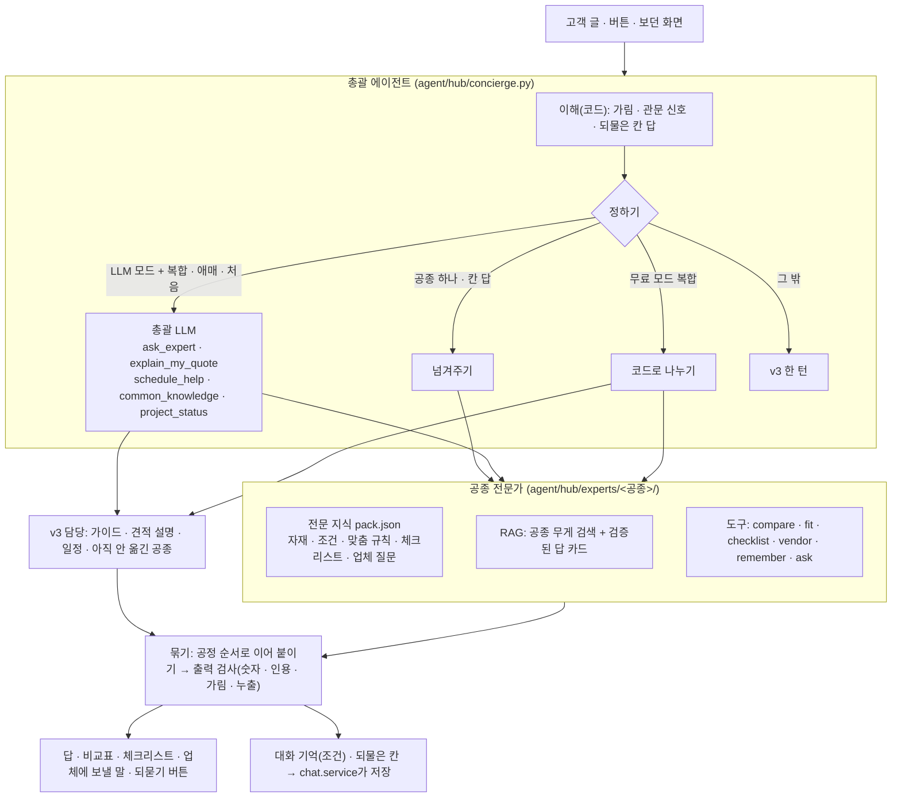

# 에이전트 허브: 총괄 + 공종 전문가

반셀프 인테리어(공정마다 업체를 직접 골라 진행) 고객이 **정하고 · 업체와 이야기하고 · 공사 전후를 챙기는 일**을 대신 정리해 주는 에이전트 틀이다.
v3의 '입구 관문 → 오케스트레이터 → 담당'을 **총괄 에이전트 하나**로 합치고, 공종마다 **전문가 에이전트**(지식 + 도구 + 판단)를 둔다. 첫 전문가는 바닥이다.

## 한눈에

| 항목 | 정한 것 |
| --- | --- |
| 입구 | 총괄 에이전트(재재) 하나. 관문 신호(분류기 · 공종 낱말 · 정책 표시)는 코드로 늘 읽고, 어디에 맡길지는 총괄이 정한다 |
| 맡기기 | 공종 하나 · 되물은 칸 답 → 그 전문가에게 바로(총괄 LLM 없음). 복합 · 애매함 · 처음 안내 → 총괄 LLM이 도구로 전문가를 부른다(LLM 모드) |
| 전문가 | 폴더 하나 = 공종 하나: 전문 지식 묶음(`pack.json`) + RAG(공종 무게 검색 · 검증된 카드) + 도구 + 지시문 + 무료 모드 판단 |
| 업무 자동화 | 자재 비교표 · 조건 맞춤 · 조건 되묻기와 기억 · 공사 전/후 체크리스트(누가 할 일인지) · 업체에 복사해 보낼 질문 |
| 두 모드 | LLM 모드: 전문가가 도구로 근거를 찾고 화면 조각을 붙인 뒤 답한다. 키가 없거나 실패하면 같은 도구 · 지식으로 코드가 답한다 |
| 옮기는 방법 | 전문가가 없는 공종 · 견적 풀이 · 일정 · 범위 밖은 v3 담당을 그대로 쓴다. 공종을 하나씩 전문가로 옮긴다 |
| 켜고 끄기 | `AGENT_HUB=true`(기본). `false`면 v3 한 턴 그대로 |

## 구조



## 파일

```
backend/app/agent/hub/
├── concierge.py        총괄: 이해 → 정하기 → 묶기. 한 턴의 입구(run_turn)
├── core.py             도구(Tool) · LLM ↔ 도구 루프(loop) · 턴 예산(Budget)
├── reply.py            전문가 몫(Reply, v3 Part를 넓힘) · 대화 기억(Memory)
├── prompts/concierge_v1.md
└── experts/
    ├── __init__.py     폴더를 찾아 전문가 등록(registered)
    ├── base.py         전문 지식 묶음 모양(Pack) · 전문가 한 번 돌리기(run_expert) · 같이 쓰는 도구
    └── floor/          바닥 전문가
        ├── pack.json   자재 5 · 조건 3 · 맞춤 규칙 · 체크리스트 2 · 업체 질문 7 · 순서/견적 메모 (문장마다 근거)
        ├── tools.py    도구(LLM)와 같은 일을 하는 함수(무료 모드도 씀)
        ├── offline.py  무료 모드 판단
        └── prompt_v1.md
```

- LLM SDK 호출은 그대로 `agent/llm.py` 한 곳(`chat_tools`). 시험용으로 `set_chat_script`(차례대로 돌려줄 답)를 더했다.
- `chat.service.ai_turn`이 `hub.concierge.run_turn`을 부르고, 대화 기억은 Redis `ai:mem:*`에 2주 둔다(되물은 칸 30분은 그대로).

## 한 턴

1. **이해(코드)**: 가림 → v3 관문 `gate()` 신호(길 · 공종 · 정책 · 신뢰도). 기다리던 칸이 있고 고객이 답했으면 칸 답으로 읽는다.
2. **정하기**
   - 전문가가 있는 공종 하나(또는 칸 답) → `run_expert`로 넘긴다.
   - LLM 모드에서 `multi` · `ask_back` · `guide` → 총괄 LLM. 총괄은 전문가 답을 다시 쓰지 않고 **결론 한 줄(lead)** 만 쓴다. 맡긴 게 없으면 v3 한 턴으로.
   - 무료 모드 `multi`에 전문가 공종이 끼면 → v3 `orchestrator.split`으로 나눠 전문가 · v3 담당을 부르고 `merge`로 공정 순서대로 잇는다.
   - 그 밖 → v3 `run_turn` 그대로(지금 동작과 같음. 시험으로 확인).
3. **묶기**: 출력 검사(v3 `check`) → 되물은 칸(`waiting`) · 대화 기억(`memory`)을 돌려준다.

## 전문가 한 번 (`experts/base.run_expert`)

| 모드 | 순서 |
| --- | --- |
| LLM | 지시문 + 브리프 칸 + 자재 key → `search_knowledge`로 근거 → 필요한 도구(비교표 · 맞춤 · 체크리스트 · 업체 질문 · 조건 기억/되묻기) → `answer`(문장마다 근거 번호). 도구 3차례 + 답 1번 |
| 무료(offline) | 질문에서 할 일(순서 · 비교 · 맞춤 · 공사 전/후 · 견적 · 업체 질문)을 코드로 고르고 같은 함수로 답. 아무 할 일도 아니면 검증된 카드 → 근거 조각 → 정직한 모름 |
| 실패 | LLM 실패 · 턴 예산 초과 → 그 전문가 몫만 무료 모드로 다시(지어낸 설명으로 채우지 않음) |

- 화면 조각(비교표 · 체크리스트 · 업체에 보낼 말 · 되묻기 버튼)은 **도구가 바로 답에 담는다**. LLM에는 요약만 돌려줘서 검증된 문장이 바뀌지 않는다.
- 답 글 검사: 숫자는 이번에 본 근거 원문 · 지식 묶음 · 고객 글에 있는 것만, 인용은 이번에 보인 조각만, AI가 저장 · 예약한 것처럼 말하면 뺀다.
- 에이전트는 저장하지 않는다. 조건은 '기억'으로 돌려주고 chat.service가 둔다. 확정 · 전송은 고객이 버튼으로 한다.

## 상한

| 상한 | 값 | 어디 |
| --- | --- | --- |
| 턴당 LLM 호출 | 8 | `core.Budget.llm_calls` |
| 턴당 맡기기(총괄 → 전문가 · v3 담당) | 3 | `core.Budget.delegations` |
| 도구 차례 | 총괄 4 · 전문가 3 (그다음은 답 도구만) | `AgentSpec.max_rounds` |
| 같은 도구 · 같은 인자 | 한 번 | `core.call_tool` |

## 바닥 전문가가 하는 일

| 고객 말 (예) | 하는 일 | 화면 |
| --- | --- | --- |
| 강마루랑 강화마루 차이가 뭐예요? | 나온 자재의 좋은 점 · 살필 점(근거) + 비교표. 맞춤은 칩으로 권함 | 묶음 · 비교표 |
| 우리 집에 맞는 바닥재 골라 줘 | 조건(가족 → 중요한 것) 하나씩 되묻고 기억 → 맞춤 규칙으로 고른 자재와 이유 | 되묻기 버튼 · 맞춤 묶음 |
| 바닥 공사 전에 뭘 준비해야 해요? | 공사 전 체크리스트(직접 · 업체에 확인 · 같이) | 체크리스트 묶음 |
| 마루 깔고 끝나고 뭘 확인해요? | 공사 뒤 확인 체크리스트 | 체크리스트 묶음 |
| 바닥 업체에 뭘 물어봐야 해요? · 장판 견적 얼마예요? | 업체에 보낼 질문 3줄(견적 · 실측 · 시공 뒤), 금액은 '계산 안 함' 정해 둔 글 + 견적서에서 볼 것 | 업체에 요청할 말(복사) |
| 도배랑 마루 중에 뭘 먼저 해요? | 순서 메모(질문에 나온 공종 이야기만) | 순서 묶음 |
| 마루가 왜 들뜨는 거예요? | 검증된 바닥 카드 · 근거 조각 | 카드 묶음 |

- 지식 묶음 문장은 모두 기존 검증 카드 · 지식 조각(K…)에서 옮겼고, 시험이 근거 번호가 실제 조각인지 · 숫자가 없는지 본다.

## 새 공종 전문가 만들기

1. `experts/<공종 코드>/`를 만든다(코드는 v3 `trades.BY_CODE`에 있는 것).
2. `pack.json`: 자재 · 조건 · 맞춤 규칙 · 체크리스트 · 업체 질문 · 메모. 문장마다 근거 번호, 금액 · 기간 숫자는 쓰지 않는다.
3. `tools.py`: 공종에 맞는 도구. 바닥 `tools.py`를 본떠 무료 모드도 같은 함수를 쓰게 한다.
4. `offline.py`: `run(r)`. `prompt_v1.md`: 지시문(바꿀 때 판을 올린다).
5. `__init__.py`의 `build()`가 `Expert`를 돌려주면 등록된다. `tests/test_agent_hub.py`처럼 근거 · 무료 모드 · LLM 대본 시험을 더한다.

## 다음 할 일

- 도배 · 목공을 전문가로 옮기기(계산 엔진 상자 · 브리프 칸이 이미 있음)
- 브리프(조건)를 프로젝트 DB에 저장하기(지금은 대화 기억, 2주)
- 체크리스트를 프로젝트 '공사 전 할 일'(`project_checks`) 켜기 버튼과 잇기
- 바닥 평가 세트(맞춤 · 체크리스트 · 업체 질문)와 LLM 모드 실측(`LLM_LIVE=true`) — 스텁 통과는 품질 확인이 아니다
