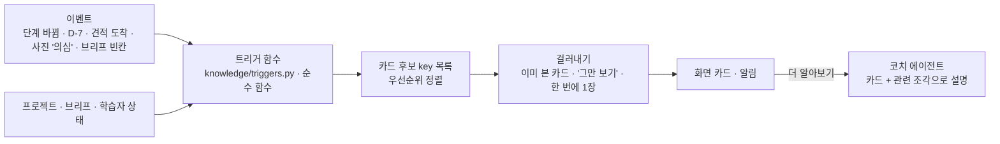

# 05. 초보를 '공부한 소비자'로 — 선제 안내와 코치

반셀프 초보가 묻기 전에, **지금 단계에서 알아야 할 것**을 먼저 알려 준다. 목표는 계약 · 실측 · 공사 때 업체와 같은 말로 이야기하고, 손해를 막는 판단을 스스로 할 수 있는 수준이다. 근거: [T1 여정 · 120개 지식](../research/T1_journey_rules.md), [T6 9장 튜터링](../research/T6_agent_tech.md), [T7 VOC](../research/T7_voc_competitors.md).

## 1. '공부한 소비자'의 정의

T1의 지식 항목 120개를 **단계 × 공정 × 난이도 × 영향**으로 묶어 학습 목표로 쓴다.

| 묶음 | 개수 | 예 |
| --- | --- | --- |
| A 행정 · 단지 | 25 | 도배 · 몰딩 · 문틀 교체는 구청 신고가 필요 없는 '경미한 행위'지만 관리주체 동의 · 단지 신고는 필요(A02) |
| B 업체 · 견적 | 16 | 견적은 총액이 아니라 항목별 '포함 · 별도 · 누락'으로 비교(B10), 흔한 누락 10가지(B11) |
| C 계약 · 대금 | 17 | 대금은 날짜가 아니라 공정 완료에 연동(C06), 소비자 요청 변경은 금액을 서면으로 먼저 확인(C10) |
| D 공정 순서 · 일정 | 14 | 목공이 천장 · 벽을 닫기 전에 전기 1차 · 에어컨 배관(D02), 몰딩 · 걸레받이는 도배 · 마루 전에(D11) |
| E 도배 | 13 | 실크는 기존지를 떼고 초배해야 해서 견적이 높다(E03), 싼 견적은 밑작업 생략 신호(E04) |
| F 목공 | 17 | 구축 몰딩을 떼면 벽 보수 추가비가 생길 수 있다 — 가견적의 '실측 후' 변수(F02) |
| G 기타 공정 | 6 | 방수 · 전기 · 샷시는 반셀프여도 전문가에게(G05) |
| H 검수 · 하자 · 분쟁 | 12 | 하자 기간 실내건축 1년, 기산일은 완공일과 사용 개시일 중 빠른 날(H03 · H04) |

- 난이도: 1 기초(누구나 알아야 함) · 2 공부한 소비자 · 3 심화(분쟁 · 법). 기본 목표는 **1 전부 + 2의 80%**, 3은 물을 때만.
- 영향 태그: 돈 · 일정 · 하자 · 안전 · 법. 카드 맨 앞에 "이걸 모르면 ○○이 생겨요"로 보여 준다.

## 2. 단계 지도 (T1 P0~P6 ↔ 믿집 화면)

| 단계 | 시점 | 믿집 화면 | 먼저 알려 줄 것(예) |
| --- | --- | --- | --- |
| P0 방향 잡기 | D-90~D-60 | 견적 받기 · 표준견적서 | 반셀프 vs 턴키, 단지 규정 확인 질문지 8문항(A01), 경미한 행위(A02), 30평대 표준 공기 27영업일(D14) |
| P1 견적 · 업체 | D-60~D-35 | 상담 · 업체 고르기 · 실측 요청 | 포함 · 별도 · 누락 비교(B10 · B11), 상세견적서는 계약서로 간주(B14), 부가세 포함 총액으로 비교(B15), 실측 후 변동 폭을 묻기(B13) |
| P2 계약 | D-35~D-21 | 실측 견적서 비교 · 업체 확정 | 법정 기재사항(C03), 대금 공정 연동(C06), 잔금 기준일(C07), 하자 기간 서면(C17) |
| P3 행정 · 착공 준비 | D-28~D-1 | 공사 날짜 · 확정 공정표 · 할 일(관리사무소 공사 신고) | 이웃 동의 범위는 단지 규정(A09), 안내문 · 소음일 공지(A11), 승강기 보양(A17), 폐기물 신고(A18) |
| P4 시공 | D0~ | 확정 공정표 · 일정 변경 | 목공 끝나고 도배 전 확인(F09 · E06), 변경은 서면 승인(C10), 도배 뒤 건조 2~4일(D08) |
| P5 준공 · 검수 · 잔금 | 마지막 주 | 공사 끝냈어요 · 확인 | 기능 → 마감 순서 검수(H01), 조명을 비춰 들뜸 보기(E11), 하자 목록 → 보증서 → 잔금(H02) |
| P6 입주 후 | 1~3년 | 서류 · 연락처 1년 | 서면 하자 접수(H07), 내용증명 · 1372(H08 · H09) |

- 지금 단계는 코드가 정한다: `calc/progress.py`의 6단계 + 공사 날짜 기준 D-n.

## 3. 선제 안내 — 코드가 고르고, 미리 쓴 카드를 보인다



- **카드 본문은 사람이 쓰고 출처를 붙인다**(`knowledge/data/cards.jsonl`). LLM이 만들지 않으므로 LLM이 실패해도 카드는 보인다. 이것은 '가짜 설명'이 아니라 검수된 지식이다(AGENTS.md §4 "규칙으로 만든 가짜 설명 금지"와 충돌하지 않음 — 금액 설명이 아니고 지식 안내다).
- 트리거는 데이터(JSON 조건식)가 아니라 **코드 함수**로 둔다. 조건이 복잡해지면 테스트하기 쉬워야 하기 때문이다. 카드 데이터에는 `trigger` 키만 적는다.

**트리거 예**

| 트리거 키 | 조건 | 카드 |
| --- | --- | --- |
| `has_both_trades` | 도배 · 목공 둘 다 고름 | 목공 → 도배 순서, 몰딩 떼면 벽지 손상(M-04) |
| `old_building` | 준공 15년 이상 | 구축 벽 보수 추가비(F02 · M-03), 천장 전체 재시공 신호(F06) |
| `asbestos_era` | 2009년 이전 착공 + 천장 평탄화 · 철거 | 천장재 석면 가능성 → 함유 여부 확인 권장(법적 의무 범위는 관할 확인) |
| `occupied` | 거주 중(짐 있음) | 짐 이동 · 보양 인건비, 공공 기준도 시공량 15% 감 |
| `silk_selected` | 도배 기본형(실크) | 실크 덧방 불가 · 철거 · 띄움 초배(E03), 품번을 견적서에(D-07) |
| `ceiling_unknown` | 브리프 천장 포함이 '모름' | 천장 포함 여부가 도배 견적 차이가 가장 큰 항목 |
| `estimates_listed` | 업체 고르기 화면 첫 진입 | 가견적은 실측 전 값, 실측 후 변동 폭 묻기(B13), 부가세 포함 비교(B15) |
| `quote_arrived` | 실측 견적서 도착 | 포함 · 별도 체크리스트(T7 3.3), 상세견적서 보관(B14) |
| `deal_confirmed` | 업체 확정 | 계약서 법정 기재사항(C03), 대금 공정 연동(C06) |
| `d_minus_14` | 공사 14일 전 | 관리사무소 질문지 · 신고 · 예치금 · 보양(A01 · A16 · A17) |
| `d_minus_3` | 공사 3일 전 | 안내문 · 소음일 공지(A11), 폐기물 신고(A18) |
| `mokgong_done` | 목공 공정 끝난 날 | 도배 인계 전 확인: 평활도 · 타카 핀 · 몰딩 이음(F09) |
| `dobae_done` | 도배 끝난 날 | 건조 2~4일, 찬바람 · 급난방 피하기, 가구 붙이지 않기(D08 · D-10) |
| `work_done` | 업체 '공사 끝냈어요' | 기능 → 마감 검수(H01), 하자 기간 · 기산일(H03 · H04) |
| `winter_work` | 공사 날짜가 12~2월 | 시공 72시간 전부터 48시간 뒤까지 5℃ 이상(LH 시방서), 난방 가능 여부 |

- 한 번에 **1장**, 같은 카드는 한 번만, 고객이 "그만 볼게요"를 누르면 그 묶음은 쉰다(CHI 2025 선제 도우미 연구: 이득이 있지만 설계에 따라 갈림).
- 트리거는 **그 상태가 이어지는 동안** 참이다. "견적서 도착"도 한 번 울리고 끝나지 않아, 같은 트리거에 묶인 카드(많게는 7장)가 다음 방문 때 차례로 보인다. D-14 · D-7 · D-3은 그날부터 공사 전까지 참인 기간이다(D-2면 셋 다 참).
- 공정 카드는 고른 공정만 보인다(common · oos는 늘). 트리거 키 목록은 `knowledge/triggers.py`가 기준이고, 카드 데이터 검사가 모르는 키를 막는다. 데이터에서 새로 생긴 키: `flatten_selected` · `moldless_selected` · `door_selected`.
- `on_question` 카드(32장)는 화면에 먼저 띄우지 않고 코치가 검색으로 꺼내 쓴다.

## 4. 코치 에이전트의 답 형식

T6 결론: 소비자는 시험 보는 학생이 아니다. 답을 숨기는 소크라테스식이 아니라 **답 먼저 → 이유 → 확인 질문 1개 → 다음에 알아야 할 것 1개**.

```
[답]   실크 위에 실크는 덧방하지 않아요. 기존 실크를 떼고 다시 붙여요.
[이유] 실크는 비닐 코팅이라 새 풀이 잘 안 붙어 들뜨기 쉬워요. 그래서 철거 · 퍼티 · 초배가 들어가고 견적이 올라가요.
       (출처: LX 시공 가이드 요약 · 업계)
[확인] 지금 벽지 끝을 살짝 들춰 봤을 때 비닐처럼 얇은 막이 벗겨지나요?   [네] [아니요] [모르겠어요]
[다음] 철거가 들어가면 폐기물 처리비도 같이 확인해 두세요.
```

| 규칙 | 이유 |
| --- | --- |
| 첫 문장에 답 | 인지 부하 관리(LearnLM), 루브릭 1번 |
| 새 용어 ≤ 3개, 처음 나올 때 쉬운 말 한 줄(용어집에서 그대로) | 용어집 일치(Khanmigo 교훈: 정의는 DB에서) |
| 확인 질문은 버튼 2~3개, 건너뛰기 허용 | 능동 학습, 강제 퀴즈 금지 |
| 금액은 쓰지 않는다 | 견적 설명 · 계산 엔진 담당. "우리 집 금액은 표준견적서에서 볼 수 있어요" 링크 |
| 출처끼리 다른 값은 "자료마다 달라요"라고 밝힘 | 예: 도배 ↔ 마루 순서, 동의 범위 |
| 법 · 안전은 단정하지 않고 확인처를 알려 줌 | "관할 구청 · 관리사무소에 확인해 주세요" |

- 출력 스키마: `{lead, why, check_question?, next_tip?, concepts_introduced[], cited_keys[]}` (02 문서). `concepts_introduced`를 받아 chat.service가 학습자 상태를 고친다.

## 5. 학습자 상태 (가벼운 knowledge tracing)

- 표: `learner_concepts(user, concept_key, state, p_known, seen_count, last_seen_at)` (04 문서 2.5).
- 갱신 규칙(코드):
  - 카드를 봄 · 코치가 설명함 → `introduced`, `p_known += (1 − p_known) × 0.3`
  - 확인 질문을 맞힘 → `p_known` 상승, 0.85 이상이면 `mastered`
  - 틀림 · "모르겠어요" → 하락 + 다음 관련 단계에서 다시 보여 줄 예약
- 쓰는 곳: 같은 설명 반복 줄이기, 단계 진입 때 아직 `unseen`인 기초(1) 카드 우선, 화면의 '공부한 소비자 진행률'(예: "P1 견적 단계 필수 지식 7/9").
- BKT식 간단 갱신이면 충분하다(데이터가 적어 DKT 같은 학습 모델은 필요 없음).

## 6. '공부한 소비자 체크리스트' 화면 (선택)

단계마다 "이것만 알면 돼요" 목록 7~10개. 항목을 누르면 카드 → 코치 설명. 다 보면 다음 단계 카드를 미리 보여 준다. 메타인지(지금 결정할 것 / 나중에 결정할 것)를 돕는다.

| 단계 | 체크 항목 예 |
| --- | --- |
| P1 견적 | 포함 · 별도 · 누락 보기 · 부가세 포함 비교 · 상세견적서 받기 · 실측 후 변동 폭 묻기 · 품번 적기 · 천장 포함 여부 · 철거 · 폐기물 포함 여부 |
| P2 계약 | 계약서 2부 · 법정 기재사항 · 대금 공정 연동 · 잔금 기준일 · 하자 기간 · 변경 서면 승인 · 1,500만 원 기준(업체별 합계 + 내가 산 자재) |
| P4 시공 | 목공 → 도배 인계 확인 · 도배 건조 · 변경은 금액부터 · 사진 남기기 |

## 7. 범위 밖까지 넓히는 방법

- 도배 · 목공 밖 공정(바닥 · 욕실 · 필름 · 전기 · 샷시)도 **지식 안내는** 한다(11 문서 D5 제안). 카드 · 조각에 `trade=oos`를 달고, 답 끝에 "이 공정은 아직 믿집 견적 · 공정표에 없어요"를 붙인다.
- T1 G 묶음 6개 + 공정 순서(D 묶음)부터 넣는다. 순서 지식은 도배 · 목공 일정과 바로 이어지기 때문이다(예: 전기 1차는 목공 전, 마루 ↔ 도배).

## 8. 평가

- `guide` 50 세트: 루브릭 8항목(09 문서 3절) + 골든 요점 12개.
- 선제 안내 지표(서비스 로그): 카드 노출 → 펼침 비율, '그만 보기' 비율, 단계별 필수 카드 도달률, 확인 질문 정답률.
