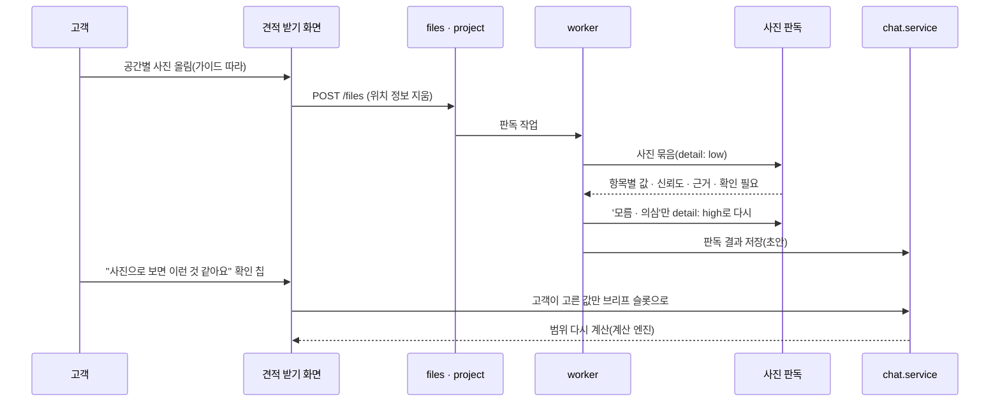

# 08. 사진 판독 · 견적서 판독

실측 전에 사진으로 '실측 후' 항목을 미리 좁히고(사진 판독), 업체 견적서 파일에서 빠진 항목 · 차이를 짚는다(견적서 판독). 둘 다 **AI는 초안만, 확정은 사람**이다. 근거: [T6 8장](../research/T6_agent_tech.md), [T4 7(d)](../research/T4_range_gap.md).

## 1. 사진 판독 (선택, 2주차 후반 목표)

### 1.1 무엇을 볼 수 있나 (2026 근거)

| 항목 | 가능성 | 화면 처리 |
| --- | --- | --- |
| 우물천장 · 등박스 | 중~높음 | "우물천장이 있는 것 같아요. 맞나요?" |
| 천장 몰딩 형태 · 걸레받이 유무 | 중(근접 사진 필요) | 선택지 4~5개 + 모름 |
| 기존 벽지 실크 / 합지 | 낮음~중(조명에 좌우) | 측광 근접 사진 + "표면에 비닐 코팅감이 있나요?" |
| 곰팡이 · 얼룩 | 중(재현율 ↑ 정밀도 ↓) | '의심'으로만, 확정 진단 금지 |
| 들뜸 | 낮음 | 비스듬한 조명 사진 요청 |
| 문 개수 | 낮음(개수 세기 약함) | 고객 입력이 정답, 사진은 보조 |
| 짐 많음 · 거주 중 | 중 | 확인 질문 |

- DefectBench(arXiv 2603.20148, 2026-03): '무엇이 있나'는 재현율이 높고, **개수 세기 · 위치 찾기 · 표면 얼룩은 약하다**. OpenAI 비전 문서도 개수 · 공간 추론 한계를 적는다. 그래서 정량 판단에 쓰지 않는다.

### 1.2 흐름



### 1.3 출력 스키마 (`PhotoFindings`)

```json
{
  "space": "거실",
  "items": [
    {"key": "ceiling_type", "value": "coffered", "confidence": "med", "evidence": "사진 2, 천장 가운데 단차", "needs_user_check": true},
    {"key": "existing_wallpaper", "value": "unknown", "confidence": "low", "evidence": "정면 조명이라 질감 판단 어려움", "needs_user_check": true},
    {"key": "mold_suspect", "value": "suspect", "confidence": "low", "evidence": "사진 4, 창 아래 모서리 어두운 얼룩", "needs_user_check": true}
  ],
  "retake": ["벽지 끝을 살짝 들춘 근접 사진", "창가 모서리를 비스듬한 조명으로"]
}
```

- `value`는 항목마다 enum + `unknown`. Structured Outputs로 강제.
- 계산 엔진은 판독 결과를 **직접 쓰지 않는다**. 고객이 확인한 슬롯 값만 들어간다.

### 1.4 촬영 가이드 (화면)

공간마다: 벽 정면 1장 · 천장 1장 · 몰딩 · 걸레받이 근접 1장 · 문제 부위 근접 + 비스듬한 조명 1장. 어안 · 파노라마는 피한다. 동호수 · 우편물 · 사람 얼굴이 나오지 않게 찍는다.

### 1.5 비용 · 평가 · 개인정보

- 비용: 1차 `detail: low`, '모름 · 의심'만 `high`. 사진 10장 1회 약 $0.02(추정, terra 이미지 토큰 산식은 미확인).
- 평가: 실제 사진 50~100장을 팀이 라벨링(항목별 정답) → 항목별 정확도 · '모름' 비율, 곰팡이는 정밀도 · 재현율 따로. 목표: 우물천장 ≥ 0.85, 잘못된 '확정' 0.
- 개인정보: 위치 정보는 올릴 때 지운다(기존 `files.service`). 얼굴 · 동호수 · 송장이 보이면 경고 · 블러. OpenAI API는 기본적으로 학습에 쓰지 않고 남용 모니터링 로그 최대 30일, `store=false`. 처리방침에 목적 · 보관 기간 · 국외 이전을 적는다. 사진 속 정보의 법적 성격은 법률 검토가 필요하다(미확인).

## 2. 견적서 판독 (이후, 팀 결정)

AGENTS.md는 "업체 실측 견적서는 줄로 바꾸지 않는다"고 정했고, features.md는 "업체 견적서에서 AI가 단가 읽기"를 에이전트 6개 밖으로 뒀다. 그래서 **정식 저장이 아닌 '참고 판독'** 으로만 제안한다.

| 항목 | 내용 |
| --- | --- |
| 입력 | 업체가 낸 견적서 파일(PDF · 엑셀 · 사진) |
| 출력 | 참고 줄 `[{name, qty?, unit?, amount?, maps_to?(표준 줄 키), confidence}]` + 빠진 항목 후보(T7 3.3 체크리스트와 대조) |
| 화면 | "AI가 읽은 내용(원본과 다를 수 있어요)" 라벨, 원본 파일 링크 옆에 |
| 쓰는 곳 | 차이 설명의 '설명 안 된 나머지'를 질문으로 바꿀 때, 누락 체크 |
| 안 하는 것 | 금액 · 합계 저장(합계는 업체가 적은 칸 + 계산 엔진), 업체 평가 점수 |
| 먼저 할 것 | 업체 **사유 코드**(06 문서 6절)만으로 설명이 충분한지 본다. 부족할 때 만든다 |
