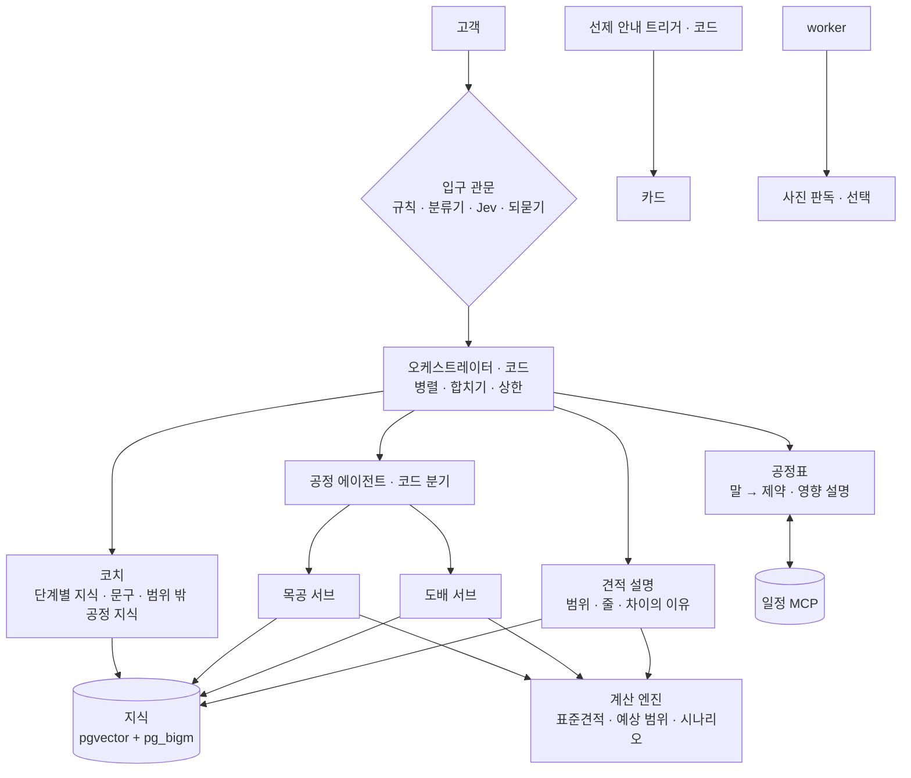

# 믿집 에이전트 설계 (2026-11-08 초안)

반셀프 초보가 **'공부한 소비자' 수준으로 판단**하고, **견적을 범위로 이해**하고, **가견적과 실측 견적의 간격이 줄도록** 돕는 에이전트 구성이다. 조사 7갈래([docs/research](../research/README.md))를 근거로 했고, 핵심 수치 일부는 원문을 직접 확인했다([verify_log](../research/verify_log.md)).

> 이 문서는 팀 결정 전 **제안**이다. AGENTS.md §4(에이전트)와 다른 부분은 [11 문서 점검](11-doc-audit.md) 2절과 [10 일정](10-roadmap.md) 2절에 모았다.

## 한 장 요약

1. **금액 · 날짜 · 범위는 계산 엔진만** 만든다. LLM은 숫자 대신 슬롯(`⟦range.low⟧`)을 쓰고 검사기가 최종 권한을 갖는다.
2. **오케스트레이터는 코드**다. 하위 작업이 예측 가능해 LLM이 경로를 정할 필요가 없다. LLM 에이전트는 코치 · 목공 · 도배 · 견적 설명 · 공정표 다섯.
3. **선제 안내는 코드가 고르는 검수된 카드**다. 지식 120개(T1) + 30개(T7)를 단계 P0~P6 × 공정 × 집 조건 트리거로 잇는다. 코치는 "답 → 이유 → 확인 질문 1개 → 다음 팁 1개" 형식.
4. **견적은 10~90% 범위**로 보인다(AACE 56R-08 80% 구간). 폭의 이유(업체 단가 · 면적 · '실측 후' 줄)와 "이걸 알려 주시면 범위가 ○~○로 줄어요"를 같이 보여 주고, 서브에이전트는 그 순서대로 묻는다.
5. **간격 줄이기**: ① 공간별 수량(지금은 고른 공간을 무시하고 집 전체로 계산) ② 업체가 '실측 후' 줄을 미리 응답 ③ 주소 → 호별 면적 ④ 셀프 실측 · 사진 확인 ⑤ 범위 밖이면 차이 설명 + 업체 사유 코드 ⑥ 데이터가 쌓이면 보정.
6. **자재 · 질감 → 시공**: 옵션(등급 × 질감 × 색 · 패턴 × 레시피)마다 단계 · 대기 · 다른 공정 · 하자 위험을 데이터로 두고, 바꾸면 계산 엔진이 시나리오를 다시 계산한다.

## 읽는 순서

| 문서 | 내용 |
| --- | --- |
| [01 작업 지도](01-tasks.md) | 작업 50개마다 코드 · 계산 · 모델 · LLM 워크플로 · 에이전트 · 사람 중 무엇이 맡나 |
| [02 에이전트 명세](02-agents.md) | 에이전트별 입력 · 도구 · 출력 스키마 · 금지 · 슬롯 · 평가 |
| [03 실행 구조](03-runtime.md) | 한 턴의 순서, 입구 관문, 오케스트레이터, Agents SDK 사용 규칙, 숫자 슬롯, SSE, 일정 MCP, 보안, CI |
| [04 지식 구조](04-knowledge.md) | 지식 여섯 가지, 표 설계, 데이터 파일, 적재 · 하이브리드 검색, 이용 조건 |
| [05 코칭](05-coaching.md) | '공부한 소비자' 정의, 단계 지도, 트리거 · 카드, 답 형식, 학습자 상태 |
| [06 견적 범위](06-price-range.md) | AACE 대응, 계산 모형, 가정값 · 기준 단가 r2, 다음 질문, 간격 줄이기, 차이 설명, 플라이휠 |
| [07 자재 → 시공](07-materials.md) | 시공 카드, 옵션 4축, 변경 규칙, 표현 사전, 미리보기 |
| [08 사진 · 견적서 판독](08-photo-docs.md) | 사진 판독 흐름 · 스키마 · 한계, 견적서 판독(참고용) |
| [09 평가](09-eval.md) | 세트별 지표, 두 층(CI · 야간), 라벨 두 층, 파일 형식 |
| [10 일정 · 결정](10-roadmap.md) | 주차별 이슈 20개, 팀이 정할 것 A~J, 위험 |
| [11 문서 점검](11-doc-audit.md) | AGENTS.md · README · CLAUDE.md · .env.example 사실 오류와 충돌 |

## 브랜치 (내 fork에만, 팀 PR 전)

| 브랜치 | 담은 것 | 상태 |
| --- | --- | --- |
| `docs-agent-design` | 이 문서들, 조사 원자료, AGENTS.md 사실 오류 수정 | 문서 |
| `feat-price-range` | 예상 범위 계산 엔진(혼합 분위수) · 가정값 r2 · 기준 단가 r2 상수 · 테스트 28개 | 로컬 계산 테스트 84개 통과, CI 검증 대기 |
| `feat-agent-knowledge` | 지식 데이터 초안(카드 · 용어 · 검색 조각 · 표현 사전 · 출처) · 평가 세트 초안 · 데이터 검사(`knowledge/ingest.py`) | AI 초안, **사람 검수 필요** |
| `feat-agent-foundation` | LLM · DB 없는 에이전트 바탕: 출력 모양(`agent/schemas.py`) · 숫자 슬롯 검사기(`agent/guards.py`) · 도배 · 목공 슬롯과 다음 질문 고르기(`agent/trades`) · 선제 안내 트리거(`knowledge/triggers.py`) · 테스트 17개 | 로컬 통과, CI 검증 대기 |

- 팀 PR로 올릴 때는 [10 문서](10-roadmap.md)의 이슈 단위(400줄 이하)로 나눈다.

## 확실하지 않은 것

- Remote Control의 '인테리어' 세션 내용은 확인하지 못했다(이 세션에서 다른 기기 세션 목록이 보이지 않음). 저장소 dev를 기준으로 했다.
- README의 '표준견적서 데이터'(CSV 12개 · 55,593개)와 AI Hub 도면 물량 산출서 원본은 저장소에 없다. 공간별 수량(06 문서 3.5)에 필요하다.
- SKN34 최종 프로젝트 요구사항 원문을 보지 못했다(MCP · 루프 · 그래프 DB 권장은 SKN29 문서 기준 기억).
- 2026년 6월 이후 정보(모델 · SDK · MCP 판)는 공식 문서로 확인했지만, Jev 한국어 성능 · `mcp` 2.3.0의 2026-07-28판 지원 · rerank-3 한국어 성능은 미확인이다.
