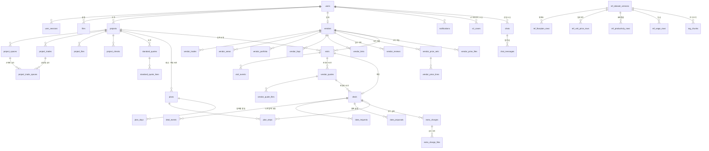

# v2 ERD

기준: 2026-11-18 `dev` 커밋 `1a3e656`. `0001`의 표 12개에 `0002`~`0023` 마이그레이션이 순서대로 적용된다. 아래 **업무 표는 `0001`~`0018`**, 기준 데이터·v2 저장·상담은 `0019`~`0023`의 현재 결과다. 돈은 원 단위 `bigint`, 날짜는 서울 기준 `date`, 시각은 `timestamptz`다. [기능 개발표](../feature-roadmap.md) · [프로젝트 구조](structure.md) · [기준 데이터 사용 안내](../reference-data.md)

## 그림

`project_trade_spaces`는 PK(`project_id`, `trade`, `space_id`)로 공정별 선택 공간을 저장한다. (`project_id`, `trade`)가 `project_trades`의 복합 PK를 참조하고 `space_id`가 `project_spaces.id`를 참조한다(CASCADE). `ref_dataset_versions`에서 데이터 행 5종으로 가는 선은 실제로 **(`dataset_id`, `dataset_kind`) → (`id`, `kind`) 복합 외래키**다. `v2_cases`와 `chats`는 모두 `users`에 속하지만 둘 사이의 외래키는 없다. 아래의 상세 제약은 실제 migration과 모델에 근거한다.

## 고치는 표

| 표 | migration | 바뀌는 것 |
| --- | --- | --- |
| users | 0002_v2_phone | `phone varchar(20)` 숫자만, CHECK `^01[0-9]{8,9}$` |
| projects | 0004_v2_project | `code varchar(16)` UQ(MJ-2611-0142, 요청 번호 · 표준견적서 번호), `rev int`(집 정보를 고칠 때마다 +1), `locked_at`(첫 실측 요청 뒤 고치기 막음), `apt_name · dong · ho`(연락처 보낼 때 받음) |
| vendors | 0007_v2_vendor_profile | `contact_method`(phone · sms · kakao · web) + `contact_url`(kakao · web이면 필수), `call_start < call_end`, `visit_fee bigint ≥0`(0 = 무료) + `visit_fee_refund`, `tax_kind`(general · exempt), `interior_license` · `insurance`(업체가 적음), `opened_on`, `updated_at` |
| vendors | 0009_v2_vendor_review | status에 `needs_info`(보완). `review_code`(사유 코드: 보완 blurry · name_mismatch · owner_mismatch · other / 거절 wrong_business · closed · other), CHECK `(status in needs_info · rejected) = (review_code 있음)`, other면 보낼 말 필수. `reject_reason` → `review_note`(≤300, 코드가 있을 때만). `approved_at`(승인일 때만). 0001의 사유 CHECK는 이것으로 바꾸고 기존 거절 행은 other로 채운다 |
| vendor_portfolio | 0007_v2_vendor_profile | `space` · `pyeong` · `taken_on` |
| files | 0007_v2_vendor_profile | kind에 `price_doc` · `quote_doc` · `work_photo`, `content_type` 100자(엑셀 MIME) |

## 새 표

| 표 | migration | 칸 · 제약 |
| --- | --- | --- |
| notifications | 0003_v2_notify | user · kind · project · `body ≤200`(고객 이름은 넣지 않음) · `link ≤200` · `dedup_key` · read_at. UQ(user, dedup_key) |
| standard_quotes | 0005_v2_standard | project · trade · `version` · `project_rev` · `formula_ver` · `price_ver` · grade · area · pyeong · supply · vat · total · `man_day numeric(4,1)` · crew · notes(가정). UQ(project, trade, version) |
| standard_quote_lines | 0005_v2_standard | (quote, key) PK, name · qty · unit · unit_price · amount · state(포함 상태 6종) · note · sort |
| plans | 0006_v2_plan | project · kind(expected · final) · version · project_rev · formula_ver · start · end · work_days · weekend_work. UQ(project, kind, version) |
| plan_steps | 0006_v2_plan | plan · trade(건조 · 청소는 비움) · kind(work · dry · clean) · label · start · end · days · crew · man_day · sort. `deal_id`(지우면 NULL)는 0013에 더함 |
| plan_days | 0006_v2_plan | (plan, day) PK · trade · kind(work · dry · clean · off) · names(날짜별 할 일) |
| vendor_faqs | 0007_v2_vendor_profile | (vendor, key) PK. key 5종(process · pricing · extra_cost · duration · as_refund), answer ≤200 |
| vendor_links | 0007_v2_vendor_profile | vendor · label · url · sort. 5개까지(service) |
| vendor_price_files | 0008_v2_vendor_price | file PK · vendor · trade. 가견적 근거 파일 |
| vendor_price_sets | 0008_v2_vendor_price | vendor · trade · version · status(draft · confirmed · retired) · confirmed_at. 부분 UQ: (vendor, trade) draft 하나, confirmed 하나 |
| vendor_price_lines | 0008_v2_vendor_price | (set, key) PK. `unit_price` 또는 `included_in`(다른 줄에 포함) 둘 중 하나, source_file(지우면 NULL) |
| vendor_reviews | 0009_v2_vendor_review | vendor · action(apply · approve · needs_info · reject · resubmit(보완해서 다시 보냄) · reapply(거절 뒤 다시 신청)) · code(needs_info · reject만) · note ≤300 · `changes jsonb`(다시 낼 때 바뀐 칸의 전 값, resubmit · reapply만) · by(지우면 NULL, 업체 본인이면 업체 id) · at. 기존 업체마다 apply(+ 이미 정한 결정) 행을 채운다 |
| visits | 0010_v2_visit | project · trade · vendor(지우면 NULL) · `vendor_name` 사본 · `slot 1~3` · status(requested · quoted · cancelled · declined · closed · chosen) · share_contact(= consent_at 있음) · consent_ver · consent_at · message ≤300 · 가견적 사본(estimate_set_id(지우면 NULL) · estimate_total) · decline_code(declined일 때만: full · out_of_area · other) · close_reason(closed일 때만: other_chosen · reselected) · `quote_ver` · contact_until · vendor_seen_at · created_at. 부분 UQ(project, trade, slot) · (project, trade, vendor) where status in requested · quoted · chosen |
| visit_events | 0010_v2_visit | visit · `from_status`(만들 때 NULL) · `to_status` · by(지우면 NULL) · code · at |
| vendor_quotes | 0011_v2_vendor_quote · 0012_v2_quote_code | visit · `code`(Q-2611-0041, 시퀀스. 요청마다 하나, 다시 올려도 같은 번호. 0012에서 UQ(code) → UQ(code, version)) · version · `sent_at`(비면 임시 저장) · measured_on · entered_amount · vat_mode(included · excluded · exempt) · supply · vat · total(계산 엔진 from_entered) · days(1~120) · valid_until(≥ measured_on) · created_at · updated_at. 보낸 것은 낼 금액 · 부가세 방식이 있음(CHECK. 파일 1개 이상은 service, 실측한 날 · 공사 기간 · 유효기간은 선택). UQ(visit, version), 부분 UQ(visit) where sent_at is null |
| vendor_quote_files | 0011_v2_vendor_quote · 0014_v2_quote_file_share | (quote, file) PK, sort 0~9(버전마다 10개까지). files.kind = quote_doc. 0014에서 file UQ → 인덱스: 같은 요청의 버전끼리는 같은 파일을 다시 붙이고, 다른 요청 견적서 파일은 막음(service) |
| deals | 0013_v2_deal | project · trade · vendor(지우면 NULL) · vendor_name 사본 · visit(UQ) · `quote_id`(확정한 버전, 지우기 막음) · status(confirmed · scheduled · checking · fixing · done · reselected) · `dates_due_at`(calc due_at: 확정 + 2일 18:00) · start · end(함께, end ≥ start, scheduled부터 있음) · work_done_on(checking · fixing · done일 때만) · `date_request_count 0~2` · created_at. 부분 UQ(project, trade) where status ≠ reselected |
| deal_events | 0013_v2_deal | deal · `from_status`(만들 때 NULL) · `to_status` · by(지우면 NULL) · note ≤300 · at |
| date_requests | 0015_v2_dates | deal · reason · `wish_dates date[]`(1~3) · due_at · status(open · answered · withdrawn). 부분 UQ(deal) where open |
| date_proposals | 0015_v2_dates · 0016_v2_date_change | deal · start · end · crew · method(app · call) · call_on · request · kind(initial · change) · reason · `plan_version` · status(pending · accepted · superseded · withdrawn). 부분 UQ(deal) where pending. change는 이유 또는 답한 요청이 있음(0016) |
| extra_charges | 0017_v2_extra | deal · title ≤40 · reason ≤300 · vat_mode · entered_amount(0~10억) · supply · vat · total(calc from_entered, total = supply + vat, 면세면 vat 0) · ack(pending · ok · talk) · acked_at(ack ≠ pending일 때만) · by · created_at. 고치지 않고 새로 올린다 |
| extra_charge_files | 0017_v2_extra | (extra, file) PK, file UQ, sort 0~4(5장까지). files.kind = work_photo |
| project_checks | 0018_v2_checks | (project, key) PK · key(CHECK: office_report 관리사무소 공사 신고, 판에 있는 항목만) · done_at · by(지우면 NULL). 끄면 행을 지운다 |

## 0019~0023: 기준 데이터·v2 상태·상담

| 표 | 마이그레이션 | 현재 구조·관계 |
| --- | --- | --- |
| `ref_dataset_versions` | 0019 · **0023 변경** | PK `id`, 자료 키 `dataset_key`, `kind`(5종), `version`, 출처·적용일·파일 경로·해시·가공 프로필·임베딩 모델·차원·`provenance JSONB`. **`status BOOLEAN NOT NULL DEFAULT false`**로 활성 여부만 관리. 같은 `dataset_key`에 `status=true` 최대 1개(부분 unique). UQ(`id`,`kind`), UQ(`dataset_key`,`version`), 내용·프로필 중복 제한 |
| `ref_floorplan_rows` | 0019 · 0020 | PK(`dataset_id`,`record_key`). 예시 도면의 공간·물량·페이지·상세/합계 역할. 버전 종류 `floorplan`; (`dataset_id`,`parent_key`)는 같은 표의 상위 행을 참조 |
| `ref_unit_price_rows` | 0019 · 0020 | PK(`dataset_id`,`record_key`). 일위대가 작업 코드·규격·구성 항목·수치·단위·조건. 버전 종류 `unit_price`, 상위 행 자기참조 |
| `ref_productivity_rows` | 0019 · 0020 · 0023 | PK(`dataset_id`,`record_key`). 표준품셈 표 셀·수치·행/열 문맥·역할·원문. 버전 종류 `productivity`, 상위 행 자기참조. 0023에서 `semantic_status` 제거 |
| `ref_wage_rows` | 0019 · 0020 | PK(`dataset_id`,`record_key`). 직종·공표일·기준 근로시간·원화 임금·표시·원문. 버전 종류 `wage`, 상위 행 자기참조. `occupation_wage` 대상 부분 unique |
| `rag_chunks` | 0019 · 0020 · 0023 | PK(`dataset_id`,`record_key`). 자료 본문·절·페이지 배열·내용 해시·`embedding VECTOR`, 버전 종류 `knowledge`. 0023에서 `review_reason` 제거 |
| `v2_cases` | 0021 | PK `id`, FK `owner_id → users.id`(CASCADE). `title`(1~40), 고른 값 `state JSONB`, 서버 재계산 견적·공정표 `quote/plan JSONB`, 합계·견적 코드·시작·종료일·작업 일수 요약. `owner_id`/수정일 인덱스 |
| `chats` | 0022 | PK `id`, FK `user_id → users.id`(CASCADE), 동시 저장 충돌 검사 `rev≥1`·되묻기 담당 `waiting`·생성/수정시각 |
| `chat_messages` | 0022 | PK `id`, FK `chat_id → chats.id`(CASCADE), `turn`·`role`(user/assistant)·본문·의도 라벨/신뢰도/출처. UQ(`chat_id`,`turn`,`role`): 한 턴의 고객 질문·답 각각 1행 |

기준 데이터 행 표 5개에는 `0020_ingest_provenance`으로 행별 `provenance JSONB DEFAULT '{}'`가 추가됐다. 같은 migration의 DB 트리거는 `rag_chunks.embedding`의 실제 벡터 차원이 연결된 버전의 `embedding_dimensions`과 일치하는지 확인하고, 임베딩이 존재하는 버전의 모델·차원 변경을 막는다. 자료의 적재 및 임베딩 생성은 별도 CLI 작업이며 migration만으로 데이터가 채워지지 않는다.

`0023_reference_simplify` 적용 뒤에는 과거에 있던 **`ref_dataset_events`가 삭제**되고 `historical`, `current_rule_usable`, `calculation_usable`, `reference_usable` 칸도 제거됐다. 문서와 새 기능에서 과거 문자열 상태(`draft/approved/active/retired/rejected`)나 상태 변경 이력을 현행 스키마로 취급하지 않는다. 삭제 전 자료의 이력을 이 표만으로 복원할 수는 없다.

### 현재 v2 저장 관계

- 화면: `/v2/cases` → `case_service` → `v2_cases`. 고객별 최대 30건이고, 입력 `state`와 견적·공정표 입력을 받아 **견적·날짜는 서버 계산 엔진으로 다시 만든다**. 금액·날짜 요약을 직접 신뢰하지 않는다.
- 대화: `/v2/ask` → `ask_chat` → `chat.service` → `chats`·`chat_messages`. 기존 `chat_id`는 반드시 본인 것인지 확인하고, 열 때 본 `rev`로 저장 시 409 충돌을 막는다. 성공한 일반 상담의 고객/답 두 행을 저장하며 범위 밖 고정 안내·실패 답은 저장하지 않는다.
- Redis에 임시 저장하는 `v2ask:{turn}`은 화면 도구 결과를 기다리는 10분짜리 턴이다. PostgreSQL의 `chat_messages`와 구분하며 DB 외래키가 없다. 독립 SSE 채팅 라우터 및 일정 MCP는 구현되지 않았다.

현재 테이블의 정본은 [refprice 모델](../../backend/app/refprice/models.py) · [RAG 모델](../../backend/app/knowledge/models.py) · [v2 모델](../../backend/app/v2/models.py) · [chat 모델](../../backend/app/chat/models.py)과 [0019](../../backend/migrations/versions/0019_reference_data.py) · [0020](../../backend/migrations/versions/0020_ingest_provenance.py) · [0021](../../backend/migrations/versions/0021_v2_cases.py) · [0022](../../backend/migrations/versions/0022_chat.py) · [0023](../../backend/migrations/versions/0023_reference_simplify.py) migration이다.

## 상태와 허용 전이

| 대상 | 전이 |
| --- | --- |
| vendors | pending → approved · needs_info · rejected(관리자) / needs_info → pending(보완해서 다시 보냄) · rejected → pending(같은 번호로 다시 신청) |
| visits | requested → quoted · cancelled(고객) · declined(업체, 사유 3종) / requested · quoted → closed(다른 업체 확정 · 다시 고르기) / quoted → chosen / chosen → closed(날짜 수락 전 다시 고르기) |
| deals | confirmed → scheduled(날짜 수락) → checking(공사 끝냈어요) → done(고객 확인) 또는 fixing(남은 일) → checking / confirmed → reselected |
| date_proposals | pending → accepted · superseded · withdrawn |
| date_requests | open → answered · withdrawn |
| vendor_price_sets | draft → confirmed(이전 confirmed는 retired) |

- 상태는 기능 service 한 곳에서만 바꾼다: 허용 전이 확인 → 조건부 UPDATE(1행이 아니면 409) → 같은 트랜잭션에 이력 행(`*_events`, `vendor_reviews`).
- '기한 지남'은 상태가 아니다. `dates_due_at` · `due_at`과 지금 시각을 비교해 화면에 보인다.

## 지키는 규칙

- 3곳 한도: `project.service.lock_for_visit()`가 프로젝트 행을 잠그고 빈 slot을 고른다. 동시 요청은 slot 부분 UQ에 걸리고 409가 된다.
- 확정 · 다시 올리기: `visits.quote_ver`가 '본 버전'일 때만 조건부로 바꾼다.
- 두 공정 동시 수락: `plans` (project, final, 본 버전 + 1) UQ로 한쪽이 409.
- 확정 공정표(final)는 날짜를 수락할 때마다 새 버전을 쌓는다. 수락한 공정 칸은 `plan_steps.deal_id`가 있고, 날짜 없는 공정 · 건조 · 청소는 예상 자리다.
- 연락처 공개는 `visit.service` 한 곳에서 계산한다: requested · quoted, 또는 chosen이고 오늘 ≤ contact_until(없으면 공개).
- contact_until = 업체가 마지막으로 '공사 끝냈어요'를 올린 날 + 1년(계산 엔진, 2/29 처리).
- 가견적 = 업체의 confirmed 단가 묶음 × 이 집 표준견적서 수량(계산 엔진). 요청할 때 묶음 id와 합계를 visits에 고정한다.
- 업체 견적 파일은 그 요청의 고객 · 업체만 연다(`visit` router에서 권한 확인 뒤 내준다, 남의 것은 404).
- CHECK · 부분 인덱스 조건은 `alembic check`가 비교하지 않으니 제약 테스트를 따로 쓴다.
