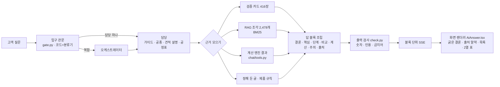

# 믿집 AI 답 설계도: ChatGPT 같은 형식으로 (2026-11-19)

근거 조사는 아래 세 문서예요.
- `research/chatgpt-vs-api.md`: ChatGPT와 API의 차이, 답 형식
- `research/agent-tools-openai.md`: 출처 · 이미지 · 속도 · 도구
- `verification/agent-coverage.md`: 질문 1,511개 점검

이 문서는 그 조사를 묶어 **무엇을 어떤 순서로 만들지** 정해요. 끝난 것은 커밋 번호를 적었어요.

## 1. 한 줄 요약

ChatGPT 답이 보기 좋은 이유의 절반은 모델 밖에 있어요. 지시문 · 형식 기본값 · 검색 도구 · 렌더러가 그 몫을 해요.
그래서 우리는 모델을 바꾸지 않고, **답을 블록으로 만들고(코드) → 블록마다 검사하고 → 블록 단위로 흘려 보내고 → 화면이 ChatGPT처럼 그리게** 만들어요.
숫자는 지금처럼 계산 엔진만 만들어요.

## 2. ChatGPT의 층 → 믿집에서 맡는 곳

| ChatGPT 층 | 하는 일 | 믿집에서 맡는 곳 | 상태 |
| --- | --- | --- | --- |
| 숨은 시스템 지시문 · 성격 | 말투, 첫 문장 결론, 서식 양 | `prompts/*_v1.md` + 정해 둔 글(`templates.py`) | 있음. 형식 규칙은 v2 지시문에 넣을 거예요(5장 안 C) |
| 형식 기본값(마크다운) | 소제목 · 목록 · 표 · 굵게 | **답 블록 스키마**(`AgentAnswer`) + `AiAnswer.tsx` | 일부 있음(묶음 · 주의 · 팁 · 계산 상자). 결론 · 단계 · 비교 블록은 다음 |
| 자동 검색 | 필요하면 웹 검색 | 자체 RAG(BM25, 카드 416장) | 있음. 웹 검색은 쓰지 않아요(7장) |
| 출처 알약 · 출처 패널 | 문장 끝 번호, 아래 목록 | 서버가 번호를 매기고(`chat.service._numbered`) 화면이 알약으로 그려요 | **끝남 `4c48dcd`** |
| 이미지 묶음 · 상품 카드 | 검색 결과 이미지 · 쇼핑 | `figure` 블록(자체 자료 그림만) | 자리만 둬요. 상품 · 업체 카드는 만들지 않아요 |
| 후속 질문 | 이어 물을 질문 | `suggest`(질문 은행에서 답할 수 있는 것만) | 있음 |
| 메모리 · 맞춤 지시 | 사용자 기억 | 프로젝트 사실(`ProjectFacts`)을 코드가 먼저 읽어 넘겨요 | 있음 |
| 모델 자동 고르기 | 빠른 모델 · 생각하는 모델 | 관문이 담당을 고르고, 무료 모드는 LLM 없이 답해요 | 있음. LLM 모드 모델 나누기는 8장 |
| 스트리밍 표시 | 글자가 바로 흐름 | `/ai/turns` SSE | **다 만든 뒤에 흘려 보내요**(체감 지연의 가장 큰 원인, 8장) |

## 3. 전체 구조

- LLM은 담당 안의 '글쓰기' 한 칸만 맡아요(LLM 모드일 때). 무료 모드는 카드 · 조각 · 정해 둔 글로 답해요.
- 출처 번호는 LLM이 아니라 코드가 매겨요. 이번 턴 조각을 문서마다 처음 나온 순서로 1, 2, 3을 붙여요.

## 4. 답 블록 사전

| 블록 | 언제 | 길이 상한 | 화면 | 상태 |
| --- | --- | --- | --- | --- |
| `lead` 결론 | 늘 맨 앞 | 1문장 · 40자 | 굵게 | **지금은 처음 그리는 문장을 굵게**(`4c48dcd`). 카드에 결론 칸을 쓰는 건 다음 |
| `body` 핵심 | 결론 뒤 | 1~2문장 · 문장당 60자 | 본문 + 출처 알약 | 있음(`brief.lines`) |
| `steps` 단계 | 방법 · 순서 꼴 | 4단계 · 단계당 30자 | 번호 목록 | 다음 |
| `compare` 비교 | 비교 꼴, 두 가지만 | 2열 × 3행 · 칸당 20자 | 2열 표(344px) | 다음 |
| `calc` 믿집 계산 | 비용 · 기간 꼴 + 프로젝트 | 상자 1~3개 | 계산 상자 | 있음 |
| `caution` 주의 | 안전 · 하자 · 셀프 | 1문장 | 주의 줄 | 있음 |
| `ask` 되묻기 | 답을 바꾸는 빈칸 | 질문 1 + 단추 2~4 | 단추 | 있음 |
| `unknown` 모름 | 근거 없을 때 | 2문장 | 흐린 글 | 있음 |
| `refs` 출처 | 근거 문장이 있을 때 | 목록 3개 | 번호 + 문서 이름 | **끝남 `4c48dcd`** |
| `more` 자세히 | 숨긴 문장이 있을 때 | 펼침 1층 | 글 단추 | 있음 |
| `next` 다음 할 일 | 단계에 맞는 화면 | 단추 2개 | 단추 | 있음 |
| `follow` 이어 물을 질문 | 답할 수 있는 후보 | 2~3개 | 글 단추 | 있음 |
| `figure` 설명 그림 | 카드가 그림을 가리킬 때 | 1장 · 설명 한 줄 | 그림 | 자리만(6장) |

**서식 규칙**
- 굵게는 결론 하나만 써요.
- 마크다운 기호 · 이모지 · 가로로 넘기는 묶음은 쓰지 않아요.
- 표는 2열까지예요. 3열이 넘으면 '이름 : 설명' 줄 목록으로 바꿔요.

## 5. 질문 꼴별 블록 순서

| 꼴(`brief.form`) | 순서 | LLM |
| --- | --- | --- |
| 예/아니요 · 뜻 · 원인 · 하자 · 그 밖 (안 A) | lead → body → caution → refs → more → next → follow | 0회 |
| 방법 · 순서 (안 B) | lead → steps → caution → refs → follow | 0회 |
| 비교 (안 B) | lead → compare → refs → follow | 0회 |
| 비용 · 기간 | lead(정해 둔 글) → calc → body → next | 0회 |
| LLM 모드 전체 (안 C) | LLM이 블록 종류와 **검사된 문장 번호만** 고르고, 글은 코드가 붙여요(`research/chatgpt-vs-api.md` 7.4 스키마) | 담당 글쓰기 1회 |

- 안 C에서 LLM이 새로 쓰는 글은 `lead.text` 한 줄뿐이에요. 이것도 출력 검사를 지나야 해요. 숫자가 있으면 빼고 무료 답으로 되돌려요.
- 길이는 스키마로 걸 수 없어서 코드가 자르고, 넘친 글은 '자세히'로 내려요.

## 6. 이미지

| 길 | 판단 | 까닭 |
| --- | --- | --- |
| API `web_search`의 이미지 결과 | 안 써요 | 출처가 광고 · 업체 글일 수 있고, 이미지 저작권 · 표시 규칙이 문서에 없어요 |
| 네이버 · 카카오 이미지 검색 API | 안 써요 | 결과를 AI에 넣거나 요약하는 걸 막고 있어요(2차 자료 · 운영자 답변) |
| 이미지 생성 | 안 써요 | 실제 시공이 아닌 그림을 사실처럼 보일 위험이 있어요 |
| **자체 자료 그림**(시방서 그림 · 우리가 찍은 시공 사진) | **이걸로 해요** | 출처 · 캡션을 우리가 달 수 있어요. 카드가 그림 id를 가리킬 때만 `figure`로 보여요 |
| 업체 포트폴리오 사진 | 업체 화면 안에서만 | AI 답에 섞으면 업체 광고가 돼요 |

- 지금 "사진으로 보여 줘"에는 그냥 "확인하지 못했어요"라고 답해요(점검 8번).
- 그림 자료가 생기기 전까지는 정해 둔 글로 안내해요: "사진은 아직 보여 드리지 못해요. 대신 순서를 글로 알려 드릴게요."

## 7. 도구와 근거

| 근거 · 도구 | 지금 | 다음 |
| --- | --- | --- |
| 검증 카드 416장 | 있음(작성자만 확인한 상태) | held-out 기준으로 찾는 말 넓히기. dev 문장을 그대로 넣는 건 멈춰요 |
| RAG 조각 | BM25만 써요. 의미 검색(pgvector)이 있는 `knowledge.service.search`는 v3에서 안 불러요 | 임베딩을 만든 뒤 하이브리드로 바꿔요(임베딩 비용 약 $0.02, 승인 뒤) |
| 계산 엔진 · 프로젝트 | 코드가 먼저 읽어 넘겨요(`chat/tools.py`) | 그대로 둬요 |
| 일정 MCP | 아직 안 불러요 | 공정표 담당이 MCP 클라이언트로 불러요 |
| LLM 도구 호출 | 없음 | 안 만들어요. 코드가 먼저 읽는 게 빠르고 안전해요 |
| `web_search` | 꺼져 있음 | 대화에서는 계속 꺼 둬요. 비용 약 3배 · 지연 증가 · 광고 섞임 때문이에요 |

## 8. 속도

| 할 일 | 효과(추정) | 상태 |
| --- | --- | --- |
| 진짜 스트리밍: 블록마다 검사 → 바로 보내기(결론 먼저) | LLM 모드 첫 문장 2~4초. 지금은 답 전체(terra low 약 9초)를 기다려요 | 다음 |
| 대화는 `gpt-6-luna` 추론 없음 먼저, 검사에 떨어질 때만 `gpt-6.1-terra` | 첫 글자 3.1초 → 1.5초(Artificial Analysis 기준) | 유료 평가 승인 뒤 |
| 무료 경로(카드 · 정해 둔 글) 넓히기 | 서버 계산만, LLM 0초 | 계속 |
| 지시문 앞부분 고정(프롬프트 캐시) | 입력 비용 · 지연 줄임 | 다음 |
| Fast 모드(`service_tier`) | 값 2배, 회사 발표 최대 2.5배 빠름 | 마지막 수단 |

- ChatGPT 웹의 체감 지연은 공개 숫자가 없어요. 비교하려면 같은 질문 6개(`evaluation/v3/gpt_compare_questions.jsonl`)를 사용자 계정 ChatGPT와 우리 화면에서 직접 재야 해요.

## 9. 이번에 찾아 고친 것

| 찾은 것 | 고친 것 | 커밋 |
| --- | --- | --- |
| **개발 DB `mitjip_v3`에 지식 조각이 0개**: 실제로 띄운 앱(도커 3300 포함)이 지식 질문 대부분에 "확인하지 못했어요"라고 답했어요. 오프라인 점검은 저장소 파일로 색인을 만들어서 이 문제가 안 보였어요 | `data_ingest load` → `verify --activate --keyword-only`로 2,478행을 넣고 키워드 검색만 켰어요(API 호출 0회). 같은 질문이 이제 카드 + 출처로 답해요 | DB 작업이라 커밋 없음 |
| "며칠이"의 "칠이"를 도장으로 읽음 | `(?<!며)칠` | `f343217` |
| "얼마나 걸려요"에 비용 표시가 붙음 | 기간 말은 비용에서 뺌 | `f343217` |
| 프로젝트 없이 물은 공종 비용 질문이 가이드로 감 | 견적서 줄을 묻지 않았으면 공종 담당으로 보냄 | `f343217` |
| 출처가 묶음 끝 이름뿐 | 문장 끝 번호 · 번호 붙은 출처 목록 · 굵은 첫 줄 | `4c48dcd` |

- 점검 숫자(질문 1,511개, 무료 모드): 정확도 87.2% → **87.8%**(1,292/1,471), 오류 0건이에요.
- 출처 번호: 출처가 있는 묶음의 문장 1,575개 중 1,510개(95.9%)에 번호가 붙어요. 출처가 있는 답은 447/1,511(29.6%)이에요.

## 10. 다음 순서

1. 카드에 `lead`(결론 한 줄) · `steps` · `compare` 칸을 더해요.
   - 처음엔 많이 쓰는 카드 50장부터 손으로 써요(LLM 0회).
   - 화면에 번호 목록 · 2열 표를 더해요.
2. 사진 요청 안내 글과 `figure` 자리를 만들어요(그림 자료 없이 글만).
3. 블록 단위 스트리밍으로 바꿔요(`chat/router.py` · `turn.py`).
4. 점검에 남은 고칠 것을 처리해요.
   - 장소 낱말보다 작업 대상(문 · 타일 · 방수)을 앞에 두기
   - 범위 밖 규칙 넓히기
   - 영어 · 오타 낱말 더하기
   - 일정 질문 규칙 더하기
5. **사용자 승인이 필요해요**
   - LLM 모드 유료 평가(안 C 스키마 + 모델 나누기)
   - 임베딩 만들기(약 $0.02)

## 11. 시험

- 출처 번호: `tests/test_v3_answer_cites.py`(문서 묶기 · 첫 등장 순서 · 카드 표시 번호 없음)
- 관문 · 에이전트 · AI API 시험: `f343217` 뒤 묶어 돌렸을 때 169개 통과, 2개 실패(`test_v3_visit_request.py` 2개)
  - 실패한 파일만 따로 돌리면 고치기 전후 모두 7개 통과예요. 그래서 돌리는 순서 · 시각에 따라 갈리는 시험으로 봐요(원인 미확인).
- 질문 점검: `evaluation/v3/coverage_check.py`(유료 호출을 막은 채 1,511개를 돌려요)
- 화면: 앱 브라우저 3031에서 같은 질문의 답을 확인했어요(굵은 첫 줄 · 알약 1 · 출처 목록)
