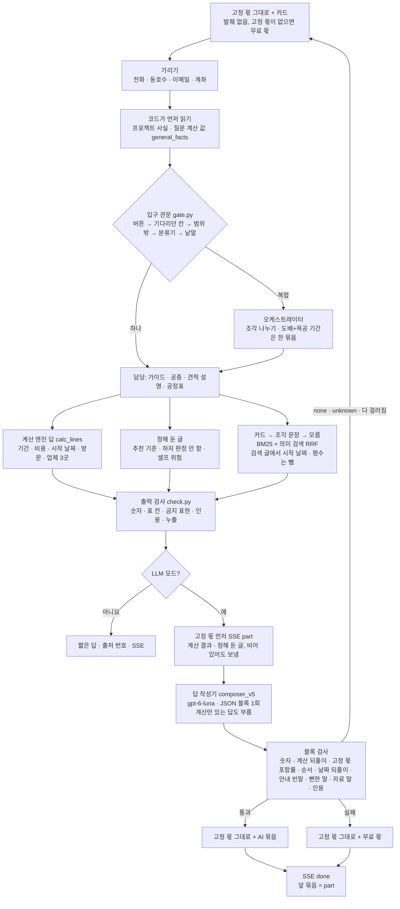

# 믿집 AI 답 설계도 v2 (2026-11-19 밤)

근거 조사 · 점검 문서
- `research/chatgpt-vs-api.md` · `research/agent-tools-openai.md` · `research/agent-web.md`: ChatGPT와 API 차이, 출처 · 이미지 · 속도 · 단가
- `verification/gpt-core-compare.md`: ChatGPT에 핵심 질문 32개를 물은 기록
- `verification/answer-audit-r1.md`: 우리 답 1회차 점검(기준선)
- `verification/agent-coverage.md`: 질문 1,511개 관문 점검

v1(오전)은 '블록을 만들고 검사해서 ChatGPT처럼 그린다'까지였어요. v2는 그 위에 **계산 엔진 답**과 **LLM 모드 답 작성기**를 더했어요.
11-20 고침(작성기 v3): 무료 답을 먼저 보였다가 LLM 답으로 통째로 바꾸던 것을 없애고, **고정 몫을 먼저 보이고 AI 글을 아래에 이어 붙여요**(5-1절). 점검은 `verification/composer-v3.md`.

## 1. 한 줄 요약

- 숫자는 계산 엔진만 만들어요. 기간 · 비용 · 날짜 · 업체 점수는 코드가 계산 엔진 값으로 문장과 2열 표를 써요. LLM은 숫자를 새로 만들지 않아요.
- 지식 질문은 카드 → 조각 문장 → 모름 순서로 답해요(무료 모드, LLM 0회).
- LLM 모드는 답 작성기를 한 번만 불러요. 작성기는 근거 묶음으로 결론 · 본문 · 단계 · 비교 표 · 주의 · 이어 묻기를 쓰고, 코드가 블록마다 검사해요. 검사에 떨어지면 무료 몫(카드 · 조각 문장)을 붙여요.
- 화면에 이미 보인 글은 바꾸지 않아요. 계산 결과 · 정해 둔 글이 먼저 보이고, AI 글은 그 아래에 이어 붙어요. 묶음마다 '믿집 계산' · 'AI 답변' · '믿집 안내'로 누가 만든 글인지 보여요.
- 믿집 자료가 없는 도배 · 목공 '무엇 · 어떻게' 질문은 LLM 일반 상식으로 숫자 없는 '일반 설명(믿집 자료 밖)'을 보여요(`verification/general-v1.md`).

## 2. 한 턴의 길

## 3. 질문 꼴별 답

| 꼴 | 무료 모드 | LLM 모드 | 예 |
| --- | --- | --- | --- |
| 기간 | 공정표 날짜 → 질문 평수 → 평수별 표. 시작 날짜가 있으면 끝나는 날 | 계산 답 먼저 + 덧붙일 것(살면서 · 짐 · 지장물)이 근거에 있으면 AI 글 | "도배 며칠" → 결론 한 줄(약 2~3일) + 24 · 34 · 44평 표 |
| 비용 | 표준견적서 합계 → 질문 평수 → 평수별 표(실크 · 합지) | 계산 답 먼저 + 덧붙일 것이 있을 때만 AI 글 | "33평 도배 비용" → 실크 약 280만 원 · 합지 약 223만 원 |
| 방문 · 문 | 목공 계산으로 방문 1개(문틀까지 · 문짝만) | 계산 답 먼저 + 필름 리폼 · 문선 마감 같은 AI 글 | "방문 교체 비용" → 약 40만 원 · 약 21만 원 |
| 업체 추천 | 코드가 3곳을 고르고 사유 틀 · 고른 기준을 적어요 | 같음(작성기는 근거 부족으로 덧붙이지 않음) | 프로젝트 없으면 '기본 정보를 넣으면 3곳을 골라 드려요' |
| 방법 · 순서 | 카드 · 조각 문장 | 결론 → 단계(번호) → 주의 | "곰팡이 벽 처리" |
| 비교 | 카드 · 조각 문장 | 결론 → 2열 비교 표 → 고르는 기준 | "실크 · 합지 차이" |
| 하자 · 계약 · 법률 | 정해 둔 글(판정 안 함) + 카드 | 같은 글 + 작성기 본문 | "이음매 벌어짐 하자?" |
| 범위 밖 | 정해 둔 글 | 같음 | "점심 뭐 먹지?" |
| 모름 | '확인하지 못했어요' + 주제별 확인할 곳 + 가까운 카드 질문 버튼 | 작성기가 unknown이면, 도배 · 목공 '무엇 · 어떻게' 질문은 일반 설명(믿집 자료 밖) + 확인할 곳, 아니면 무료 답 그대로 | '천장 도배는 벽이랑 뭐가 달라요?' |

- 계산 엔진 값으로 답했으면 '확인하지 못했어요' 줄을 붙이지 않아요. 정책 글로 답했으면 확인할 곳 줄도 빼요.
- 확인할 곳은 주제 · 시점으로 골라요: 업체 고르기 · 견적 비교는 빼고, 아파트 생활은 관리사무소, 분쟁은 1372, 계약은 표준계약서 · 1372, 공사 뒤는 시공한 업체, 공사 중은 시공하는 업체.
- '얼마' · '얼마 동안'이라도 환불 · 분쟁 · 견적 보는 법 · A/S · 하자 · 보증 질문은 비용 · 기간 표시를 떼요.
- 표가 있는 답은 짧은 답으로 접지 않고, 결론 → 표 → 나머지 순서로 그려요.

## 4. 계산 엔진 답 (`agent/v3/calc_lines.py`)

| 답 | 값을 만드는 곳 | 차례 |
| --- | --- | --- |
| 기간 | `calc.dobae.standard_v3`(반나절 단위 일수) · 예상 공정표 | 이 집 공정표 → 질문 평수(10~80평 · 33~265㎡) → 24 · 34 · 44평 |
| 시작 날짜 | `calc.schedule.span`(주말 · 공휴일 빼고 일하는 날에 놓기) | '12월 1일부터' · '12/1부터' · '12.1(화)' · '내일' · '다음 주 월요일' |
| 비용 | 표준견적서 · `dobae.standard_v3`(실크 · 합지) · `mokgong.quote` | 이 집 합계 → 질문 평수(이 집과 10% 넘게 다를 때) → 예시 |
| 방문 1개 | `mokgong.quote(door)` 문틀까지 · 문짝만 | 문 · 방문 낱말이 있을 때 |
| 업체 3곳 | `calc.vendor_pick`: 별점 0.40(리뷰 수로 4.0 쪽 당김) + 믿집 공사 0.30 + 가견적 0.30 + 이 구 0.05 | 가견적이 있는 업체만, 이 구가 3곳 이상이면 이 구만 |
| 도배 + 목공 기간 | 공정표 또는 평수별 목공 · 도배 일수 | 두 값을 더하지 않아요 |

- 질문 계산 값(`chat.tools.general_facts`)은 DB 없이 약 20ms에 세요. 프로젝트 사실(`project_facts`)은 세션 사용자로만 읽어요.
- 숫자 검사는 계산 값 글(`calc_text`)에 있는 숫자만 통과시켜요. 표 칸도 같은 검사를 지나요.

## 5. LLM 모드 답 작성기 (`agent/v3/composer.py`, 지시문 `composer_v5`)

| 칸 | 값 |
| --- | --- |
| 언제 | 가이드 · 공종 · 복합 담당, `LLM_LIVE=true` + 키 + 사용자 하루 100턴 안. 계산 답만 있는 턴도 불러요(카드 · 조각 근거가 하나도 없으면 안 부름) |
| 모델 | `gpt-6-luna`, 추론 none(`OPENAI_LIGHT_ROLES=trade,composer`) |
| system | `composer_v5.md`. 규칙(먼저 new 칸에 고정 몫에 없는 새 사실 적기 · 그 사실만 쓰기, 없으면 none · 화면 안내 · 뻔한 말 · 받은 조건에 조건 달기 · 순서 바꿔 말하기 쓰지 않기) → 블록 모양 → 출력 JSON → 예시 5개(비교 · 방법 · 모름 · 계산 결과가 먼저 보일 때 · 덧붙일 것 없음) |
| user | `<자료>{계산 결과, 정해 둔 글, 카드, 근거}</자료>` + 가린 질문. 근거 = 무료 답이 인용한 조각 + 검색 위 6개(조각마다 420자, 도배 · 목공 · 공통 질문엔 다른 공종 조각 뺌) |
| 받는 것 | `{new: [새 사실], verdict: answer · partial · unknown · none, lead, blocks: [body · steps · compare · caution], follow}`. none = 고정 몫이 이미 답했고 덧붙일 새 사실이 없음(AI 묶음을 붙이지 않아요). 고정 몫이 있는데 new가 비면 코드도 none으로 봐요('작성기: 새 사실 없음'). new는 화면에 보이지 않아요 |
| 검사 | 숫자(계산 · 근거 글에 있는 것만) · 계산 숫자 되풀이(문장 · 비교 표 줄) · 정해 둔 글 되풀이(글자 묶음 50% 이상, 또는 고정 몫 글에 IDF 무게 포함률 0.45 이상) · 고정 몫이 말한 두 공정 순서를 바꿔 말한 문장(공종 이름 없이 '공정 · 작업'만 써도, 새 말 포함률 0.55 이상) · 계산 묶음이 날짜를 보였을 때 날짜 · 요일 · 종료일 · '주말 · 공휴일 빼고'를 다시 말한 문장 · '~수 있어요'로 끝나는데 고정 몫 · 안내 낱말을 빼면 새 말이 없는 안내 빈말(포함률 0.6 이상) · 고정 몫 아래 '~에 따라 달라져요' · '업체마다 다를 수 있어요' · '~정하기 어려워요' · '~만으로 정해지지 않아요'만 쓴 뻔한 말 · '자료로 확인하지 못했어요' 같은 말 · 인용 지지(문장과 인용 조각 글자 묶음 겹침 0.18 이상, 다 안 맞으면 문장을 뺌) · 금지 표현 · 지시문 규칙 30자 누출 |
| 이어 묻기 | LLM이 쓴 질문을 카드 열쇠 질문(점수 0.62 이상)으로 바꿔요. 고객에게 되묻는 말 · 숫자 든 말은 버려요 |
| 되돌리기 | none · unknown · 다 걸러짐 → 고정 몫이 있으면 고정 몫 + 카드(무료 발췌는 붙이지 않음), 없으면 무료 몫. 실패 → 고정 몫 + 무료 몫. partial이면 '확인하지 못했어요'는 빼고 확인할 곳만 |
| 캐시 | OpenAI 자동 캐시(1,024토큰부터). 실측: 첫 호출 캐시 0, 다음 호출부터 입력 약 3,050토큰 중 2,079토큰을 캐시에서 읽음 |

## 5-1. 화면에 보이는 순서 · 표시 (`chat/router.py` · `components/ai/AiPanel.tsx` · `AiAnswer.tsx`)

- SSE: LLM 모드는 `part`(고정 몫, 약 0.6~0.8초) → `done`(고정 몫 그대로 + AI 묶음 · 출처 · 계산 상자 · 카드 · 이어 묻기). done의 앞 묶음은 part와 같아요(평가 스크립트가 턴마다 비교해요).
- 기다리는 동안: part 아래에 'AI가 믿집 자료로 답을 쓰고 있어요' + 점 세 개(움직임 줄이기 설정이면 멈춤). 무료 모드는 점만 잠깐 보여요.
- 먼저 보낸 답은 짧은 답(brief)으로 접지 않아요. 접으면 이미 보인 글이 바뀌어 보여서예요.
- 답에 먼저 보낸 묶음 수(`fixed`)를 실어요. 화면은 그 묶음의 제목을 그 묶음끼리만 보고 정하고(서로 다른 제목이 둘 이상일 때만 보임), 출처 목록은 done 뒤에만 그려서 먼저 보인 모양이 바뀌지 않아요.
- 묶음 출처 표시: calc → '믿집 계산', llm → 'AI 답변', general → '일반 설명(믿집 자료 밖)', 그 밖(정해 둔 글 · 카드 · 조각) → '믿집 안내'. 같은 표시가 이어지면 맨 앞에 한 번만. 예전 답 위 '자동 답변' 칸(notice)은 없앴어요.
- 대화 목록: 질문 + 답을 한 턴으로 그려요. 보내면 새 질문을 목록 맨 위(8px 아래)로 올리고, 답은 그 아래로 자라요. 마지막 턴은 목록 높이만큼 자리를 잡아요. 답이 오는 동안 · 온 뒤에는 스크롤을 건드리지 않아요. 위로 올려 마지막 질문이 안 보이면 '최신 대화로' 단추(40px)가 떠요. 스크롤은 대화 목록만 움직이고 페이지는 그대로예요.
- 근거: ChatGPT · assistant-ui `turnAnchor="top"`(질문을 위에 두고 답이 아래로), use-stick-to-bottom · AI Elements(위로 올리면 따라가기 멈춤 + 맨 아래 단추), Fluent wait-ux(응답 표시는 바로, 3초 넘으면 안내 글).

## 6. 출력 검사 (`agent/v3/check.py`, 두 모드 공통)

- 숫자: 묶음마다 허용 글(카드 · 조각 원문 · 계산 결과 · 정해 둔 글 · 고객 글)에 없는 숫자가 든 문장 · 표 칸은 빼요. 기간 숫자는 계산 결과에 있는 것만.
- 금지 표현, AI가 보내기 · 확정 · 예약을 한 것처럼 말함, 주소, 지시문 누출.
- 가림: 전화 · 동호수 · 이메일 · 주민등록번호 꼴 · 계좌 꼴.
- 인용: 이번 턴에 보인 조각 · 카드 번호만 남겨요. 출처 번호는 코드가 매겨요.

## 7. ChatGPT와 다르게 하는 것

| ChatGPT(32개 기록) | 믿집 | 까닭 |
| --- | --- | --- |
| 같은 34평 도배 비용이 답마다 합지 100~220만 원 · 실크 180~350만 원으로 달라요 | 계산 엔진 값 하나(실크 약 286만 원 · 합지 약 228만 원) | 견적 서비스는 숫자가 흔들리면 안 돼요 |
| '도배로드' 한 곳을 전화번호 · 당근 후기로 추천 | 믿집 등록 업체 중 정한 점수로 3곳 + 고른 기준 | 광고 · 검색 결과가 아닌 같은 기준 |
| 기간 답에 출처가 없어요 | 반나절 단위 계산 + 실측 뒤 업체가 정한다는 단서 | |
| 웹 사진 24개 답(외국 사이트 18) | 사진은 아직 보여 드리지 못한다고 안내 | 출처 · 저작권을 달 수 있는 자체 그림만 쓸 거예요 |

배울 것: 첫 줄 바로 답(했음), 2열 비교 표(했음), 끝에 고르는 버튼(다음), 업체에 보낼 질문 복사 상자(다음).

## 8. 점검

| 회차 | 무엇 | 결과 |
| --- | --- | --- |
| r1 | 무료 모드 핵심 32개 × 2맥락 + 표본 60 (기준선) | 답함 39% · 맞음 36% · expect 45% |
| r2 · r2b | 같은 세트, 계산 답 · 모름 줄 정리 뒤 | 기간 · 비용 · 업체 질문이 계산 엔진 숫자로 답함. 남은 모름은 지식이 빈 주제(문 교체 · 천장 · 계약금 · 살면서 · 입주 · 실측 시기) |
| c1 · c2 | LLM 모드 64턴(gpt-6-luna) | c2: 작성기 53/64턴, 합계 약 $0.021, 한 턴 평균 2.85초. 계산 되풀이 · 자료 말 · 다른 공종 근거가 보여 고쳤어요 |
| GPT | ChatGPT 32개(임시 채팅) | 첫 글자 평균 2.6초 · 끝 13.5초 · 평균 780자 |
| 점검 r2 | 답 124개를 고객 입장에서 읽기(`verification/answer-audit-r2.md`) | 문제 67개(큼 14) → 환불 · A/S 오인, 확인할 곳, 겹친 줄, 셀프 카드, 버튼을 고침 |
| r3 · f4 | 지식 3회차(`verification/knowledge-iter3.md`) + 고침 뒤 | 핵심 64턴 모름: 운영 무료 모드 13 → 0, 질문 1,511개 모름 685 → 612, 관문 담당 1,168 → 1,169 |
| g1 | 일반 설명 63턴(`verification/general-v1.md`) | 무엇 · 어떻게 16개 중 일반 설명 2(작성기 13), 빼야 할 질문 21개 일반 설명 0, held-out 26개 작성기 20, $0.0132 |
| f5 · c5~c8 | 작성기 v3 · 이어 붙이기(`verification/composer-v3.md`) | f5 무료 답 f4와 64/64 같음. c8: 작성기 51/64턴, $0.0114, part 처음 보인 때 평균 0.58초, 앞 묶음 다름 0, 모름 줄 0 |

## 9. 남은 것

- 처음 보는 말투(held-out) 모름은 거의 그대로예요(약 50%). 카드 찾기가 글자 묶음 방식이라, 카드 열쇠를 의미 검색으로 찾는 게 다음이에요
- 끝에 고르는 버튼(벽지 종류 · 빈집 여부)으로 되묻기, 업체에 보낼 질문 복사 상자
- 작성기: 빠진 조건 칸(`missing[]`) → 되묻기, 블록 단위 스트리밍(지금은 블록 한 벌이 끝나면 한 번에 붙어요)
- 폰 가상 키보드: 입력 칸이 키보드에 가리는지 실제 기기에서 확인해야 해요(`interactive-widget=resizes-content` · visualViewport는 Chrome · iOS가 달라요)
- 일반 설명을 판단형 질문('~해도 될까요?')까지 넓힐지는 사용자 결정이 필요해요. 목공 자재 낱말(합판 · MDF)은 관문에 아직 없어요
- 사진: 자체 자료 그림(`figure`). 출처 종류를 다시 적재해 제조사 표시 바로잡기(지금은 '안내 자료'로 보여요)
- 업체 추천 화면: 중개자 고지 · 후기 정책 첫 화면 고지는 법률 검토가 필요해요
- 예전 묶음 다시 쓰기(`llm_mode.rewrite`)는 남아 있지만 이제 부르지 않아요
