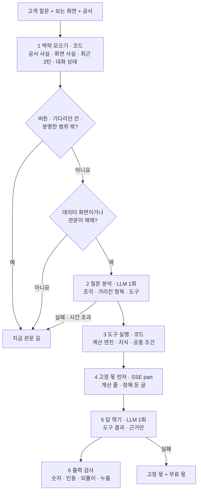

# AI 질문 분석 · 오케스트레이터 설계안 (LLM 모드, 2026-11-20)

> 상태: **추천안으로 확정(2026-11-20 사용자)**. 9장 순서대로 만들어요. 무료 모드 · 계산 엔진 규칙은 바꾸지 않아요.

## 0. 한눈에

| 묻는 것 | 결론 |
| --- | --- |
| 무엇이 문제 | 길(담당)을 코드가 먼저 고르고, 담당은 자기 몫 사실만 봐요. 화면에 보이는 것(가견적 줄)과 앞 대화는 아무도 몰라요 |
| 줄 이름 규칙을 더하면 | 땜질이에요. 화면 항목 · 다른 말(밥값 · 차비)이 늘 때마다 규칙이 늘어요 |
| 바꿀 모양 | 맥락 모으기(코드) → **질문 분석(LLM 1회)** → 도구 실행(코드, 계산 엔진) → 고정 몫 먼저 → **답 엮기(LLM 1회)** → 검사 |
| 숫자 | 지금처럼 계산 엔진 도구가 낸 값만 써요. LLM은 숫자를 만들지 않아요 |
| 언제 분석을 거나 | 추천: 데이터가 있는 화면(가견적 · 표준견적서 · 견적서 · 공정표 · 실측)과 관문이 애매할 때만. 나머지는 지금 관문 |
| 비용 · 지연(어림, 재야 함) | 분석이 붙는 턴만 약 $0.0002 더, 1~2초 더. 지금 LLM 모드 한 턴은 약 $0.00025 · 평균 3.4초 |
| 기존 결정과 다른 점 | `agent-next.md` 2.5는 '관문을 LLM 분류로 통째 바꾸지 않기'예요. 이 안은 통째가 아니라 **데이터 화면 · 애매할 때만** 분석을 걸어서 그 결정과 맞춰요 |

## 1. 왜 바꾸나 (2026-11-20 3300 업체 가견적 화면 질문 8개)

| 질문 | 지금 답 | 원인 |
| --- | --- | --- |
| 도배 인건비는 왜 4품이야? | 일반론 + '견적서에서 확인해 보세요' | 가견적 줄(4.5품 × 30만 원)을 몰라요 |
| 철거는 왜 합계에 안 들어가요? | 맞음(실측 뒤 · 합계 밖 + 계산 상자) | 표준견적서 줄이라 알아요 |
| 퍼티 작업이 뭐야? | 맞는 카드 + 묻지 않은 공정표 상자 | 분류기가 일정 담당으로 보냄(0.76) |
| 도배 부자재는 왜 이렇게 비싸? | '벽 도배 시공(풀 포함) 줄은 합계에 들어가요' | 표준견적서 줄만 맞춰 봐서 '도배'가 겹친 줄을 고름 |
| 운송비는 왜 나오는거야? | 되묻기 | 분류기 0.39, 규칙 없음 |
| 식대는 왜 줘야해? | 되묻기 | 분류기 0.43, 규칙 없음 |
| 실크 벽지는 보통 뭐 써? | 실크가 무엇인지만 | 맞는 카드 없음 |
| 이 견적서 업체랑 비교할 때 뭘 위주로 봐야해? | '표준견적서는 업체 견적이 아니에요' | '이 견적서'가 무엇인지 모르고, 비교할 점 자료도 없음 |

지금 설정에서 찾은 문제(코드로 확인)

1. 관문은 정규식 + 작은 분류 모델(`intent_lr_v1`, 라벨 5개, 기준 0.7)이에요(`agent/v3/gate.py`). 화면 내용을 모르고, v3 관문은 Jev를 부르지 않아요.
2. 처음 고른 길이 답 전체를 정해요. 담당은 자기 몫 사실만 봐서, 길이 틀리면 뒤에서 바로잡을 곳이 없어요.
3. 화면 맥락이 사실에 없어요.
   - 보던 화면은 관문 동점 깨기에만 써요(`gate.py` 229줄).
   - 업체 id는 실측 날짜 고르기에만 써요(`chat/tools.py` 67줄).
   - 가견적은 합계 · %만 넣어요(`chat/tools.py` 95줄). `EstimateFacts.lines · separate`는 늘 비어 있어요.
4. 오케스트레이터는 이음말로 최대 3조각을 나누는 코드예요. 분석 · 위임 · 엮기는 하지 않아요.
5. LLM 모드에서도 작성기는 가이드 · 공종 · 복합 길의 덧붙이기만 해요(`turn.py` 213줄). 견적 설명 · 일정 길은 LLM 0회예요. `llm_mode.rewrite`는 부르는 곳이 없어요.
6. 대화 이력이 LLM에 가지 않아요. 이어 묻기는 정규식으로 앞 질문에 이어 붙여서, '합지는요?'가 실크 값을 보여요.
7. 되풀이 거르기가 계속 늘어요(오늘만 다섯 갈래). 작성기가 할 말이 없어도 덧붙이는 역할이라 생기는 일이에요.
8. 카드에 빈칸이 있어요. 도배 카드 71개에 운송비 · 식대 · 부자재 · 품 · 가견적 비교 · 실크 고르기가 없어요.
9. 평가 세트(64턴)에 화면 질문이 없어서 위 문제가 평가에 보이지 않았어요.

## 2. 흐름



- 무료 모드는 지금 관문 · 담당 그대로예요. 화면 사실(3장)만 더해서 견적 설명이 가견적 줄도 맞춰 보게 해요.
- 지금 관문은 버리지 않아요. 무료 모드, 분석 실패 때, 데이터 없는 화면에서 그대로 써요.

## 3. 화면 사실 (ScreenFacts, 코드)

화면에 보이는 값과 같은 service 함수에서 받아요. 숫자는 모두 계산 엔진 값이에요.

| 화면 | 넣는 것 | 받는 곳 |
| --- | --- | --- |
| 업체 자세히(`vendor`) | 그 업체 가견적 줄(이름 · 키 · 수량 · 단위 · 단가 · 금액), 표준견적서와 같은 일 · 따로 받는 줄, 줄마다 표준과 차이, 합계 · 표준 대비 %, 벽지 바꾸면 차이 | `visit.service.vendor_detail` · `calc.estimate` |
| 업체 보기(`vendors`) | 보이는 업체 3곳 합계 · % · 따로 받는 줄 | `visit.service.vendors_for` |
| 표준견적서(`standard`) | 표준견적서 줄 · 포함 상태 · 합계(지금 값) | `chat.tools._standard` |
| 견적서(`quotes`) | 실측 견적서 칸(낼 금액 · 부가세 방식 · 기간 · 유효기간). 업체 파일 글은 넣지 않아요 | `quote.service` |
| 공정표(`plan` · `schedule`) | 공정 블록 · 상태 · 연기 대기 | `schedule.service` |
| 실측(`visits` · `pick`) | 요청 상태 · 업체가 답한 날짜 범위 | `visit.service` |

- 분석기에는 **항목 목록**(키 · 이름 · 짧은 뜻)만 넘기고 숫자는 넘기지 않아요. 숫자는 분석에 필요 없고, 지어낼 틈도 줄어요.
- 업체가 쓴 글(소개 · 메모 · 파일)은 지시문에 넣지 않아요.

## 4. 질문 분석 (LLM 1회, 구조화 출력)

```python
class Ask(BaseModel):
    text: str                 # 그 조각을 풀어 쓴 질문('이 견적서' → '마루와벽 가견적')
    kind: Literal["line", "compare", "what", "how", "price", "period",
                  "schedule", "vendor", "start", "policy", "other"]
    items: list[str]          # 가리킨 화면 항목 키(목록에 있는 값만, 예: estimate.truck)
    trades: list[TradeCode]
    tools: list[ToolName]     # 부를 도구(목록에 있는 값만)

class Plan(BaseModel):
    asks: list[Ask]           # 1~3개
    ask_back: str | None      # 정말 모를 때만. 화면 항목 후보 단추와 같이 보여요
    out_of_scope: bool
```

- 받는 것: 가린 질문, 최근 3턴(질문 + 답 첫 줄), 화면 항목 목록, 공종 목록, 도구 목록.
- 검사: `items` · `tools`는 목록 밖 값이면 버려요. 사용자 · 공사 id는 LLM 출력으로 받지 않아요(서버 세션).
- 지시문은 `prompts/planner_v1.md`. 예시는 화면마다 1~2개.

## 5. 도구 (코드, 읽기만)

| 도구 | 하는 일 | 지금 코드 |
| --- | --- | --- |
| `line(item)` | 화면 줄 하나: 무엇인지(카드) + 수량 × 단가 = 금액, 포함 상태, 표준과 차이 | `answer.line_box` · `calc.estimate` |
| `compare(scope)` | 업체끼리 · 표준과 줄 차이, 따로 받는 줄, 같은 일 기준으로 견주기 | `calc.estimate` + `EstimateLineGap`(채움) |
| `period` · `price` · `pair_period` | 기간 · 비용 · 두 공정 날짜 | `calc_lines` |
| `schedule` | 공정표 보기 · 연기 미리 보기 | `schedule.service`(일정 MCP 파일은 아직 비어 있어요) |
| `knowledge(text, trade)` | 카드 → 조각 | `answer.knowledge` · `search` |
| `trade_conditions(trade, text)` | 공종 조건 · 되묻기 칸 | `trade_agent` (TradeSpec) |
| `vendor_pick` | 업체 3곳 고르기(코드 점수) | `calc.vendor_pick` |

- 상한: 도구 4번(같은 도구 · 같은 인자는 한 번), 턴당 하위 호출 3번(`agents.md` 8장).
- 도구는 코드가 실행해요. LLM이 도구를 여러 번 오가며 부르는 반복 방식은 쓰지 않아요. v2 묻기 창이 그 방식이고, 한 턴 6.9~8.7초였어요(`v2/ask_tools.py`).

## 6. 답 엮기 (작성기 v6)

- 지금 작성기(`composer_v5`)를 넓혀요. 고정 몫은 도구가 낸 계산 줄 · 정해 둔 글이고, 먼저 그대로 보여요.
- 받는 것: 분석한 조각들 + 도구 결과(계산 줄 · 카드 · 조각) + 화면 이름 + 최근 3턴.
- 지금 규칙은 그대로예요: 새 사실 칸 먼저, 숫자는 도구 값만, 업체 · 브랜드 추천 · 하자 판정 · 법률 판단은 하지 않아요.
- 견적 설명 · 일정 길도 LLM 모드면 엮기를 불러요(지금은 정해 둔 글만).
- 조각이 둘 이상이면 한 답 안에 조각마다 블록을 둬요. 하위 답을 다시 요약하지 않아요(`agent-next.md` 2.5 A5).

## 7. 비용 · 지연 · 안전

| 칸 | 값 |
| --- | --- |
| 분석 1회(gpt-6-luna) | 입력 약 1,500 · 출력 약 150토큰 → 약 $0.0002(어림) |
| 엮기 1회 | 지금 작성기와 비슷, 약 $0.00025(c10 실측 평균) |
| 지연 | 분석이 붙는 턴은 고정 몫이 약 0.8초 → 1.5~2초, 끝은 약 3.4초 → 4.5~5초(어림, 재야 함) |
| 하루 상한 | 사용자당 LLM 100턴 그대로(`chat/service.py`). 넘으면 무료 모드 |
| 실패 | 분석 실패 · 시간 초과(제안 8초, 지금 LLM 호출 상한은 30초) → 지금 관문 길. 엮기 실패 → 고정 몫 + 무료 몫 |

## 8. 고를 것

| 번호 | 고를 것 | 안 | 추천 |
| --- | --- | --- | --- |
| G1 | 분석을 언제 거나 | ① LLM 모드의 모든 턴 ② 데이터 화면 + 관문이 애매할 때 ③ 관문이 애매할 때만(`agent-next.md` 2.2) | ② |
| G2 | 분석 방식 | ① 분석 1회 → 코드 실행 → 엮기 1회 ② 도구 호출 반복(v2 방식) ③ 분석 없이 화면 사실만 엮기에 넣기 | ① |
| G3 | 분석 모델 | ① gpt-6-luna ② gpt-6.1-terra(약 10배 비쌈) | ① |
| G4 | 첫 글 | ① 분석 뒤 계산 줄 먼저(1.5~2초) ② 지금처럼 관문 기준 고정 몫을 0.8초에(틀린 길이면 틀린 글이 먼저 보임) | ① |
| G5 | 지금 분류기 | ① 데이터 없는 화면 · 무료 모드에서만 ② 분석기 앞 1차로 늘 ③ 없앰 | ① |

- 2026-11-20 사용자가 추천안(G1 ② · G2 ① · G3 ① · G4 ① · G5 ①)을 골랐어요. 구조에 크게 걸리는 것은 고치기 전에 사용자에게 물어요.
- ③을 고르면 '애매'의 뜻은 '기준 0.7 아래'예요. 오늘 퍼티 질문(0.76)처럼 높은 신뢰로 틀린 길은 못 잡아요.
- 팀 문서(AGENTS.md)는 '코드 라우터 + 학습한 분류기 + Jev'예요. v3는 그 문서를 따르지 않기로 했지만, 팀 dev로 합칠 때는 팀 결정이 필요해요.

## 9. 만드는 순서 (단계마다 커밋 · 평가)

1. **화면 사실**: 업체 자세히 화면의 가견적 줄 · 차이 · 따로 받는 줄을 사실에 넣어요. 무료 모드 견적 설명도 가견적 줄을 맞춰 봐요(줄 이름은 화면 데이터에서 와서 규칙을 손으로 늘리지 않아요).
2. **화면 질문 평가 세트**: 업체 가견적 30 · 표준견적서 20 · 공정표 15 · 실측 · 견적서 15 · 이어 묻기 20(2~3턴), dev : held-out = 2 : 1. 지금 구조로 기준선(무료 · LLM)을 재요.
3. **분석기 + 도구 실행 + 작성기 v6**: LLM 모드 · G1 조건에서만. 실패하면 지금 길.
4. **대화 이력 3턴**: 분석 · 엮기에 넣어요. '이 견적서 · 그럼 합지는?'을 풀어요.
5. **지식 카드 빈칸**: 운송비 · 식대 · 부자재 · 품(인건비 세는 법) · 가견적 비교 · 실크 고르기(브랜드 추천 없이 규격 · 확인할 점). 근거 조각 인용 필수(`cards_check.py`).
6. **정리**: 쓰지 않는 `llm_mode` 지시문, 분석 뒤에도 필요 없는 되풀이 거르기는 평가로 확인한 뒤 줄여요.

평가 지표

- 분석: 가리킨 항목 · 의도 · 도구가 맞는 비율.
- 답: 화면 숫자를 썼는지, 질문에 답했는지(판정자 두 번, 순서 바꿔), 되풀이 · 빈말 수.
- 비용 · 지연: 턴당 값, 고정 몫 처음 보인 때, 끝난 때.
- 회귀: 지금 64턴 세트(c 시리즈)와 무료 모드 core_run.
- 한 번 돌리는 값은 작은 모델로 1~2센트 안이에요. 넘으면 금액을 먼저 알려요.
