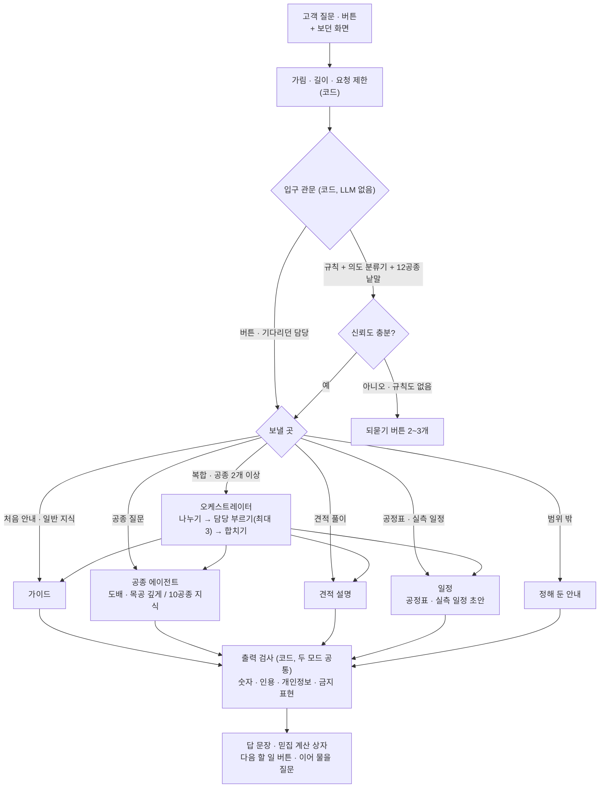
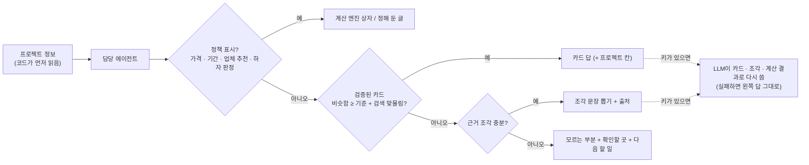

# 믿집 v3 에이전트 설계

- 쓴 날: 2026-11-18 · 쓴 역할: 에이전트 설계 · 상태: 설계안 → **1차 구현(B5, 2026-11-19)**. 설계와 달라진 곳은 0.1절, 돌린 기록은 [verification/b5.md](verification/b5.md)
- 기준: [00-prompt.md](00-prompt.md) · 지금 코드 조사 [research/00-codebase.md](research/00-codebase.md)
- 결정: [adr/agent-01](adr/agent-01-structure.md) 구조 · [02](adr/agent-02-free-mode-answers.md) 무료 모드 답 · [03](adr/agent-03-trade-coverage.md) 공종 덮기 · [04](adr/agent-04-evaluation.md) 평가 · [05](adr/agent-05-local-models.md) 로컬 모델 · [06](adr/agent-06-llm-provider.md) LLM 공급자 · [07](adr/agent-07-answer-cards.md) 답 카드 모양 · 위치 · 기준
- 실험 계획: [evaluation/v3/PLAN.md](../../evaluation/v3/PLAN.md) · 돌린 기록: [verification/agents.md](verification/agents.md)
- 조사: 웹 검색 36회(영어 30 · 한국어 6), 직접 연 출처 34개(맨 아래 '근거')

## 0. 한눈에

| 항목 | 정한 것 |
| --- | --- |
| 구조 | **코드 입구 관문 → 단일 의도는 담당에게 바로(넘겨주기), 복합 · 여러 공종만 오케스트레이터(깊이 1)**. 담당: 가이드 · 공종 · 견적 설명 · 일정 |
| 공종 | 공종 에이전트 **코드 한 벌 + 공종 설정(TradeSpec) 13개**(12공종 + 공통). 도배 · 목공은 깊게(조건 묻기 · 계산 엔진 연결), 나머지 10공종은 지식 답 |
| 무료 모드(기본) | 관문(규칙 + 학습 분류기) → **검증된 답 카드** → 없으면 **근거 조각 문장 뽑기(추출식)** → 없으면 **정직하게 '모르는 부분' + 다음 할 일**. 숫자는 계산 엔진 상자, 가격 · 업체 추천 · 하자 판정은 정해 둔 글 |
| LLM 모드 | 같은 구조 · 같은 도구 · 같은 출력 검사. 키가 있을 때만 담당이 카드 · 조각 · 계산 결과로 글을 써요. 실패하면 그 몫은 무료 모드 답으로 |
| 숫자 | 금액 · 수량 · 기간 · 날짜는 계산 엔진만. 답 글의 숫자는 계산 결과 · 근거 원문 · 고객 글에 있는 것만 남아요 |
| 기준선(실제로 잼) | 의도 분류 held-out 정확도 **0.940** · macro-F1 **0.944**(67문장), 분류기(≥0.7) → 규칙 조합 0.970. 키워드 검색 held-out hit@5 **0.697** · MRR **0.684**(99문항) |
| v3에서 바로 고칠 것 | 지금 분류기는 다른 공종 문장 20개를 **모두 범위 밖**으로 보내요 → 12공종 낱말로 덮으면 v3 라벨 정확도 held-out 0.836 → 0.940 |
| 사용자 확인 | 로컬 모델 · 로컬 임베딩 내려받기, Jev 빼기, 공급자(OpenAI 유지), 실측 일정 초안을 일정 에이전트가 맡기 |

### 0.1 1차 구현에서 설계와 달라진 것 (B5, 2026-11-19)

| 항목 | 설계 | 구현 |
| --- | --- | --- |
| 카드 | `data/v3/cards/`, 첫 목표 약 290장 | `backend/app/agent/cards/` 360장(공통 63 · 도배 53 · 목공 46 · 10공종 17~21 · 서비스 9), 검증 상태 '쓴 사람 확인'. 뜻 채점은 `evaluation/v3/judge_packs/`로 리드가 |
| 받아들이기 | 점수 ≥ t_card 그리고 맞물림 | 열쇠 점수 + 맞물림 덤(위 3개 +0.10 · 위 8개 +0.05) ≥ 0.55, 맞물림 없으면 ≥ 0.62. 검색 위 조각을 인용한 카드도 후보(agent-07) |
| 분류기 | `intent_lr_v2` 다시 학습 | 다시 학습 안 함. v1 + 12공종 낱말 + 규칙 관문으로 의도 정확도 dev 0.887 · held-out 0.881, held-out macro-F1 0.889(17.3 #2 목표 0.92 못 미침) |
| 검색 | 키워드 + 12공종 | `knowledge/search3.py`(12공종 무게) 채택. 카드 열쇠 색인은 맞물림이 자기 자신과 돌아서 안 넣음. Kiwi는 dev +0.087이지만 의존성 승인 전이라 보류 |
| 오케스트레이터 | 나누기 · 합치기 | 공종마다 자기 마디만 남기는 `focus` 추가. E4 dev 조각 덮음 0.64(17.3 #3 목표 0.9 못 미침) |
| 지식 번호 | K7001~ | K20001~(v3 첫 묶음 193) · K21001~(개선 2회차 iter2 140, `v3_csv.START2`). 품셈 · LH 시방서 · KCS처럼 문서 첫 화면 주소뿐인 출처는 링크 없이 이름만 |
| API | `/v3/ask` | `/ai/turns`(SSE) · `/ai/threads` · `/ai/faq`(`backend/app/chat/`) |
| 테스트 | `backend/tests/v3/test_agent_*.py` | `backend/tests/test_v3_agent_*.py` · `test_v3_ai_*.py` |
| 하위 에이전트 정의 | `.claude/agents/v3-*.md` | 만들지 않음(맡은 파일 밖). 카드는 Agent 도구로 띄운 쓰기 하위 에이전트가 근거 조각만 보고 썼어요 |
| E5 · E6 | 계획 | 안 함 |
| 조각 문장 보이기(개선 1회차) | 원문(-다)을 따옴표로 | 미리 만든 해요체 요약(`backend/app/knowledge/summaries.jsonl` 508개, 조각 글 sha가 같을 때만)을 보이고, 없으면 원문. 질문 낱말 겹침 0.5 아래면 정직하게 '모름' |
| 순서 문장 근거(개선 1회차) | 근거 없이 정해 둔 글 | 계산 엔진 공정표 순서를 근거 종류 `rule`(`rule:plan-order`)로 인용 + 받치는 조각 |

## 1. 근거가 설계에 준 것

| 근거 | 설계에 준 것 |
| --- | --- |
| 예측 가능해야 하는 일은 정해진 코드 경로, 가장 단순한 것부터 [S1] · 코드 오케스트레이션이 속도 · 비용 · 성능을 더 예측 가능하게 [S3] | 흐름 · 라우팅 · 합치기는 코드. LLM은 글쓰기 한 곳 |
| 다중 에이전트는 채팅의 약 15배 토큰, 문맥을 같이 써야 하거나 의존이 많은 일에는 안 맞음 [S2] · 순차 과제에서 다중 구조가 최대 −70% [S6] | 상담은 대부분 '한 의도 · 순차 질의응답' → 단일 의도는 오케스트레이터를 거치지 않음 |
| 감독자가 하위 답을 다시 옮기며 '번역 손실', 그대로 넘기니 약 50% 개선 [S4] | 오케스트레이터는 하위 답을 다시 쓰지 않고 이어 붙여요(순서 · 겹침 문장만 더함) |
| 실패 유형: 단계 반복 15.7% · 종료 조건 모름 12.4% · 되묻기 실패 6.8%, 상위 목표 검증 +15.6% [S5] | 호출 상한 · 같은 도구 같은 인자 금지 · 되묻기 소유자 하나 · 출력 검사를 코드로 |
| LLM은 이해에만, 업무는 정해진 흐름이 결정적으로, 응답은 템플릿 [S10] | 무료 모드 = 규칙 · 분류기(이해) + 카드 · 템플릿(답) |
| 고객 상담 봇: 허용 목록 action-selector, 문맥 최소화 [S11] | 무료 모드의 답은 '검증된 카드 고르기' = 허용 목록. 고객 글은 지시문에 들어가지 않음 |
| 고정 기준값 의미 캐시는 오류율 보장이 없음 [S9] | 지난 LLM 답을 재사용하는 캐시는 쓰지 않음. 카드 받아들이기는 기준값 + 검색 맞물림으로 |
| 불확실할 때만 비싼 판정으로 넘기는 계단식 [S17] · 후보 묶음으로 되묻기 [S18] | 신뢰도 낮으면 Jev 대신 후보 2~3개 버튼으로 되묻기 |
| 맥락 붙이기 + BM25 + 재순위가 검색 실패를 줄임 [S13] | 무료 모드는 바이그램 BM25 + 예시 질문, 키가 있으면 의미 검색 RRF. 재순위 · 로컬 임베딩은 내려받기 승인 뒤 실험 |
| LLM 판정의 위치 · 장황함 · 자기 우대 편향 [S20], 형식 편향이 가장 큼 [S21], 다국어 판정 일치 κ 약 0.3 [S22] | 코드 채점 먼저, 하위 에이전트 판정은 이진 루브릭 · 순서 바꾸기 · 두 판정자 · 사람 표본 |

## 2. 구조도

### 2.1 한 턴



### 2.2 담당 안에서 무료 모드와 LLM 모드



- 무료 모드가 기본이에요. `LLM_LIVE=true`이고 키가 있을 때만 점선이 켜져요.
- 정책 · 카드 · 검색 · 출력 검사는 두 모드가 같은 코드예요. LLM 모드는 '글을 더 자연스럽게, 질문에 맞게' 쓰는 층 하나만 더해요.

## 3. 역할과 책임

| 담당 | 맡는 질문 | 쓰는 것 | 무료 모드 | LLM 모드 | 하지 않는 일 |
| --- | --- | --- | --- | --- | --- |
| 입구 관문 (코드) | 모든 질문 | 규칙 · 의도 분류기 · 12공종 낱말 · 보던 화면 | 전부 코드 | 같음(LLM 없음, Jev 뺌 — ADR-06) | 답 쓰기 |
| 오케스트레이터 (코드) | 복합 요청, 공종 2개 이상, 공정 사이 조정 | 나누기 규칙 · 계산 엔진 공정 순서 · TradeSpec 순서 문장 | 나누기 → 담당 병렬 → 순서대로 이어 붙이기 | 나누기가 안 되면 LLM이 나누기 JSON(허용 값만) | 하위 답 다시 쓰기, 깊이 2 이상 |
| 가이드 | 처음 고객 궁금증 · 시작 순서 · 용어 · 계약 전 확인 · 관리사무소 · 하자 기본 · 서비스 질문 | 공통 카드 · 용어 카드 · 프로젝트 단계 | 카드 + 단계별 다음 할 일 버튼 | 카드 · 조각으로 글 | 일반 시세 · 일반 기간 숫자(표준견적서 · 공정표로 안내) |
| 공종 에이전트 | 공종별 자재 · 공법 · 하자 · 순서 · 준비 · 셀프 가능 여부 | TradeSpec · 공종 카드 · 공종 + 공통 검색 · 브리프 | 카드 → 추출식 → 모름. 도배 · 목공은 빈 조건 하나 되묻기 | 카드 · 조각 · 브리프로 글, 되묻기 칸 JSON | 하자 판정, 브랜드 · 업체 추천, 10공종 금액 |
| 견적 설명 | 내 표준견적서 · 가견적 · 실측 견적서 줄 · 차이 | 계산 엔진 결과(줄 상태 6종 · 산식 · 표준 ↔ 시장 차이 `gap_steps` · 가견적 줄별 차이) · 용어 카드 | 줄 · 차이마다 정해 둔 풀이 + 계산 상자 | 같은 값으로 글 | 금액 만들기 · 업체 메모를 지시로 쓰기 |
| 일정 | 공정표 읽기 · 조건 바꾸기 · 연기, **실측 일정 초안**(희망일 → 기간 초안) | 계산 엔진 공정표 · 공휴일 · 기한 규칙 · 업체가 낸 기간 | 날짜 말 규칙 해석 → 계산 엔진 → 정해 둔 글 · 초안 카드 | 말 → 조건 JSON(도구) → 계산 엔진 | 날짜 만들기, 보내기 · 확정(고객이 누름) |
| 출력 검사 (코드) | 모든 답 | `v2/guard.py` 규칙 + 인용 · 카드 버전 확인 | 같음 | 같음 | — |

- 다섯 에이전트(오케스트레이터 · 가이드 · 공종 · 견적 설명 · 일정) 그대로예요. 실측 일정 초안은 일정 에이전트가 맡아요(팀 확인 항목 'AI 실측 일정 초안을 맡을 에이전트' → **사용자 확인 필요**, 18절).
- 공종 에이전트는 v2처럼 '고객에게 말하지 않는 하위 호출'만이 아니라, 단일 공종 질문이면 직접 답하는 담당이에요(넘겨주기). 복합일 때만 오케스트레이터의 하위 호출이 돼요.

## 4. 입력 · 출력 모양

```python
# 서버가 세션으로 정한다. LLM 출력 · 도구 인자로 바꾸지 않는다
class TurnContext:
    user_id: UUID
    chat_id: UUID | None
    project_id: UUID | None          # 가이드는 프로젝트 없이도 돈다
    view: View | None                # 보던 화면: start · standard · vendors · vendor_detail · visits · visit_request · quotes · compare · schedule · thread
    mode: Literal["free", "llm"]     # settings.llm_live and 키 있음 → llm
    today: date                      # 서울 날짜. 계산 엔진에 인자로 넘긴다

# 코드가 먼저 읽어 넘긴다 (기능 service 공개 함수 → 필요한 칸만). 숫자는 계산 엔진 결과 그대로
class ProjectFacts:
    stage: Literal["info", "standard", "vendors", "visit", "after_visit", "construction", "done"]
    area_m2: float | None; area_basis: Literal["supply", "exclusive"] | None
    trades: list[TradeChoice]        # dobae(grade economy|basic) · mokgong(items)
    living: Literal["living", "vacant"] | None
    start_wish: date | None; start_kind: str | None
    standard: StandardSummary | None # 합계 · 줄(key · 상태 · 수량 · 금액), calc 결과
    plan: PlanSummary | None         # 시작 · 끝 · 공정 블록, calc 결과
    visits: list[VisitBrief]         # 업체 이름(화면에 보이는 이름) · 상태 · 업체가 낸 기간 · 기한
    budget_band: str | None
    # 동 · 호 · 연락처는 넣지 않는다

class GateResult:
    route: Literal["guide", "trade", "quote_explanation", "schedule", "multi", "out_of_scope", "ask_back"]
    trades: list[TradeCode]          # dobae · mokgong · floor · tile · bath · kitchen · paint · film · electric · window · demolition · plumbing · common
    policy: list[Literal["price", "period", "vendor_reco", "brand_reco", "defect_judgement", "legal_case", "diy", "safety"]]
    confidence: float
    source: Literal["button", "waiting", "rule", "model"]
    candidates: list[str]            # ask_back일 때 버튼으로 보일 후보 2~3개

class AgentTask:                     # 오케스트레이터 → 담당 (도구로 부름)
    part: int; text: str             # 나눈 문장 조각
    route: str; trades: list[TradeCode]; policy: list[str]
    facts: ProjectFacts              # 그 담당에 필요한 칸만
    brief: dict[str, str]            # 지금까지 모은 조건(도배 · 목공)
    shown: list[str]                 # 이미 보인 카드 · 조각 번호 (되풀이 막기 · 인용 확인)

class Sentence:
    text: str
    cites: list[str]                 # [K####] 조각 · card:<id>@<버전>

class Section:                       # 담당 하나가 낸 묶음 (v2 Section을 넓힘)
    title: str                       # 예: "[도배] 실크 · 합지"
    sentences: list[Sentence]
    caution: str = ""; tip: str = ""
    source: Literal["card", "extract", "llm", "template", "calc"]

class CalcBox:                       # 화면의 '믿집 계산' 상자. 글이 아니라 calc 값 참조
    label: str                       # 예: "기존 벽지 철거"
    ref: str                         # 예: "standard.lines.demolish" · "visit_draft.recommend"

class AgentAnswer:
    sections: list[Section]
    calc: list[CalcBox] = []
    cards: list[Card] = []           # choices(되묻기) · next_step(버튼) · caution · standard_quote · visit_draft
    ask: AskSlot | None = None       # 도배 · 목공 빈 조건 하나 (trade · slot · 질문 · 선택지)
    unknown: list[str] = []          # 확인하지 못한 부분 ("…은 실측 때 업체가 정해요")
    suggest: list[str] = []          # 이어 물을 질문 0~3 (답할 수 있는 것만)
    failed: bool = False
    trace: Trace                     # route · 쓴 카드 · 쓴 조각 · 모드 · 지시문 판 (화면에 안 보임, 평가용)
```

- 카드 모양은 10.2절, 도구 인자는 7절이에요.
- 금액 · 날짜 칸은 출력 모양에 두지 않아요. 숫자가 필요하면 `CalcBox.ref`로 계산 결과를 가리키고 화면이 그 값을 그려요.

## 5. 넘겨주기 규칙

1. **단일 의도는 넘겨주기(handoff)**: 관문이 고른 담당이 고객에게 바로 답해요. 오케스트레이터를 거치지 않아요 [S3][S4].
2. **복합은 도구로 부르기(agents as tools)**: 오케스트레이터만 담당을 불러요. 깊이는 1, 한 턴에 담당 호출은 3번까지, 서로 다른 조각은 동시에 불러요.
3. **하위 답은 그대로**: 오케스트레이터는 하위 묶음을 다시 쓰지 않아요. 더하는 것은 (1) 공정 순서대로 줄 세우기, (2) 겹침 · 순서 문장(TradeSpec 규칙), (3) 실패한 조각의 '확인하지 못했어요' 한 줄뿐이에요 [S4].
4. **되묻기 주인은 하나**: 되묻는 담당이 `waiting = {route, trade, slot}`을 남기고, 다음 턴의 짧은 답("32평이요")은 그 담당이 받아요. 분류기가 다른 의도를 0.7 이상으로 말할 때만 옮겨요(지금 `route.keep_waiting` 그대로). 기다림은 2턴 또는 30분 뒤 비워요.
5. **라우팅 되묻기는 한 번**: 그다음은 버튼 선택지로 끝내요(반복 막기 [S5]).
6. **담당끼리 서로 부르지 않아요**: 공종이 다른 공종을 부르면 안 되고, 필요하면 '복합'으로 관문이 정해요.
7. **버튼 · worker 일은 관문을 건너뛰어요**: 화면 버튼(예: "합지 · 실크 차이")은 `source=button`, 실측 견적서 도착 뒤 설명은 worker가 견적 설명을 바로 불러요.

## 6. 함께 쓰는 상태

| 상태 | 누가 만드나 | 어디 두나 | 쓰는 곳 |
| --- | --- | --- | --- |
| `TurnContext` | 서버(로그인 세션 · 요청) | 한 턴 | 모두 |
| `ProjectFacts` | 코드가 턴 시작에 짧은 DB 세션으로 읽음 | 한 턴 | 모두. LLM 모드에서도 LLM이 고르지 않음 |
| 지난 대화 6개 · `waiting` · `rev` | `chat.service` | DB `chats` · `chat_messages` | 관문 · 담당 |
| 브리프(공종별 조건) | 담당이 제안 → 고객이 버튼으로 담기 → 기능 service가 저장 | DB(프로젝트 · 상담 조건) | 공종 · 견적 설명 |
| 보인 카드 · 조각 | 담당 | 한 턴(+ 대화 행에 번호만) | 인용 확인 · 이어 물을 질문 · 되풀이 막기 |

- 에이전트는 DB에 쓰지 않아요. 저장은 고객이 누른 버튼을 받은 기능 service가 해요.
- LLM을 기다리는 동안 DB 세션을 쥐지 않아요(지금 `v2/ask_chat.py` 방식 그대로).

## 7. 도구

| 도구 | 하는 일 | 무료 | LLM | 쓰는 담당 |
| --- | --- | --- | --- | --- |
| `find_cards(query, trades, topic?)` | 검증된 답 카드 찾기(비슷함 · 맞물림 점수) | 코드가 부름 | LLM 도구 | 가이드 · 공종 · 견적 설명 · 일정 |
| `search_knowledge(query, trades, k=6)` | 지식 조각 검색(키워드, 키가 있으면 + 의미 검색 RRF) | 코드가 부름 | LLM 도구 | 가이드 · 공종 |
| `trade_spec(trade)` | 공종 설정: 주의점 · 실측 변수 · 준비 · 순서 규칙 · 브리프 칸 | 코드 | 지시문에 넣음 | 공종 · 오케스트레이터 |
| `glossary(term)` | 용어 카드(품 · 초배 · 부가세 · 실측 후 …) | 코드 | LLM 도구 | 가이드 · 견적 설명 |
| `price_reference()` | 표준견적서 · 시장 범위 · 차이 이유(계산 엔진, 지금 있음) | 코드 | LLM 도구 | 견적 설명 · 공종(도배 · 목공) |
| `estimate_gap(vendors)` | 가견적 줄별 차이(업체 확인 단가 × 믿집 수량, 업체끼리 · 표준견적서와). 표준 ↔ 시장 차이는 `price_reference`의 `gap_steps` | 코드 | LLM 도구 | 견적 설명 |
| `plan_with(constraints)` | 공정표 다시 계산(`set_schedule_constraints`, 지금 있음) | 코드(규칙 해석) | LLM 도구 | 일정 |
| `visit_draft(window?, vendors)` | 실측 일정 초안 계산(새 계산 함수, 13절) | 코드 | LLM 도구 | 일정 |
| 일정 MCP(`get_schedule` · `preview_schedule_change` · `request_schedule_change` …) | 공정표 연기 미리보기 · 승인 대기 건 | 안 씀(버튼 흐름) | 일정만 | 일정 |

- 도구 인자에 `user_id` · `project_id`를 두지 않아요. 서버가 `TurnContext`로 채워요.
- MCP는 같은 프로세스 안에서 붙이고 공개 경로에 내놓지 않아요. 2026-07-28 명세는 세션을 없애고 호출 사이 상태를 서버가 만든 핸들로 넘기게 했어요 [S8]. 미리보기 핸들(`preview_id`)은 사용자 · 프로젝트 · 공정표 판에 묶어요.
- 도구 목록 순서는 고정해요(캐시 적중 [S8]).

## 8. 호출 상한

| 상한 | 값 | 어디서 세나 |
| --- | --- | --- |
| 턴당 담당 호출(오케스트레이터) | 3 | `orchestrator` |
| 담당별 도구 호출 | 4 (같은 도구 · 같은 인자 다시 부르기 금지) | 담당 루프 |
| 턴당 LLM 호출(LLM 모드) | 6 (도구 4 + 답 + 다시 쓰기 1) | `llm.py` |
| 턴당 LLM 호출(무료 모드) | 0 | — |
| 다시 찾기 | 첫 검색이 '부족'일 때 1번 | 담당 |
| 사용자별 질문 | 시간당 60(지금 값), LLM 모드 하루 토큰 상한 | `ratelimit` · `llm.py` |
| 질문 길이 · 지난 대화 | 1,000자 · 6개 | 관문 |

- 상한에 닿으면 오류 대신 '지금까지 확인한 것 + 다음 할 일 버튼'으로 끝내요.

## 9. 공종 덮기

### 9.1 질문 종류별 담당 · 자료 · 답 방식 (모든 공종 공통 규칙)

| 질문 종류 | 담당 | 자료 | 무료 모드 | LLM 모드 |
| --- | --- | --- | --- | --- |
| 가격 | 도배 · 목공: 견적 설명 / 10공종: 공종 | 계산 엔진(도배 · 목공만), 견적 구성 카드 | 도배 · 목공: 계산 상자(표준견적서) + 줄 풀이. 10공종: "지금은 도배 · 목공만 계산해요" + 견적서에서 볼 것 카드 | 같은 값으로 글. 일반 시세 숫자 금지 |
| 자재 | 공종 | 자재 카드 · 제조사 · 시방서 조각 | 비교 카드(고르는 기준) + 도배 · 목공은 조건 되묻기 1개 | 카드 · 조각으로 맞춤 설명 |
| 공법 | 공종 | 시방서 · LH · 품셈 조각, 공법 카드 | 카드 → 추출식(시방서 문장 + 출처) | 조각 인용하며 풀어 씀 |
| 기간 | 일정 | 계산 엔진 공정표 | 프로젝트 있으면 계산 상자, 없으면 '기본 정보 넣기' 버튼. 10공종은 순서만(날짜 없음) | 같음 |
| 하자 | 공종(공종 하자) · 가이드(일반) | 하자판정기준 · 소비자분쟁해결기준 · 시방서 | 원인 · 확인법 · 사진 기록 카드 + 분쟁조정 안내(정해 둔 글). 판정은 안 함 | 같은 범위로 글 |
| 업체 | 가이드 | 업체 고르는 기준 카드, 믿집 업체 화면 | "특정 업체는 추천하지 않아요" + 기준 카드 + 업체 보기 버튼(도배 · 목공). 10공종: 믿집이 아직 연결하지 않음 | 같음 |
| 계약 | 가이드 | 표준계약서 · 소비자원 자료 | 계약 전 확인 카드 + 실측 견적서 확인 카드 | 같음 |
| 순서 | 일정(날짜) · 오케스트레이터(공종 사이) | 계산 엔진 공정 순서 · TradeSpec 순서 규칙 | 순서 카드 + 공종 사이 겹침 문장(정해 둔 글) | 같음 |
| 관리사무소 | 가이드 | 관리규약 · 공동주택관리법 · 승강기 · 소음 자료 | 공사 신고 · 동의서 · 소음 시간 카드 | 같음 |
| 범위 밖 | 관문 | — | 정해 둔 안내(잡담 · 결제 · 계약서 작성 · 다른 일) | 같음(LLM 안 부름) |

### 9.2 공종 × 질문 종류 (무료 모드 답 방식)

기호: **C** 검증된 카드 · **X** 조각 문장 뽑기 · **E** 계산 엔진 상자 · **T** 정해 둔 글 · **A** 조건 되묻기 · **R** 다른 곳 안내(1372 · 관리사무소 · 전문가)

| 공종 | 깊이 | 가격 | 자재 | 공법 | 기간 | 하자 | 업체 | 계약 | 순서 | 관리사무소 | 범위 밖 |
| --- | --- | --- | --- | --- | --- | --- | --- | --- | --- | --- | --- |
| 도배 | 깊게 | E · C | C · A | C · X | E | C · X · R | T · 화면 | C | E · C | C | T |
| 목공 | 깊게 | E · C | C · A | C · X | E | C · X · R | T · 화면 | C | E · C | C | T |
| 바닥 · 타일 · 욕실 · 주방 · 도장 · 필름 · 전기/조명 · 창호 · 철거 · 설비 | 지식 | T · C | C · X | C · X | T · C(순서만) | C · X · R | T | C | C · T | C | T |
| 공통(계약 · 하자 · 관리사무소 · 일정) | 지식 | T | — | — | E(프로젝트 있음) | C · X · R | T · C | C · X | C · E | C · X | T |

- 위험 공종(전기 · 가스 · 설비)의 셀프 방법은 T("전문가 시공이 필요한 일이에요") + R로 끝내요. 나머지 셀프 질문은 C · X로 주의점까지만 말해요 — **사용자 확인 필요**(v2 평가 세트는 셀프 방법을 '답하면 안 됨'으로 뒀어요).

### 9.3 지금 자료가 덮는 양 (실제로 셈, `evaluation/v3/coverage.py`)

| 공종 | 조각 | 예시 질문 | 많은 출처 |
| --- | --- | --- | --- |
| 도배 | 329 | 174 | 표준시방서 167 · 제조사 77 · 공공 25 |
| 목공 | 813 | 222 | 표준시방서 507 · 공공 69 · 제조사 85 |
| 바닥 | 116 | 199 | 제조사 85 · 품셈 10 |
| 타일 | 110 | 201 | 제조사 77 · 품셈 11 · 고시 9 |
| 욕실 | 160 | 294 | 제조사 91 · 품셈 21 · 고시 16 |
| 주방 | 89 | 155 | 제조사 59 · 법령 10 |
| 도장 | 99 | 155 | 제조사 36 · 품셈 16 · 법령 10 |
| 필름 | 47 | 66 | 제조사 32 · 안내 8 |
| 전기/조명 | 91 | 155 | 제조사 43 · 고시 14 · 정부 안내 11 |
| 창호 | 180 | 305 | 제조사 73 · 법령 26 · 고시 23 |
| 철거 | 68 | 129 | 제조사 20 · 품셈 12 |
| 설비 | 118 | 232 | 제조사 30 · 고시 24 · 품셈 19 |
| 공통 | 652 | 780 | 법령 195 · 공공 93 · 경험담 66 |

- 2,148조각(시공일지 제외) 기준이고, 한 조각이 여러 공종이면 모두 셌어요.
- 10공종도 조각이 47~180개 있어 지식 답이 가능해요. 다만 **10공종을 잴 평가 질문이 아직 없어요**(17절 데이터 요청).

## 10. 무료 모드 설계

### 10.1 한 턴 순서

1. 가림(전화 · 동호수) · 길이 · 요청 제한(코드, 지금 `intent.clean` · `guard.mask`).
2. 관문
   1. 버튼 · 기다리던 담당이면 그대로.
   2. 정책 표시(정규식): 가격 · 기간 · 업체 추천 · 브랜드 추천 · 하자 판정 · 개별 법률 · 셀프 · 안전.
   3. 분명한 범위 밖(잡담 · 결제 · 계약서 작성 대행) → 정해 둔 글.
   4. 12공종 낱말(`trades_v3`) → 공종 2개 이상이면 `multi`.
   5. 의도 분류기(v2로 다시 학습할 `intent_lr`): 라벨이 범위 밖인데 공종 낱말이 있으면 `trade`로 바꿔요(기준선 실험에서 v3 라벨 정확도 0.836 → 0.940).
   6. 신뢰도 0.7 이상이면 받고, 아래면 규칙 결과, 규칙도 없으면 후보 2~3개 버튼으로 되물어요(기준선: 분류기 ≥0.7 → 규칙 → 분류기 = held-out 0.970). 되묻기 기준값은 E1에서 다시 정해요.
   7. 보던 화면은 동점 깨기에만 써요(예: 표준견적서 화면의 "이거 왜 이래요?" → 견적 설명).
3. 담당(아래 10.2~10.7). 복합이면 오케스트레이터(10.6).
4. 출력 검사(12절) → 대화 저장 → 응답. 화면은 답 위에 '자동 답변'을 보여요(9판 화면 글 그대로).

### 10.2 답 카드

**모양** (설계 때 `data/v3/cards/<trade>.jsonl` → 구현은 `backend/app/agent/cards/<trade>.jsonl`, 한 줄에 카드 하나. 실제 칸은 [agent-07](adr/agent-07-answer-cards.md))

```json
{
  "id": "dobae.material.silk-vs-hapji", "version": 2,
  "trade": "dobae", "topic": "자재", "stage": "choose_scope",
  "keys": ["합지랑 실크 중에 뭐로 해야 해요?", "실크벽지랑 합지벽지 차이가 뭐예요?", "세 놓을 집이면 합지로 해도 돼요?", "..."],
  "answer": [
    {"text": "합지는 종이 벽지라 값이 싸고 시공이 빨라요. 다음에 그 위에 덧붙이기(덧방)도 할 수 있어요.", "cites": ["K736", "K740"]},
    {"text": "실크는 종이 위에 비닐(PVC)을 입혀 물걸레로 닦을 수 있고 오래 써요. 값은 합지보다 비싸요.", "cites": ["K737"]}
  ],
  "caution": "벽에 곰팡이 · 습기가 있으면 어떤 벽지든 바탕부터 고쳐요.",
  "tip": "고른 벽지는 기본 정보에서 바꾸면 표준견적서가 바로 다시 계산돼요.",
  "calc": [{"label": "고른 벽지로 계산한 표준견적서", "ref": "standard.total"}],
  "actions": ["standard", "vendors"],
  "ask": {"slot": "dobae.grade", "question": "오래 사실 집인가요, 세 놓을 집인가요?", "options": ["오래 살 집", "세 놓을 집", "아직 몰라요"]},
  "level": {"new": "용어 풀이 문장 1개 더", "experienced": "짧게"},
  "policy": [], "source_level": "공공 · 제조사",
  "verified": {"by": "subagent:card-verifier", "at": "2026-11-20", "status": "ok", "checks": ["근거", "숫자", "정책", "해요체"]},
  "review_by": "2027-05-20"
}
```

- 답 문장은 2~4개, 문장마다 근거 조각 번호. 금액 · 기간 숫자는 넣지 않고(`calc` 참조로), 시방서 수치(겹침 폭 · 양생 시간)는 근거 원문 그대로일 때만 인용과 함께 둬요.
- `keys`는 실제 고객 질문 묶음에서 5~12개(데이터 수집 담당의 질문 은행). 기준선에서 예시 질문(hints)을 빼면 검색 hit@5가 0.665 → 0.539로 떨어졌어요. 고객 말투 열쇠가 무료 모드의 핵심이에요.

**만드는 법** (Claude Code 하위 에이전트, 유료 API 0회)

1. 묶기(코드): 질문 은행을 공종 × 주제로 나누고, 바이그램 TF-IDF 비슷함으로 같은 뜻 질문을 묶어요. 묶음 하나 = 카드 하나 후보.
2. 근거 모으기(코드): 묶음 대표 질문들로 검색해 위 8조각(공종 + 공통)과 출처 등급을 붙여요.
3. 쓰기(하위 에이전트 A, `card-writer`): 근거 조각만 보고 카드 JSON을 써요. 조각에 없는 내용 · 숫자 · 브랜드 · 업체 · 하자 판정은 쓰지 않아요. 문장마다 인용.
4. 검증(하위 에이전트 B, `card-verifier`, 다른 문맥): A의 생각 과정은 보지 않고 카드와 인용 조각만 봐요. 문장마다 받쳐짐 · 일부 · 안 받쳐짐, 정책 위반, 해요체를 판정하고 통과 · 고칠 것을 돌려줘요. 안 받쳐진 문장이 하나라도 있으면 떨어뜨려요.
5. 코드 검사: `guard.check`로 숫자, 인용 번호가 근거 목록에 있는지, `keys`가 다른 카드와 겹치는지(자카드 ≥ 0.6), 길이.
6. 사람 표본: 공종마다 10%를 리드 · 사용자가 읽어요. 바꾼 카드는 버전을 올리고 PR로만 들어가요.
7. 다시 보기: `review_by`가 지나거나 근거 자료 판이 바뀌면 다시 검증해요.

- 첫 목표: 공통 50 · 도배 50 · 목공 40 · 10공종 각 15(150) ≈ 290장. 견적 설명 줄 풀이(상태 6종 · 줄 종류)와 일정 문장은 카드가 아니라 정해 둔 글(10.5 · 13절)로 만들어요.

### 10.3 카드 찾기 · 받아들이기

- 점수: 질문 ↔ `keys` 바이그램 TF-IDF 코사인의 최댓값.
- 받아들이기: 점수 ≥ `t_card` **그리고** 카드 근거 조각이 같은 질문의 키워드 검색 위 5개에 있음(맞물림) **그리고** 관문 공종 · 주제와 맞음.
- 사전 실험(지금 예시 질문 2,035개를 카드 열쇠로 흉내, dev 206 · 자료 없음 36문항):

| 받아들이기 | 기준 0.4 | 기준 0.5 | 기준 0.6 |
| --- | --- | --- | --- |
| 비슷함만: 답한 비율 · 근거 맞음 · 자료 없음인데 답함 | 0.485 · 0.470 · 9/36 | 0.248 · 0.549 · 4/36 | 0.117 · 0.750 · 2/36 |
| 비슷함 + 검색 맞물림 | 0.272 · 0.679 · 4/36 | 0.150 · 0.774 · 3/36 | 0.107 · 0.773 · 2/36 |

- 맞물림을 더하면 같은 기준값에서 근거 맞음이 0.47 → 0.68(기준 0.4)로 오르고 잘못 답하기가 줄었어요. 다만 지금 예시 질문은 카드 열쇠로 만든 것이 아니라 **흉내일 뿐**이에요. 진짜 카드 세트로 E3에서 기준값을 다시 정해요(목표: 받아들인 카드 정밀도 ≥ 0.9).
- 가까운 카드가 둘 이상(점수 차 < 0.05)이면 첫 카드를 보이고 나머지는 '이것도 궁금하세요?' 칩으로 보여요(되묻기 겸 이어 물을 질문).

### 10.4 카드가 없을 때: 조각 문장 뽑기 · 모름

- 조각 문장 뽑기(추출식): 공종 + 공통 검색 위 6조각에서 질문 낱말과 많이 겹치는 문장 1~3개를 골라 "자료에는 이렇게 나와요"로 보여요. 출처 이름 · 종류(표준시방서 · 법령 · 제조사 · 경험담)를 같이 보여요.
  - 쓰는 조건: 검색 `enough`(덮는 비율 ≥ 0.35), 법 · 안전 · 돈 질문은 블로그 · 후기 제외(지금 `bm25.POLICY`), 화면에 원문을 보여도 되는 출처만(법령 · 고시 · 시방서 · 공공 자료는 됨. 제조사 · 경험담은 짧게. 시공 안내서(책)는 허락 전까지 안 보임 — **사용자 확인 필요**).
  - 원문 문체(-다)는 따옴표 안에서 그대로 두고, 앞뒤 안내 글만 해요체예요.
- 모름: 위 조건이 모두 안 되면 정해 둔 글로 "이 질문은 믿집 자료로 확인하지 못했어요"와 **확인할 곳**(실측 때 업체 · 관리사무소 · 1372 소비자상담센터 · 제조사)과 **다음 할 일 버튼**을 보여요. 지어내지 않아요.
- 기준선: 지금 `enough`는 '자료 없음' 질문의 24~34%만 '부족'으로 잡아요(held-out 0.24 · dev 0.341). 그래서 무료 모드는 `enough`만 믿지 않고, 정책 표시(가격 · 추천 · 범위 밖)를 관문에서 먼저 걸러요.

### 10.5 숫자: 계산 엔진 상자 · 정해 둔 글

- 카드 글에는 금액 · 기간 숫자를 쓰지 않고, 필요한 숫자는 `CalcBox`로 계산 결과를 가리켜요. 화면은 9판처럼 '믿집 계산 173.5㎡ × 1,727원 = (299,635원)' 상자로 그려요. 정해 둔 글에 숫자 자리가 있으면 계산 결과로만 채워요(아래 표).
- 견적 설명 무료 모드는 9판 화면에 나온 세 가지 풀이를 정해 둔 글 + 계산 결과로 만들어요.

| 풀이 | 보던 화면 | 계산 엔진에서 받는 것 | 정해 둔 글 (예, 9판 화면 글) |
| --- | --- | --- | --- |
| 표준견적서 줄 | D01 표준견적서 | 줄 상태 6종 · 수량 · 단가 · 산식, 시장 차이(`gap_steps` 이름 · 이유 · 금액) | 실측 후 줄: "뜯어낼 벽지 양은 집을 봐야 알 수 있어서 실측 뒤 업체가 정해요. 괄호 금액은 참고 금액이에요." + 계산 상자 |
| 업체 사이 가견적 차이 | D06 업체 보기 | 업체별 확인한 단가 줄([dev-06](adr/dev-06-price-codes.md) 키 `putty` · `paper_hapji` · `paper_silk` · `material` · `labor` · `meal` · `truck`, 화면 코드 1201~1208) × 같은 믿집 수량, 줄별 차이 · 받는 법(`price` · `included` · `excluded`) | "두 곳 다 같은 수량으로 계산했어요. 차이는 단가예요. {업체}는 {차이 큰 줄 1~3개} 단가가 높고 {따로 받는 줄}을 따로 받아요." + 차이 상자 |
| 실측 견적서 비교 | 실측 견적서 비교 | 업체가 적은 칸(낼 금액 · 부가세 방식 · 공사 기간 · 유효기간)과 계산 엔진 합계 | "두 곳 다 업체 양식 파일이라 줄끼리 견주지 않아요. {업체}가 {차이} 많고, 공사는 {N}일 짧아요. 무엇이 들어갔는지는 파일을 열거나 채팅으로 물어보세요." + 차이 상자 |

  - 글 속 숫자 자리(`{차이}` · `{N}`)는 계산 결과로만 채우고, 채운 뒤에도 출력 검사를 거쳐요.
  - 업체 파일 · 메모 글은 풀이에 넣지 않아요(데이터 칸만). '파일을 열어 보세요 · 채팅으로 물어보세요'로 넘겨요.
- 일정 무료 모드 = 공정표 블록 · 건조 · 쉬는 날을 정해 둔 글로 읽어 줘요. 조건 바꾸기는 날짜 말 규칙(13.2)으로 해석해 계산 엔진에 넘겨요.

### 10.6 여러 공종이 섞인 질문 (오케스트레이터)

1. 나누기(코드): 이음말("그리고 · 하고 · 랑 · 도 같이 · 그럼 · ?")과 공종 낱말 위치로 문장을 조각내요. 조각이 하나뿐인데 공종이 둘이면 같은 문장을 공종마다 하나씩(공종 슬롯 고정) 만들어요. 최대 3조각.
2. 조각마다 관문 2단계를 다시 돌려(버튼 없이) 담당을 정하고 동시에 불러요.
3. 합치기: 계산 엔진 공정 순서(철거 → 설비 · 창호 → 전기 → 목공 → 욕실 · 타일 → 필름 · 도장 → 도배 → 바닥 → 가구 · 주방 → 조명 · 마감 → 청소)로 묶음을 세워요. 앞뒤 공종 쌍에 TradeSpec 순서 문장이 있으면 덧붙여요(예: 목공 → 도배 "목공이 끝난 뒤 도배해요. 몰딩을 바꾸면 둘레 벽지를 다시 붙일 수 있어요(실측 때 확인해요)").
4. 실패한 조각은 그 몫만 "그 부분은 확인하지 못했어요"와 다음 할 일. 모두 실패할 때만 답 전체 실패예요.
- 왜: 질문 은행 1,109개 중 도배 · 목공 낱말이 함께 나온 문장이 36개였고 대부분 목공 질문이 도배로 번지는 모양이었어요(예전 조사). 이것이 오케스트레이터 몫이에요. E4에서 단일 검색과 견줘요.

### 10.7 개인화와 말 수준

- `ProjectFacts` 칸으로 카드의 빈칸만 채워요(예: "고른 벽지: 실크", "빈 집으로 계산했어요"). 숫자는 계산 상자로.
- 말 수준은 지금 `v2/level.py`(첫 화면 목적 + 업계 말 수)를 그대로 써서 카드의 `level` 변형(용어 풀이 한 문장 더 / 짧게)을 골라요.
- 도배 · 목공 깊은 상담: TradeSpec의 브리프 칸(면적 기준 · 벽지 등급 · 천장 포함 · 곰팡이 · 거주 중 · 몰딩 · 문 범위 · 걸레받이 …) 중 이 질문이 바꾸는 빈 칸이 있으면 카드의 `ask` 하나만 되물어요. 선택지 버튼 + '아직 몰라요'.

### 10.8 이어 물을 질문

- 지금 `knowledge.suggest`(질문 은행 + 답할 수 있는지 검색으로 확인)를 그대로 쓰고, 후보에 '카드 `keys` 중 아직 안 보인 것'을 더해요. 0~3개, 답할 수 없는 것 · 금액 · 기간 · 추천을 묻는 것은 빼요.
- v3에서는 10공종이 범위 안이라 지금의 '범위 밖 공정 거르기(`OUT_Q`)'를 공종별 카드 유무로 바꿔요.

## 11. LLM 모드 설계

- 켜지는 조건: `LLM_LIVE=true` + 공급자 키. 공급자는 하나(OpenAI 유지 — ADR-06, **사용자 확인 필요**), 호출은 `app/agent/llm.py` 한 곳.
- 구조 · 관문 · 정책 · 카드 · 검색 · 출력 검사는 무료 모드와 같아요. 달라지는 곳만:

| 자리 | LLM이 하는 일 | 받는 것 | 내는 모양 |
| --- | --- | --- | --- |
| 담당 글쓰기(가이드 · 공종) | 카드 · 조각 · 프로젝트 칸으로 질문에 맞게 다시 씀. 카드가 있으면 카드가 우선 | 지시문(판 번호) + 카드 + 조각(데이터 칸) + 브리프 | `Section` JSON(문장마다 인용), `ask` 칸 |
| 견적 설명 | 계산 결과 · 차이 이유를 풀어 씀 | 계산 결과 JSON · 용어 카드 | `Section` + `CalcBox` 참조 |
| 일정 | 말 → 조건 JSON(`plan_with`) · 실측 초안 문장 | 공정표 · 기간 · 공휴일 | 도구 인자 · `Section` |
| 오케스트레이터 | 코드 나누기가 안 될 때만 나누기 JSON(라벨 · 공종은 허용 값만) | 질문 | `{parts: [{text, route, trades}]}` (최대 3) |
| 검색 | 질문 임베딩(text-embedding-3-small)을 더해 RRF | 질문 | — |

- 실패 · 시간 초과 · 출력 검사에서 남은 글 없음 → **그 몫은 무료 모드 답**(검증된 카드 · 조각 · 정해 둔 글)으로 보여요. 무료 답도 없으면 '확인하지 못했어요'. 규칙으로 만든 가짜 설명은 쓰지 않아요(카드는 검증된 글이라 가짜 설명이 아니에요).
- 지시문은 `v3/prompts/<역할>_v<n>.md`로 판 번호를 붙이고, 바꿀 때 E5(지시문 변형) 결과를 남겨요.
- 비용 막기: 무료 모드 카드로 답이 끝나면 LLM을 부르지 않는 '카드 먼저' 설정을 둬요(LLM 모드에서도 카드 점수가 아주 높으면 카드 그대로, 기준은 E3).

## 12. 출력 검사 (두 모드 공통)

| 검사 | 규칙 | 지금 코드 |
| --- | --- | --- |
| 숫자 | 계산 결과 · 근거 원문 · 고객 글에 없는 숫자가 든 문장은 뺌. 기간(일 · 주 · 개월)은 계산 결과에 있는 것만 | `v2/guard.check` 그대로 |
| 한글 숫자 | '삼백만 원' · '삼십 평' 같은 한글 금액 · 면적 문장은 뺌 | 같음 |
| 인용 | `[K####]` · `card:<id>@<판>`이 이번 턴에 보인 것인지, 문장과 조각 겹침 ≥ 0.18 | `bm25.verify_cites` + 카드 번호 확인 추가 |
| 금지 표현 | 사기 · 바가지, 금액 보장, 하자 단정, "이 금액으로 확정" + v3: "제가 예약했어요 · 보냈어요 · 확정했어요"(AI는 보내기 · 확정을 안 함), 브랜드 · 업체 지목 추천 | `guard.BANNED` + 추가 |
| 개인정보 | 전화 · 동호수 · 계좌 · 이메일 · 주민등록번호 꼴 가림(보안 LM-04, 가림 모듈 하나로 합침). 로그에는 입력값 · 개인정보를 남기지 않음 | `guard.mask` · `intent.clean` → `shared/` 하나 |
| 지시문 누출 | 지시문과 연속 30자가 같은 문장은 버림(보안 LM-06, LLM 모드) | 새로 |
| 모양 | Pydantic으로 다시 검사(길이 · 개수), 남은 문장이 없으면 그 몫 실패 | `agent/schemas.py` 넓힘 |
| 버전 | 답에 카드 판 · 자료 판 · 지시문 판을 `trace`로 남김 | 새로 |

## 13. 실측 일정 AI 초안 카드 (무료 모드)

### 13.1 하는 일

- 화면: D08 요청서 옆 AI 칸 '실측 일정 요청 · 초안', D03 '마루와벽이 12월 13일~18일에 된대요 … 믿집 계산 1.4(월) − 20일 = 12.15(화)'.
- 규칙: **AI는 초안만 만들어요. 보내기 · 날짜 확정은 고객이 눌러요.** 기한(업체 첫 답 48시간 · 고객 고르기 7일)은 계산 엔진 · worker 몫이에요.

### 13.2 순서

1. 입력(코드가 읽음): 공사 시작 희망(`start_wish` 또는 `start_kind`), 담은 업체(최대 3) · 가견적 상태, 업체가 이미 답한 기간, 오늘, 공휴일.
2. 고객 말(있으면)에서 희망 기간을 규칙으로 읽어요: "12월 7일~21일", "다음 주", "12월 둘째 주", "주말 빼고", "평일 오전". 못 읽으면 달력 버튼으로 되물어요(LLM 모드면 LLM이 같은 JSON을 만들어요).
3. 계산 엔진 함수(개발자 [dev-04](adr/dev-04-visit-scheduling.md)가 정한 것을 그대로 씀):
   - 업체 답 전: 희망 기간 = 공사 시작 희망일 − 28일 ~ − 14일의 일하는 날(dev-04, UC-VIS-01). 시작 희망이 없으면 고객에게 달력으로 물어요.
   - 업체 답 뒤: 업체가 낸 기간 안에서 공사 시작 − 20일에 가장 가까운 일하는 날 반나절을 추천해요(9판 D15 '1.4(월) − 20일 = 12.15(화)', dev-04가 계산 엔진 함수로 정함). 기한은 dev-04 `calc/deadline.py`(업체 첫 답 48시간 · 고르기 7일).
   - 에이전트가 받는 것: 추천 범위 · 추천 반나절 · 쓴 산식 · 막는 이유 코드(`holiday` · `past_date` · `vendor_range` · `slot_taken`).
4. 카드(정해 둔 글 + 계산 상자): 희망 기간 · 보낼 업체 · [고른 2곳에 요청 보내기] 버튼. 업체 답 뒤에는 "{업체}가 {기간}에 된대요. 공사 시작 희망 {날}과 {N}일 떨어진 {추천일}이 무난해요." + 계산 상자 + [달력에서 {추천일} 고르기].
5. LLM 모드는 4의 문장만 다듬어요. 날짜 · 일수는 계산 결과 그대로(출력 검사가 막아요).

## 14. 가이드 (처음 고객) · 로그인 전

- 프로젝트 단계(`ProjectFacts.stage`)로 '지금 할 일'과 다음 단계 버튼을 정해요. 단계는 지시문 4장 고객 흐름(처음 · 기본 정보 → 표준견적서 → 가입 → 업체 담기 → 실측 일정 → 채팅 → 실측 뒤)과 화면 공사 띠(기본 정보 · 표준견적서 · 업체 담기 · 실측 일정 · 실측 · 실측 뒤)를 따라요.
- 처음 질문 카드(공통 50장 안): 믿집이 뭘 해 주는지 · 표준견적서는 업체 견적인지 · 가견적은 어떻게 나오는지 · 실측은 돈이 드는지 · 업체 고르는 기준 · 계약 전 확인 · 관리사무소 신고 · 공사 순서 · 하자가 생기면.
- 일반 금액 · 기간을 물으면 숫자 대신 [표준견적서 보기] · [예상 공정표] 버튼이에요.
- **로그인 전**(9판 N1 A): AI 칸은 '로그인하면 AI에게 물을 수 있어요'와 자주 묻는 질문 칩만 보여요. 칩을 누르면 검증된 카드를 그대로 보여요(입력 칸 없음, 서버 계산 없음, 카드 파일만 읽음). 로그인 없는 요청 제한은 개발자 · 보안 담당과 정해요.
- C54 '자주 묻는 질문' 화면도 같은 카드 파일에서 읽어요. 화면 FAQ와 AI 답이 서로 다르게 말하는 일을 막아요(예전 조사의 '카드와 대화가 다르게 말함' 실패).

## 15. 보안

| 위험 | 막는 것 |
| --- | --- |
| 업체 글(소개 · FAQ · 메모 · 채팅)로 하는 지시 끼워 넣기 | 업체 글은 지시문에 넣지 않고 데이터 칸으로만. 무료 모드는 생성 모델이 없어 지시를 따를 길이 없어요. LLM 모드 견적 설명은 계산 결과 · 구조화 칸만 받고, 업체 메모 원문은 화면에 그대로만 보여요(문맥 최소화 [S11]) |
| 고객 글로 하는 지시 끼워 넣기 | 관문 · 정책 · 카드 고르기는 코드라 바뀌지 않아요(허용 목록 action-selector [S11]). LLM 모드는 담당별 도구를 코드가 정하고(plan-then-execute), 출력은 모양 검사 [S12] |
| 남의 프로젝트 보기 | `user_id` · `project_id`는 세션으로만. 도구 인자에 없음. 남의 것은 404 |
| 확정 · 보내기를 AI가 함 | 에이전트는 DB에 안 써요. 초안 카드의 버튼을 고객이 눌러야 기능 service가 저장 |
| 카드 오염 | 카드는 정적 파일 + 검증 기록 + PR로만 바뀜. 실행 중에는 못 바뀜 |
| 개인정보 | 가림 뒤에만 분류기 · LLM · 로그. 로그에 입력 원문 없음 |
| 많이 부르기 | 요청 제한 · 호출 상한 · 하루 토큰 상한(LLM 모드) |
| AI 알림 · 국외 이전 | AI 칸 처음 알림('AI가 답해요 · 저장 · 확정은 하지 않아요')과 '자동 답변' 표시. 고지 항목 · LLM 모드 국외 이전 공개는 보안 담당 `security.md`(7장 고지 · PI-04)를 따라요. Jev를 빼면(ADR-06) 국외 이전 받는 곳이 OpenAI 하나로 줄어요. 법 조문 원문은 내가 직접 열지 못했어요 |

- 보안 담당 `security.md` 8장(LM-01~LM-10)과 같은 규칙이에요. 무료 모드는 생성 모델이 없어 주입 · 국외 이전 · 비용 위험이 없고, LLM 모드는 그 통제를 모두 켠 뒤에만 키를 넣어요.

## 16. 평가와 기준선

- 계획: [evaluation/v3/PLAN.md](../../evaluation/v3/PLAN.md) — E1 라우팅 · E2 검색 · E3 답 만들기 · E4 단일 vs 다중 · E5 지시문 변형 · E6 사용자 흉내 대화.
- 이번에 실제로 돈 것(무료, 명령은 [verification/agents.md](verification/agents.md)):

| 무엇 | dev | held-out |
| --- | --- | --- |
| 의도 분류기 `intent_lr_v1` 정확도 · macro-F1 | 0.917 · 0.918 (133) | **0.940 · 0.944** (67) |
| 분류기(≥0.7) → 규칙 → 분류기 | 0.940 · 0.940 | 0.970 · 0.974 |
| 규칙만 | 0.684 | 0.791 |
| 신뢰도 0.7에서 바로 받는 비율 · 그 정확도 | 0.842 · 0.973 | 0.806 · 1.000 |
| 다른 공종 문장 → 범위 밖으로 감 | 13/13 | 7/7 |
| v3 라벨 정확도: 분류기 그대로 → + 12공종 낱말 | 0.820 → 0.910 | 0.836 → 0.940 |
| 키워드 검색(무료 모드) hit@5 · MRR | 0.665 · 0.660 (206) | **0.697 · 0.684** (99) |
| 키워드 + 의미 검색(11-13 순위 사본) hit@5 · MRR | 0.709 · 0.686 | 0.758 · 0.690 |
| 예시 질문 뺀 키워드 검색 hit@5 | 0.539 | (안 봄) |

- 표본이 작아요. held-out hit@5 0.697의 95% 구간은 0.600~0.779예요. 숫자는 건수와 함께 읽어요.

## 17. 다음 제작 단계 계획

### 17.1 맡을 파일

| 파일 | 내용 |
| --- | --- |
| `backend/app/agent/v3/__init__.py` | 새 패키지(v2 `agent/`는 그대로 두고 옆에) |
| `backend/app/agent/v3/schemas.py` | 4절 모양(`GateResult` · `AgentTask` · `Section` · `CalcBox` · `AgentAnswer`) |
| `backend/app/agent/v3/gate.py` · `policy.py` | 관문(규칙 · 분류기 · 12공종 · 되묻기 · 보던 화면) · 정책 표시 |
| `backend/app/agent/v3/trades.py` | TradeSpec 13개(도배 · 목공 깊은 칸 · 순서 규칙 · 브리프 칸) — `evaluation/v3/trades_v3.py` 낱말표를 옮김 |
| `backend/app/agent/v3/orchestrator.py` | 나누기 · 부르기 · 합치기 |
| `backend/app/agent/v3/guide.py` · `trade_agent.py` · `quote_explain.py` · `schedule_agent.py` | 담당 |
| `backend/app/agent/v3/templates.py` | 정해 둔 글(범위 밖 · 정책 · 모름 · 견적 줄 상태 · 일정 · 실측 초안) |
| `backend/app/agent/v3/llm_mode.py` · `prompts/*_v1.md` | LLM 모드 층(`llm.py`만 부름) |
| `backend/app/agent/v3/turn.py` | 한 턴 |
| `backend/app/agent/intent_lr_v2.json.gz` | v3 라벨로 다시 학습한 분류기 |
| `backend/app/knowledge/cards.py` · `extract.py` | 카드 읽기 · 색인 · 찾기, 조각 문장 뽑기(덧붙임, 기존 파일은 안 바꿈) |
| `backend/tests/v3/test_agent_*.py` | 관문 · 정책 · 카드 · 오케스트레이터 · 출력 검사 · 실측 초안 · 권한(무료 모드는 LLM 없이 전부 돈다) |
| `evaluation/v3/` | 세트 · 스크립트(`train_intent.py` 순수 파이썬 학습 · `e3_answers.py` · `e4_multi.py` · `e6_sim.py`) · 결과 |
| `backend/app/agent/cards/*.jsonl` | 검증된 답 카드(하위 에이전트로 만듦, 운영 이미지가 `app`만 복사해서 옮김 — agent-07) |
| `.claude/agents/v3-card-writer.md` · `v3-card-verifier.md` · `v3-answer-sim.md` · `v3-judge.md` · `v3-sim-user.md` | 카드 쓰기 · 검증, LLM 모드 흉내, 판정, 고객 흉내 하위 에이전트 정의 |

다른 역할에 넘길 것(그 역할 파일이라 내가 고치지 않음)

| 역할 | 부탁 |
| --- | --- |
| 개발자 | `/v3/ask`(또는 v2 경로 확장)와 `ProjectFacts` 읽기(기능 service 공개 함수), dev-04 실측 희망 기간 · 날짜 추천 함수가 '쓴 산식 · 막는 이유 코드'를 같이 돌려주게(13.2), dev-06 줄별 가견적 결과(키 · 받는 법 · 금액)를 견적 설명이 읽을 수 있는 모양 |
| 디자이너 | '믿집 계산' 상자 · '자동 답변' 표시 · 되묻기 칩 · 초안 카드 컴포넌트 |
| 보안 | 지시 끼워 넣기 시험 문장(업체 글 · 고객 글), 개인정보 가림 시험, 로그인 전 칩 요청 제한 |
| UI/UX · 글 점검 | 정해 둔 글(범위 밖 · 정책 · 모름 · 견적 줄 상태 6종 · 실측 초안) 해요체 점검 |
| 데이터 수집 | 아래 17.2 |

### 17.2 필요한 데이터 (데이터 수집 담당에게)

`data/v3/questions/*.jsonl` — 질문 은행(카드 열쇠 · 평가 세트 둘 다에 써요)

```json
{"id": "q-floor-0012", "text": "강마루랑 강화마루 차이가 뭐예요?", "trade": "floor", "kind": "자재",
 "route": "trade", "stage": "choose_scope", "trades_all": ["floor"], "policy": [],
 "source_url": "…", "source_type": "community|blog|public_faq|written", "split": "dev|heldout"}
```

- `trade`: 12공종 + common, `kind`: 가격 · 자재 · 공법 · 기간 · 하자 · 업체 · 계약 · 순서 · 관리사무소 · 범위밖, `route`: guide · trade · quote_explanation · schedule · multi · out_of_scope.
- 양(첫 목표): 10공종 각 40 이상, 도배 · 목공 각 150, 공통 150, 복합(공종 2개 이상) 60, 범위 밖 80, 견적 설명 · 일정 각 60. dev : held-out = 2 : 1.
- 원문을 길게 옮기지 않고 고객 말투로 바꿔 써요(지금 300세트 방식).

`data/v3/knowledge/*_rag.csv` — 지금 `knowledge/sources.py`가 읽는 열 그대로(`ref` · `doc` · `content` · `section` · `trades` · `hints` · `source_type` · `source_org` · `source_url` · `doc_date` · `page` · `page_known` · `rel` · `source_sha256`)에 **화면 표시 허락 열 `display`**(full · short · none)를 더해 주세요. 번호는 K20001부터(K5001~ 책 · K6000~K16949 시공일지와 안 겹치게. 처음 정한 K7001~은 시공일지 K7154 등과 겹쳐 옮겼어요 — `knowledge/v3_csv.py` `START`). 10공종 공공 자료(표준시방서 · 품셈 · 소비자분쟁해결기준 · 하자판정기준 공종 조항)를 먼저.

### 17.3 순서

| # | 할 일 | 끝났다고 보는 기준 |
| --- | --- | --- |
| 1 | 데이터 형식 합의(17.2), v3 라벨 세트 v0(지금 200문장 다시 라벨 + 다른 공종 20 · 복합 추가) | 세트 파일 · 라벨 기준 문서 |
| 2 | `intent_lr_v2` 학습(순수 파이썬) + 관문 · 정책 + 테스트 | E1 held-out macro-F1 ≥ 0.92, 다른 공종 → trade ≥ 0.95 |
| 3 | TradeSpec 13개 + 오케스트레이터 나누기 · 합치기 | E4 조각 덮기 ≥ 0.9 |
| 4 | 카드 파이프라인(작성 · 검증 하위 에이전트) — 공통 · 도배 · 목공 먼저 | 카드 140장, 검증 통과율 · 사람 표본 기록 |
| 5 | 무료 모드 한 턴(카드 → 조각 → 모름) + 출력 검사 + 테스트 | E3 무료 모드 합격선 |
| 6 | 견적 설명 · 일정 정해 둔 글 + `visit_draft` 연결 | 시나리오 테스트(실측 초안 · 줄 풀이) |
| 7 | 10공종 카드 150장 | 공종별 평가 질문으로 E3 |
| 8 | LLM 모드 층(스텁 테스트, 유료 호출은 사용자 승인 뒤) | `LLM_LIVE=false`에서 전부 통과 |
| 9 | E5 · E6, ADR 검증 결과 채우기 | 실험 비교표 |

## 18. 사용자 · 팀 확인 필요

1. 로컬 언어 모델(Ollama 등, 0.8~5GB) 내려받기 여부 — 제품 기본에는 안 씀을 권해요(ADR-05).
2. 로컬 임베딩(KURE-v1 약 0.6B) · 재순위(bge-reranker-v2-m3 약 0.6B) 내려받기 — 검색 실험(E2)용(ADR-05).
3. Jev(OpenRouter) 빼기, LLM 공급자 OpenAI 하나 유지(ADR-06).
4. 실측 일정 초안을 일정 에이전트가 맡기(여섯 번째 에이전트 없음).
5. 시공 안내서(책) 글을 화면에 보여도 되는지(조각 문장 뽑기).
6. 셀프 시공 질문을 어디까지 답할지(9.2).
7. 계약 · 하자 공통 카드 문구를 고객 대변인 ADR(customer-01 계약 · 대금 안내, customer-03 끝 확인 점검 목록)이 정해지면 같은 말로 맞추기(화면과 AI 답이 같은 말을 하게).

## 19. 근거 (직접 열어 확인한 것, 확인 2026-11-18)

- [S1] Anthropic, Building effective agents (2024-12-19) — https://www.anthropic.com/engineering/building-effective-agents — 워크플로(정해진 코드 경로)와 에이전트를 나누고 라우팅 · 오케스트레이터-워커 · 평가자-개선자를 정리. 가장 단순한 것부터, 복잡함은 결과가 나아질 때만
- [S2] Anthropic, How we built our multi-agent research system (2025-06-13) — https://www.anthropic.com/engineering/multi-agent-research-system — 조사 과제에서 다중 +90.2%, 토큰은 채팅 대비 에이전트 약 4배 · 다중 약 15배. 문맥 공유 · 의존이 많은 일엔 안 맞음. 20문항 · LLM 판정 루브릭 · 사람 점검
- [S3] OpenAI Agents SDK, Agent orchestration — https://openai.github.io/openai-agents-python/multi_agent/ — 코드 오케스트레이션이 속도 · 비용 · 성능을 더 예측 가능하게. agents as tools(관리자가 최종 답) vs handoffs(담당이 직접 답), 섞어 씀
- [S4] LangChain, Benchmarking Multi-Agent Architectures (2025-06-10) — https://www.langchain.com/blog/benchmarking-multi-agent-architectures — τ-bench + 방해 도메인. 단일은 도메인 2개부터 급락, swarm이 supervisor보다 조금 나음(번역 손실), 그대로 넘기기 등으로 supervisor 약 50% 개선
- [S5] Cemri et al., Why Do Multi-Agent LLM Systems Fail? (arXiv 2503.13657, v3 2025-10-26) — https://arxiv.org/abs/2503.13657 — 기록 1,600여 개 · 실패 14유형 3분류(κ 0.88). 단계 반복 15.7% · 추론-행동 불일치 13.2% · 종료 조건 모름 12.4% · 되묻기 실패 6.8%. 상위 목표 검증 +15.6%
- [S6] Kim et al., Towards a Science of Scaling Agent Systems (arXiv 2512.08296, v3 2026-04-08) — https://arxiv.org/abs/2512.08296 — 260구성. 나눌 수 있는 과제 +80.8%, 순차 계획 최대 −70.0%. 중앙 검증이 없으면 오류가 더 번짐
- [S7] Google, Agent Development Kit (2025-04-09) — https://developers.googleblog.com/en/agent-development-kit-easy-to-build-multi-agent-applications/ — 루트 → 하위 에이전트 계층, 설명(description)으로 위임, 순차 · 병렬 · 반복 워크플로 에이전트
- [S8] MCP 2026-07-28 Key Changes — https://modelcontextprotocol.io/specification/2026-07-28/changelog — 세션 · initialize 제거, 호출 사이 상태는 서버가 만든 핸들을 도구 인자로, Sampling · Roots · Logging 폐기 예정, tools/list 순서 고정 권고
- [S9] vCache: Verified Semantic Prompt Caching (arXiv 2502.03771, v5 2026-02-21) — https://arxiv.org/abs/2502.03771 — 고정 기준값 의미 캐시는 오류율 보장 없음. 항목별 기준값 · 오류 상한, 적중 최대 12.5배 · 오류 26배 낮음
- [S10] Rasa, Thinking CALMly — https://rasa.com/docs/rasa-pro/building-assistants/thinking-calmly — LLM은 이해(명령)만, 업무는 흐름이 결정적으로 실행, 응답은 기본 템플릿, 지식 질문은 RAG 명령
- [S11] Beurer-Kellner et al., Design Patterns for Securing LLM Agents against Prompt Injections (arXiv 2506.08837, v3 2025-06-27) — https://arxiv.org/html/2506.08837v3 — 6패턴. 믿을 수 없는 입력을 본 뒤에는 중요한 행동을 일으킬 수 없게. 고객 상담: 주제 분류기 · 허용 목록 action-selector · 문맥 최소화
- [S12] OWASP GenAI, LLM01:2025 Prompt Injection — https://genai.owasp.org/llmrisk/llm01-prompt-injection/ — 역할 제한 · 출력 형식을 결정적 코드로 검증 · 최소 권한(권한 기능은 코드) · 위험 행동 사람 승인 · 외부 내용 분리 · 적대적 시험
- [S13] Anthropic, Contextual Retrieval (2024-09-19) — https://www.anthropic.com/news/contextual-retrieval — top-20 실패율 5.7% → 3.7%(맥락 임베딩) → 2.9%(+맥락 BM25) → 1.9%(+재순위). 20만 토큰 미만 자료면 전부 넣기도 가능
- [S14] kiwipiepy — https://github.com/bab2min/kiwipiepy — 한국어 형태소 분석기, Apache-2.0, pip, 모델 패키지 따로(CoNg 약 58.7MB)
- [S15] BAAI/bge-reranker-v2-m3 — https://huggingface.co/BAAI/bge-reranker-v2-m3 — Apache-2.0, 0.6B, 다국어 재순위
- [S16] nlpai-lab/KURE-v1 — https://huggingface.co/nlpai-lab/KURE-v1 — MIT, bge-m3 기반 0.6B · 1024차원. 한국어 검색 Recall@5 0.739(bge-m3 0.730, text-embedding-3-large 0.664, 제작자 보고)
- [S17] Intent Detection in the Age of LLMs (arXiv 2410.01627, EMNLP 2024 Industry) — https://arxiv.org/abs/2410.01627 — 불확실할 때만 LLM으로 넘기는 혼합이 LLM 정확도 2% 안 · 지연 50% 감소. LLM 범위 밖 판별은 라벨 범위 · 개수에 크게 흔들림
- [S18] Conformal Intent Classification and Clarification (arXiv 2403.18973, NAACL Findings 2024) — https://arxiv.org/abs/2403.18973 — 분류기 불확실성을 정답을 담는 작은 후보 묶음 되묻기로, 범위 밖 판별로 넓힘
- [S19] Text Classification in the LLM Era (arXiv 2502.11830, 2025-02-17) — https://arxiv.org/abs/2502.11830 — 32데이터셋 · 8언어. 0샷 LLM은 감성 분류에서만 강하고 언어별 격차가 큼
- [S20] Judging LLM-as-a-Judge with MT-Bench (arXiv 2306.05685) — https://arxiv.org/abs/2306.05685 — 위치 · 장황함 · 자기 우대 편향, GPT-4 판정과 사람 일치 80% 이상
- [S21] Judging the Judges (arXiv 2604.23178, TMLR 2026) — https://arxiv.org/abs/2604.23178 — 완화법 9개 × 판정 모델 5개. 형식(마크다운) 편향 0.10~0.76으로 가장 크고 위치 편향 ≤ 0.04. 완화로 일치 +4.5~11.5pt
- [S22] How Reliable is Multilingual LLM-as-a-Judge? (Findings EMNLP 2025) — https://aclanthology.org/2025.findings-emnlp.587/ — 25언어 평균 Fleiss κ 약 0.3, 저자원 언어 더 나쁨, 크기 · 다국어 학습으로 안 나아짐
- [S23] Ragas, Faithfulness — https://docs.ragas.io/en/stable/concepts/metrics/available_metrics/faithfulness/ — 답을 주장으로 나눠 검색 맥락이 받치는 비율. 참조 답 불필요, 작은 판별 모델(HHEM) 대안
- [S24] Benchmarking LLM Faithfulness in RAG with Evolving Leaderboards (arXiv 2505.04847, EMNLP 2025 Industry) — https://arxiv.org/abs/2505.04847 — 맥락을 줘도 근거 없는 내용 · 모순이 자주 남고 감지도 어려움
- [S25] τ-bench (arXiv 2406.12045) — https://arxiv.org/abs/2406.12045 — LM이 사용자를 흉내, 정책 · 도구, 끝 DB 상태 비교, pass^k. gpt-4o 성공 50% 미만, retail pass^8 25% 미만
- [S26] Goal Alignment in LLM-Based User Simulators (arXiv 2507.20152, v2 2026-03-08) — https://arxiv.org/abs/2507.20152 — 흉내 사용자가 여러 턴에서 목표를 놓침(UGST), 목표 상태 추적으로 개선
- [S27] Claude Code, Subagents — https://code.claude.com/docs/en/sub-agents — 하위 에이전트마다 따로 문맥 · 지시문 · 도구 허용 목록, 결과만 돌려줌, 모델 지정, 사용량은 같은 한도
- [S28] LGAI-EXAONE/EXAONE-4.0-1.2B (+ GGUF 파일 목록) — https://huggingface.co/LGAI-EXAONE/EXAONE-4.0-1.2B — EXAONE AI Model License 1.2-NC, 약 1.28B, 65,536토큰, KMMLU-Redux 46.9(추론) · 40.4. Q4_K_M 812MB
- [S29] kakaocorp/kanana-1.5-2.1b-instruct-2505 — https://huggingface.co/kakaocorp/kanana-1.5-2.1b-instruct-2505 — Apache-2.0, 약 2.1B, 32K, KoMT-Bench 6.54, FunctionChatBench 53.7
- [S30] Qwen/Qwen3-4B · Ollama qwen3 — https://huggingface.co/Qwen/Qwen3-4B · https://ollama.com/library/qwen3 — Apache-2.0, 4.0B, 생각 모드 켜고 끄기. 4b 2.5GB · 8b 5.2GB
- [S31] Ollama gemma3 — https://ollama.com/library/gemma3 — 1b 806MB · 4b 3.4GB · 12b 8.2GB, Gemma Terms of Use
- [S32] naver-hyperclovax/HyperCLOVAX-SEED-Text-Instruct-1.5B — https://huggingface.co/naver-hyperclovax/HyperCLOVAX-SEED-Text-Instruct-1.5B — 라이선스 hyperclovax-seed(상업 조건은 페이지에 없어 확인 못 함), 16K, KMMLU 0.393
- [S33] monologg/koelectra-small-v2-distilled-korquad-384 — https://huggingface.co/monologg/koelectra-small-v2-distilled-korquad-384 — 13.7M 추출식 QA 모델. 모델 카드 · 라이선스 표시 없음(확인 못 함)
- [S34] Claude Docs, Embeddings — https://platform.claude.com/docs/en/build-with-claude/embeddings — Anthropic은 자체 임베딩 모델이 없고 Voyage AI를 안내. voyage-4-nano는 공개 가중치(Apache 2.0)

저장소 안 근거: `evaluation/rag/README.md`(검색 기준선 · 공정 무게 · '딱 자르면 정답 40%를 못 봄'), `evaluation/answer/README.md`(유료 답 평가 · 추천 질문 문제), `evaluation/trade/README.md`, `docs/agent-contract.md`, 예전 보고서 `d10-/reports/믿집 구조 개선과 에이전트 조사.md` · `처음 고객 질문과 자재 지식 설계.md` · `상담 답 품질 · RAG · 추천 질문 설계.md` · `공정 에이전트 확장 계획.md`.

확인 못 함: AI 기본법 투명성 조항 원문(국가법령정보센터 본문을 열지 못함), 한국어 형태소 BM25 vs 바이그램 BM25를 직접 비교한 공개 수치, DSCP(AAAI 2025 다중 의도 나누기) 원문(접속 막힘), Qwen3 · Gemma 한국어 공식 점수.
