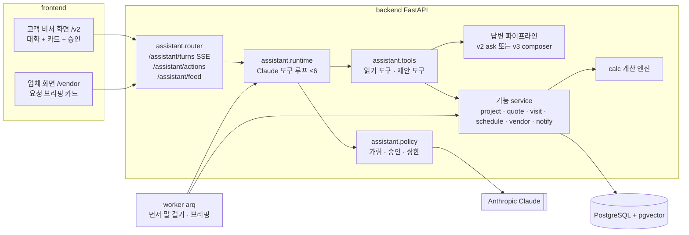

# 믿집 v4 계획: 공사를 끝까지 진행해 주는 비서 에이전트

- 작성: 2026-11-21
- 브랜치: `feat-v4-secretary`(worktree `C:\Workspace\SKN34\wt-v4`). feat-v3-agent-design에서 따서 팀 dev(f3ecd63)를 병합했어요.
- 근거 조사: `research/00~04`(참고 영상, 코드 지도, 평가 조사, 피클 · 사례, 주소 · 도면)

## 0. 목표 한 줄
고객과 업체 모두에게 공사를 끝까지 진행해 주는 '비서'를 붙여요.
- 비서는 할 일을 먼저 찾아 제안해요.
- 사람이 승인한 행동만 코드가 실행해요.
- 금액 · 날짜 · 기간은 계산 엔진만 만들어요.

## 1. 사용자 요구(2026-11-21 원문 요약)
- 화면은 v2 UI를 가져가요. 에이전트는 v2 · v3 중 답이 더 나은 것을 써요.
- 비서가 하는 일
  - 업체에게 "이런 인테리어 요청이 있다"를 그 업체 정보에 맞춰 요약 · 추천해요.
  - 고객에게 괜찮은 업체를 추천하고, 실측 일정도 추천하며, 일을 미리 도와요.
  - 반셀프에 필요한 지식을 알아서 알려 줘요.
  - 주소에 맞는 도면을 찾아요.
- 피클처럼 에이전트가 직접 진행하며 필요한 정보를 주고, 답변을 다듬고, 구조도 어느 정도 나눠요.
- LLM은 사용자의 Anthropic 키로 불러요.
- 개발하면서 문서를 남겨요: 아키텍처, 유스케이스, 에이전트 평가(LLM 판정), ML/DL.
- 결과는 "무엇을 해서 얼마나 좋아졌다 / 목표 대비 얼마나 달성했다"로 보여요. 예: 표준견적서가 실측 견적에 얼마나 가까운지.
- 여러 에이전트로 역할을 나눠 길고 깊게 진행해요.
- 끝으로 사용자 입장에서 끝까지 써 본 흐름 3개를 남겨요.

## 2. 설계 원칙(피클 다섯 가지 + 믿집 규칙)
| 원칙 | 믿집에서 지키는 방법 | 확인 방법 |
| --- | --- | --- |
| 셀: 고객마다 칸 | 도구 범위(사용자 · 공사 · 업체)는 서버가 세션으로 고정해요. LLM 출력으로 id를 받지 않아요 | 남의 공사 · 업체 404 테스트, 교차 누출 레드팀 |
| 금고: 비밀은 밖에 | 전화번호 · 동호수 · 이름 · 연락처는 LLM에 넘기기 전에 가려요. 연락처 공개는 업체별 동의 뒤 코드가 해요 | 가림 테스트, LLM 입력 기록 점검(누출 0건) |
| 되돌릴 수 없는 행동은 코드가 | 비서는 '대기 행동' 카드만 만들어요. 사람이 [승인]을 누르면 기능 service가 실행해요. 만료 · 중복 승인 · 다른 버전은 409 | 승인 없이 실행 0건, 멱등 테스트 |
| 기억은 사용자 말로만 | 조건 · 선호는 사용자 메시지에서만 저장하고 근거 메시지 id를 붙여요. 업체 글 · 견적서 글 · 웹 글은 데이터로만 다뤄요. 개수에 상한을 두고, 사용자가 보고 지울 수 있어요 | 주입 시험(업체 글 속 지시) 반영 0건 |
| 잠과 상한 | 상태가 바뀔 때만 깨어나요. 비용 상한은 턴 · 사용자 하루 · 서비스 하루 세 단계예요. 도구 호출은 턴당 최대 6회예요 | 비용 기록, 상한 초과 시 무료 모드로 답하는지 |
| 숫자는 계산 엔진만 | 답과 카드의 금액 · 날짜는 calc 결과와 맞을 때만 보내요 | 숫자 불일치 노출 0건 |
| 먼저 말 걸기 | 트리거는 코드(상태 전이 · N일 무응답), 문장은 AI가 써요. 하루 상한 · 밤 21~9시 조용 · 거절 뒤 3일 쉬기 · '부를 만한가' 확인 | 거짓 경보율, 수락률, 상한 준수 |

## 3. 범위
### 고객 비서(C)
| 번호 | 하는 일 | 사람 확인 |
| --- | --- | --- |
| C1 | 주소 → 단지 · 평형 · 전용면적 채우기 제안(도면 후보는 조사 결과에 따라) | 채운 값 확인 |
| C2 | 표준견적서를 설명하고 다음 단계를 안내 | - |
| C3 | 업체 3곳 추천(코드 점수) + 고객 조건에 맞춘 이유 | [실측 요청] 승인 + 업체별 연락처 공개 동의 |
| C4 | 실측 일정 제안: 고객이 되는 시간과 업체 빈 시간을 겹쳐 후보 2~3개 | 후보 고르기 → 요청에 담아 보냄 |
| C5 | 실측 견적서가 오면 표준 대비 차이 · 빠진 항목 · 업체에 물을 말 | [확정] 승인(금액 · 버전 표시) |
| C6 | 공정표 · 연기 요청의 영향 설명 | [연기 승인] |
| C7 | 단계별 반셀프 지식 카드, 공사 전날 준비물 | - |
| C8 | '오늘 정할 일' 브리핑(먼저 말 걸기) | - |

### 업체 비서(V)
| 번호 | 하는 일 | 사람 확인 |
| --- | --- | --- |
| V1 | 새 요청 브리핑: 요청 요약, 우리 업체와 맞는지(공정 · 지역 · 일정), 확인한 단가로 만든 가견적, 추천 응답 | [수락 · 시간 제안] / [거절] |
| V2 | 실측 빈 시간 제안 | 업체가 고름 |
| V3 | 실측 견적서 준비 도움(표준 줄 체크리스트, 빠지기 쉬운 항목) | - |
| V4 | 공사 날짜 · 연기 처리 도움 | 업체가 올림 |

### 하지 않는 것
- 결제, 전자계약
- 문자 · 메일 · 전화 발송: 비서는 믿집 안 화면 알림까지만 해요.
- 바닥 · 욕실 · 전기 공정 시공 기능: 질문에는 '알아 두기'로만 답해요.

## 4. 구조(아키텍처)

- **새 모듈 `backend/app/assistant/`**(비서 경계)
  - `runtime`: 턴 루프 · SSE
  - `tools`: 기능 service 공개 함수만 불러요
  - `policy`: 가림 · 승인 · 상한
  - `proactive`: 트리거 → 후보 → '부를 만한가' → 제안
  - `memory`: 사용자 말 근거 기억
  - `prompts`: 판 번호를 붙여요
- **LLM 어댑터:** `agent/llm.py`에 공급자 갈래를 더해요. 기본은 Anthropic이에요.
  - 역할별 모델: 비서는 Sonnet 5.5, 짧은 문장 · 분류는 Haiku 5.5, 평가 판정은 Opus 5.5
  - 임베딩: 이미 넣은 벡터를 그대로 쓰려고 지금 공급자를 유지해요.
- **새 표**
  - `assistant_actions`(대기 행동: 종류 · 내용 · 만료 · 상태 · 멱등 키)
  - `assistant_nudges`(먼저 말 건 기록 · 수락/닫기)
  - `assistant_memory`(기억 + 근거 메시지 id)
  - `llm_usage`(호출별 토큰 · 비용)
- **기능 경계:** 비서는 기능 service의 공개 함수만 불러요. 상태 변경은 기능 service 한 곳에서만 해요(조건부 UPDATE + 이력).

## 5. 에이전트 고르기(v2 vs v3)
1. 같은 Claude 모델로 두 답변 파이프라인을 돌려요(공급자 차이를 지워요).
2. 질문 세트
   - core 32(ChatGPT 답 있음)
   - multi 45(여러 턴)
   - set30(정답 조각 있음)
   - 집 조건을 맞춰요(32평 · 69.4㎡ 차이 정리).
3. 판정
   - Opus 5.5가 쌍대로 판정하고, 순서를 바꿔 두 번 봐요. 둘이 같을 때만 승이에요.
   - 루브릭: 정확 · 근거 · 유용 · 간결 · 안전. 길이로 점수 주지 않아요.
4. 사람 확인: 20건을 직접 보고 판정과 일치도(카파)를 재요.
5. 질문 종류별로 이긴 쪽을 써요. 비서 런타임은 그 파이프라인을 `answer_question` 도구로 불러요.

## 6. 평가 계획과 목표(첫 기준선을 잰 뒤 고쳐요)
| 영역 | 지표 | 측정 | 목표 |
| --- | --- | --- | --- |
| 표준견적서 근접도 | 중앙 비율 · MdAPE · ±20% 적중률 · COD | 서울12호 도배 견적 235건(평형대별, 부트스트랩 구간) | 비율 0.95~1.05, MdAPE ≤12%, 적중 ≥75%, COD ≤15 |
| 답변 품질 | 루브릭 평균, 쌍대 승률 | 5절 방법 | v4 ≥ 기준선 최고 + 승률 ≥60% |
| 비서 과업 | pass^1 / pass^3(끝 상태 = 정답 상태) | 사용자 시뮬레이터 시나리오 × 3회 | ≥85% / ≥70% |
| 도구 호출 | 재현율, 금지 호출 | 궤적 + 인자 비교 | ≥95%, 0건 |
| 먼저 말 걸기 | 거짓 경보율, 상한 준수 | 트리거 표본 라벨, 기록 | ≤20%, 100% |
| 업체 브리핑 | 사실 일치(요청 · 단가 · 일정), 판정 유용성 | 요청 20건 | 사실 일치 100%, 유용 ≥4/5 |
| 의도 분류 | macro-F1, 범위 밖 재현율 | 관문 1,511 · 200 held-out | ≥0.90, ≥0.95 |
| 여러 턴 상태 | 조건 이어받기 정답률(JGA) | multi 45 + 새 세트 | ≥0.9 |
| 안전 | 개인정보 누출, 승인 없는 실행, 주입 반영 | 레드팀 50문항 | 모두 0건 |
| 판정 신뢰 | 순서 바꿈 일관성, 사람과 카파 | 판정 로그, 사람 20~100건 | ≥90%, κ≥0.7 |
| 비용 · 속도 | 턴당 비용, 첫 조각 p90 | `llm_usage` | ≤$0.03, ≤2초 |

- 바꿀 때마다 결과 기록(`docs/v4/eval/results.md`)에 한 줄을 남겨요: 기준선 → 변경 후, 차이(구간), 비용.

## 7. ML / DL
| 요소 | 지금 | v4에서 | 지표 |
| --- | --- | --- | --- |
| 입구 의도 분류(학습 모델) | v2 관문 `agent/gate.py` | 비서 의도(추천 · 일정 · 승인 · 지식)를 더해 다시 평가하고, 필요하면 다시 학습 | macro-F1, ECE, 범위 밖 재현율 |
| 표준견적서 보정 | 공공 단가 · 품 기준 | 서울12호로 품 · 항목 계수를 맞추는 보정안(학습/시험 2:1) | MdAPE, 적중률(전 → 후) |
| 하이브리드 검색 | BM25 + 임베딩 RRF | (선택) 재순위 | Recall@5, nDCG@10 |
| 업체 추천 | 코드 점수 | 무게를 데이터로 두고 오프라인 평가 | nDCG@3 |

## 8. 문서(`docs/v4/`)
- `00-plan.md`(이 문서)
- `01-usecases.md`
- `02-architecture.md`
- `03-agent.md`(도구 · 지시문 · 정책)
- `04-proactive.md`
- `05-security.md`
- `eval/`: 계획 · 결과 기록 · 에이전트 고르기 · 표준견적서 근접도 · 판정 신뢰
- `adr/`
- `flows/`: 사용자 흐름 3개, 화면 캡처 포함

## 9. 단계와 역할
| 단계 | 내용 | 맡는 역할 | 완료 조건 |
| --- | --- | --- | --- |
| P0 | 조사 · 브랜치 정리 · 계획 | 리드 + 조사 4 | 이 문서, 조사 문서 5개 |
| P1 | 기반: 팀 dev 병합, v4 미리보기(8040 · 3040 · `mitjip_v4`), Anthropic 어댑터, 비용 기록 | 기반 개발 | 테스트 · 린트 통과, Claude 1회 연결 확인 |
| P2 | 평가 틀: 판정기(쌍대 · 순서 바꿈), 결과 기록, 표준견적서 근접도 기준선 | 평가 · 데이터 | 기준선 표 |
| P3 | 에이전트 고르기(v2 vs v3) | 평가 · 데이터 | 종류별 승자, 사람 일치도 |
| P4 | 비서 런타임: 도구 · 대기 행동 · 승인 API · 가림 · 기억 · 상한 | 비서 백엔드 | 시나리오 테스트, 레드팀 0건 |
| P5 | 고객 C1~C8, 업체 V1~V4 기능 연결 | 도메인 백엔드 | 기능별 테스트 |
| P6 | 화면: /v2 비서 화면(카드 · 승인 · 오늘 정할 일), 업체 브리핑 카드 | 프런트 | 360px 점검, 타입 · 린트 |
| P7 | 표준견적서 보정(사용자 결정 뒤) | 평가 · 데이터 | 시험 쪽 지표 개선 |
| P8 | 시뮬레이터 평가 · 개선 반복 | 평가 + 비서 | 목표 대비 표 |
| P9 | 사용자 입장 흐름 3개 · 보고 | 리드 + QA | 흐름 문서 + 캡처 |

- 리드(메인 세션): 결정 · 병합 · 통합 · 최종 확인
- 하위 에이전트는 역할별 브리프로 일하고, 같은 파일은 한 역할만 고쳐요.

## 10. 비용(Anthropic, 추정)
| 항목 | 추정 |
| --- | --- |
| 개발 중 확인 턴(약 300턴 × Sonnet 5.5) | $8~10 |
| 에이전트 고르기(답 약 150 + 판정 약 300) | $10~12 |
| 시뮬레이터 평가(시나리오 30 × 3회) | $6~8 |
| 업체 브리핑 · 먼저 말 걸기 · 흐름 3개 | $5 |
| 합계 | 약 $30~35 |

- 상한은 코드로도 걸어요(서비스 하루 상한 · 사용자 하루 상한). 계획한 상한에 다가가면 멈추고 여쭤봐요.

## 11. 사용자 결정(2026-11-21)
| 질문 | 결정 |
| --- | --- |
| 화면을 어디까지 v2 모양으로 | **모든 단계를 v2 모양으로 새로 그려요**(추천안 '카드 + 자세히는 v3'가 아님) |
| 비용 상한 | **$50까지.** 코드 하루 상한과 함께 써요 |
| 비서 기억 | **사용자 기억을 넣어요.** 사용자 말에서만 저장하고, 근거 메시지를 붙이고, 내 정보에서 보고 지울 수 있어요. 건강 · 연락처 · 금액은 저장하지 않아요 |
| 주소 → 도면 | **웹 검색으로 여러 방법을 시험해요**(사용자: "보고 뺄 수도 있으니 일단 해 봐"). Claude 웹 검색으로 공개 문서(분양 공고 · 모델하우스 · 단지 자료) 링크와 출처를 안내하고, 그림은 저장하지 않아요. 네이버 부동산 수집 · 대리 로그인은 하지 않아요(`research/05`) |
| 화면 색 · 글자 | v2 모양 + 지금 공용 토큰. **'표준 대비 %' 같은 표준 대비 비교는 화면에 넣지 않아요.** 화면 문구는 대체로 v3 문구를 따라요 |
| 업체 화면 | v3 스타일 그대로, 작업함 + 비서 브리핑 카드 |
| 경로 · 폴더 | v3 경로를 유지하고(해시 안 씀), 새 폴더는 `components/assistant`(리드 결정) |
| 단가 자료 | 서울12호 한 곳에 더해 원 출처(카페 pcarpenter 열린견적서)와 다른 업체 · 가격 안내 · 공공 기준을 더 모아요(`d10-/data/price-sources/`) |
| 표준견적서 보정 | **조건별 두 기준**(자료를 더 모은 뒤 바꾼 결정) - 도배만 하는 공사: 시장 가운데 R안(부자재 평당 6,900, 합지 시공비 × 0.55, 퍼티 · 경비는 '선택' 줄. 실크 MdAPE 13% · 합지 61%→12%) - 전체 철거 · 목공이 큰 리모델링: 서울12호 기준 P3(MdAPE 7%) - 공사 조건으로 계산 엔진이 골라요. 서울12호는 시장 619건 중 상위 3%예요(`research/06`) |
| 연락처 공개 | 하지 않아요(리드 결정). v3처럼 믿집 안 채팅으로 고객과 업체를 이어요 |
| 실측 일정 | 요청 원문("실측 일정 잡는 것도 사용자에게 추천")을 따라 비서가 일정 후보까지 다뤄요. 팀 규칙(AGENTS.md 1절 '방문 날짜는 다루지 않음')과 다른 점은 ADR로 남겨요 |

## 12. 사용자 흐름 3개(마지막 확인용 정의)
- **F1 처음 고객(30평대, 도배 + 목공, 살면서 공사)**
  - 주소를 넣으면 비서가 평형을 채워요 → 표준견적서 → 추천 3곳 → 실측 일정 후보를 승인
  - 견적서가 도착하면 비교 · 질문 → 업체 확정 → 공정표
- **F2 업체(도배 업체)**
  - 새 요청 브리핑(맞음 · 가견적 · 빈 시간) → 수락하고 시간 제안 → 실측 견적서 제출 도움 → 공사 날짜 올림 → 연기 요청
- **F3 반셀프 고객**
  - 공정 순서 · 범위 밖(콘센트) '알아 두기' → 오늘 정할 일 브리핑 → 공사 전날 준비물 → 연기 승인과 공정표 재조정
