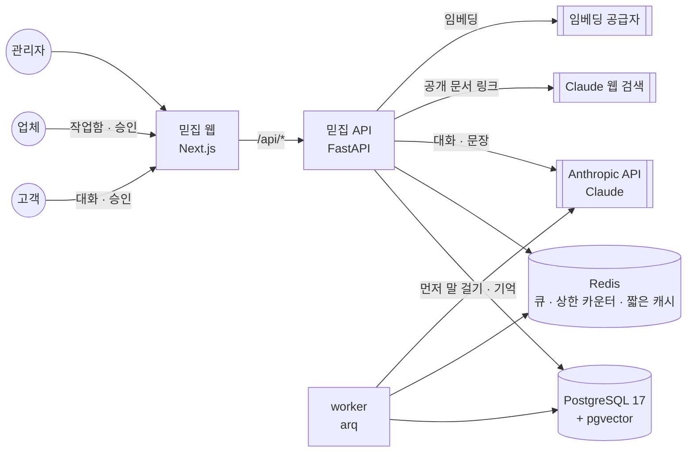
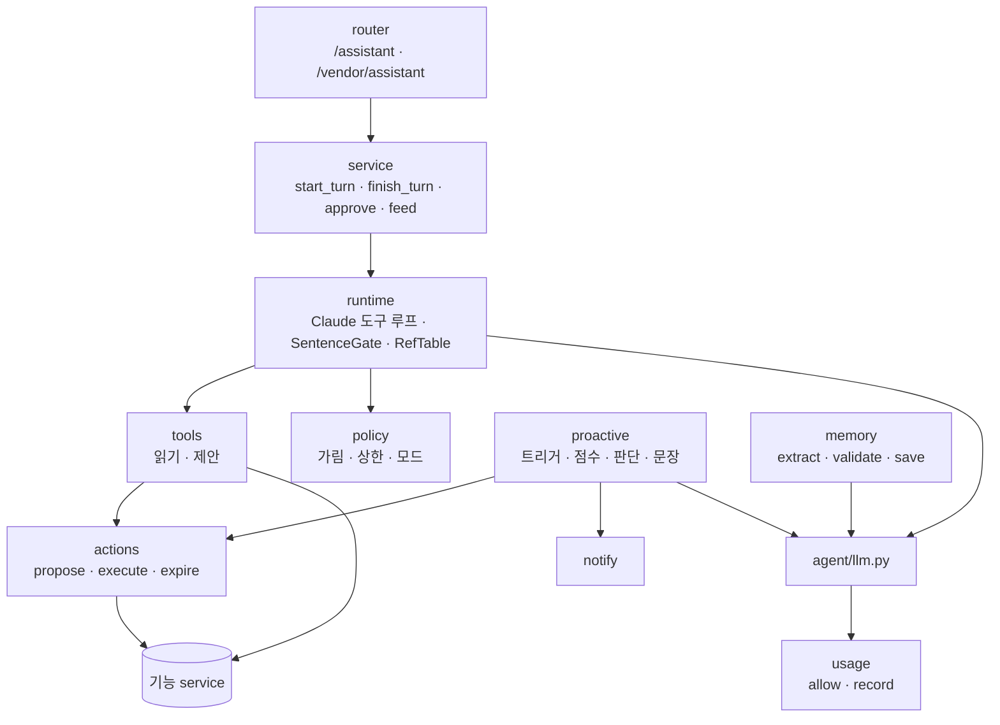
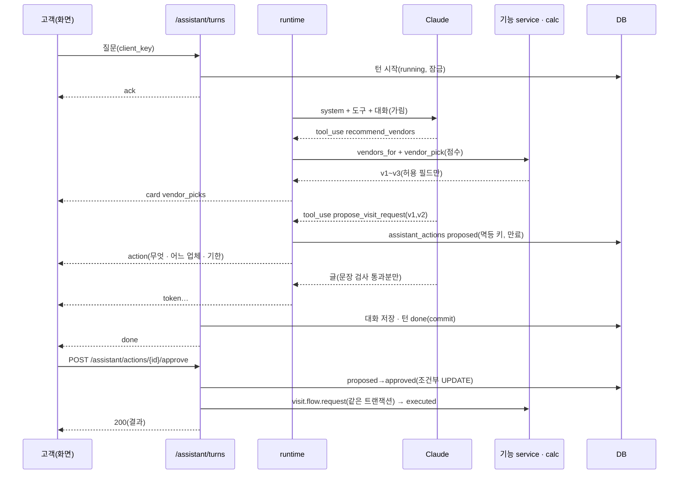

# v4 아키텍처

- 2026-11-21
- 자세한 계약: `03-비서 백엔드 설계.md`
- 화면 설계: `design/README.md`

## 1. 한눈에(컨텍스트)


## 2. 컨테이너와 경계
| 컨테이너 | 하는 일 | 바뀌는 점(v4) |
| --- | --- | --- |
| web(Next.js) | 화면만 | 고객: `components/assistant`(대화 + 단계 카드 + 승인), 업체: 작업함 + `components/pro/assistant` |
| api(FastAPI) | 유일한 공개 API | `assistant` 모듈(비서 경계), `usage` 모듈(비용 · 상한) 추가 |
| worker(arq) | 느린 일 | `assistant_sweep`(2분) · `assistant_hourly` · 기억 추출 |
| PostgreSQL | 원본 데이터 · 지식 검색 | 표 4개 + `chats.kind` + 단가 판 |
| Redis | 큐 · 상한 카운터 | 지워져도 됨(상한은 DB 합계로 되살림) |

## 3. 구조를 나눈 방법
- **비서 경계(`assistant/`)**: 대화 런타임 · 도구 · 대기 행동 · 정책 · 먼저 말 걸기 · 기억이 한 모듈에 있어요.
  - 기능 모듈(project · quote · visit · schedule · vendor · notify · calc)은 비서를 몰라요.
  - 비서는 기능 service의 공개 함수만 불러요.
- **LLM 관문(`agent/llm.py`)**: Claude 호출은 이 파일 한 곳에서만 해요. 모델 · 가격 · 상한 · 기록이 여기를 지나요.
- **비용(`usage/`)**: 모든 LLM 호출이 `allow()` → 호출 → `record()`를 지나요. v2 · v3 · 비서 · worker가 같은 상한을 써요.
- **계산(`calc`)**: 금액 · 날짜 · 업체 점수는 calc만 만들어요. 에이전트 글의 숫자는 calc 값과 맞을 때만 보내요.
- **옛 길 유지**: `/v2/ask` · `/ai/turns`는 옛 화면 비교용으로 남기고, 새 화면은 `/assistant/*`만 써요.

층 규칙(위는 아래를 부를 수 있어요)
```
조립  main.py | worker.py
흐름  assistant → v2 → chat → schedule → visit → quote
대상  account | project | vendor
기반  files | refprice | jobs | knowledge | notify | usage → auth
도구  agent → calc
공통  shared → db | queue → config
```

## 4. 비서 모듈 구성요소


## 5. 대표 흐름
### 5.1 고객 턴(업체 추천 → 실측 요청 승인)


### 5.2 먼저 말 걸기
1. 업체가 견적서를 올려요. visit · quote service가 상태를 바꾸는 트랜잭션 안에서 `notifications`에 `quote_sent`를 같이 써요(아웃박스).
2. worker `assistant_sweep`(2분)이 이벤트를 읽어 후보를 만들어요(견적 비교 카드).
3. 점수를 매겨요(기한 · 행동 준비 · 이미 읽음 · 최근 보냄 · 닫음 이력).
   - 70 이상이면 보내요. 40~69는 Haiku가 '부를 만한가'를 판단해요. 40 미만은 기록만 해요.
4. 채널: feed에는 늘 쌓고, 화면 알림(종)은 하루 상한 · 밤 9시로 미루기 · 거절 뒤 쉬기를 지켜요.

### 5.3 업체 브리핑
1. `visit_requested`가 들어와요.
2. 업체 feed에 브리핑 카드가 생겨요. 코드로 요약 · 맞음 여부 · 가견적(확인한 단가 × calc)을 만들고, 문장은 Haiku가 써요.
3. 업체가 [수락 · 시간 제안]을 눌러요 → 대기 행동 → 승인 → `visit.flow.answer_window`가 실행돼요.

## 6. 피클 다섯 원칙의 자리
| 원칙 | 코드 위치 | 테스트 |
| --- | --- | --- |
| 셀 | 모든 조회의 `user_id = 세션`, 도구는 ref만(RefTable), project · visit 확인 함수 | 권한 404/403 |
| 금고 | `policy.mask_in` · `to_model` · SentenceGate, 웹 질의는 단지명 · 구만 | 누출 레드팀 0 |
| 게시는 코드가 | `assistant_actions` 상태 머신 + `actions.execute`(조건부 UPDATE, 버전 고정, 멱등 키, 만료) | 동시 승인 1건, 만료 409 |
| 기억은 사용자 말로 | `memory.extract`(한 줄) · `validate`(허용 키, 근거 인용, 금지 항목) · 쓰기 도구 없음 | 주입 반영 0 |
| 잠과 상한 | worker 주기 · 이벤트 구동, `usage.allow`(하루 · 전체), 턴 상한(도구 6 · LLM 8 · 45초 · $0.06) | 상한 시 무료 모드 |

## 7. 모델과 비용
| 쓰는 곳 | 모델 | 이유 |
| --- | --- | --- |
| 고객 · 업체 비서 대화, 도면 웹 검색 | claude-sonnet-5-5 | 도구 사용 · 한국어 답 품질과 비용의 균형($2/$10 per MTok) |
| 먼저 말 걸기 문장 · '부를 만한가' · 기억 추출 · 짧은 분류 | claude-haiku-5-5 | 짧은 일, 값쌈($0.10/$0.50) |
| 평가 판정 | claude-opus-5-5 | 판정 정확도. 생성 모델과 다른 모델로 자기 선호를 줄임 |
| 임베딩 | 기존 공급자 | 이미 넣은 벡터를 그대로 씀 |

- 비용 상한: 이번 작업 $50, 코드 상한 전체 $45 · 서비스 하루 $5 · 사용자 하루 $1.00 · 새 계정(가입 7일 안) 한 계정 하루 $0.20 · 새 계정 합 하루 $1 · 턴 $0.06
- 프롬프트 캐시: 도구 · system 고정 앞부분 + 자동 캐시

## 8. 관측
- `llm_usage`: 호출별 토큰 · 비용 · 지연 · 오류 종류(글 없음)
- `assistant_turns.trace`: 도구 이름 · 결과 크기 · 걸린 시간(글 없음)
- 평가 결과 기록: `eval/results.md`(바꿀 때마다 기준선 → 변경 후)
